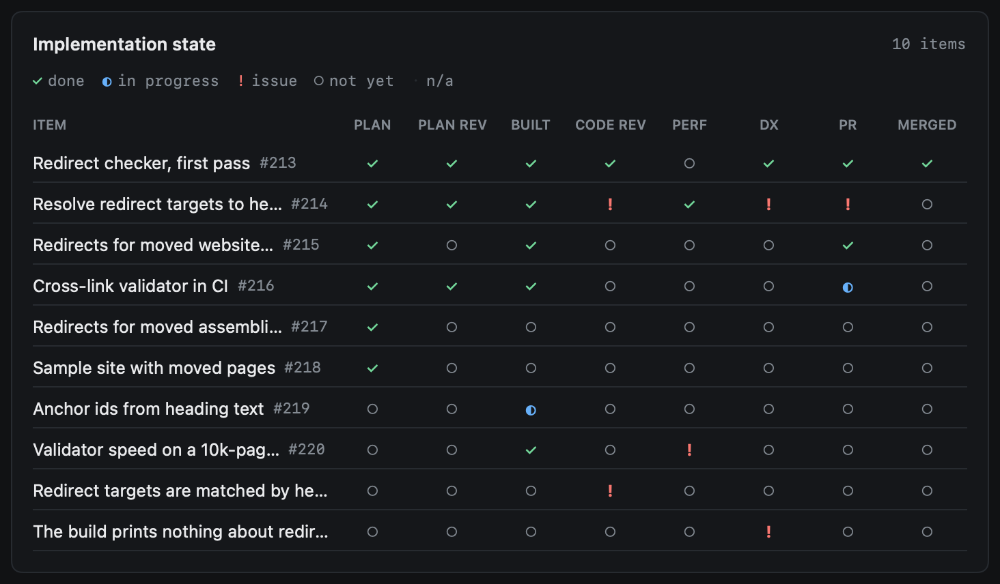
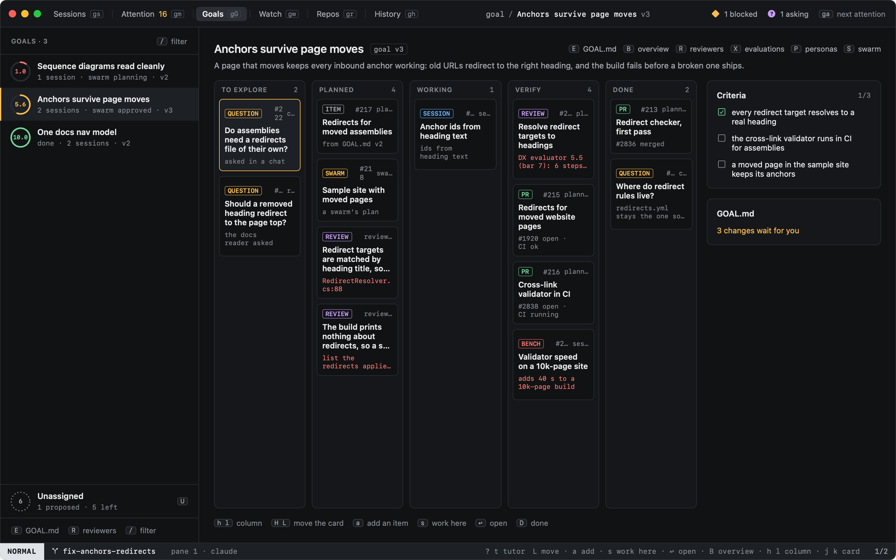
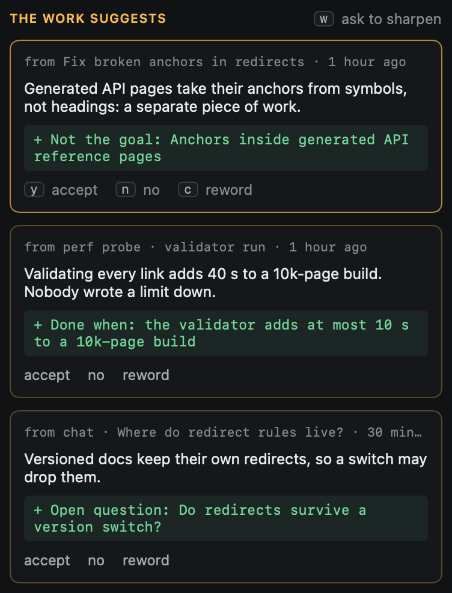

# Items and the board

A goal's work is split into items. Few of them are typed in: heed finds them in the goal and in the work on it, and
where each one stands follows from evidence (a session working on it, a review, a benchmark, a PR, a merge), never
from ticking a box.

## Where items come from

| Source | What | How |
|---|---|---|
| You | An item or a question, by hand | `a` (or `n`) on the board, or `:goal.item.add <title>`; a title ending in `?` is a question |
| Planner | `GOAL.md` broken into planned items | On a new goal, and on each version that changes the goal, what it is not or when it is done; `:goal.plan` asks now |
| Sessions | A follow-up in the ledger entry of a session on the goal | When the entry is written; matched against the items the goal has, and kept with how sure heed is that it is new |
| Chats | A question in a chat on the goal | When the chat closes: the question lands in **To explore** |
| PRs | A PR on a branch of the goal's sessions, or linked to an item | Automatic: it moves its item to **Verify**, and to **Done** once merged; a PR with no item gets one |

A title found in the work is compared with the goal's items first: much alike is the same item, nothing alike is a
new one, and in between a cheap model call decides. Every item records where it came from and why.

## Stages



The overview's **Implementation state** shows each item through its stages: plan, plan review, built, code review,
perf, DX, PR and merged. A stage is ✓ done, ◐ in progress, `!` an issue, ○ not yet, or · not needed for this goal. The
newest evidence of a stage decides it, and a later stage implies the ones it cannot happen without: a merged PR means
the PR and the build are done. Hover a mark for the evidence behind it. A click on a row shows the item on the board.

## The board



`B` shows the goal as five columns: **To explore** (questions and what nobody has planned), **Planned**, **Working**
(a session on it, something being built), **Verify** (a PR, or built work under review) and **Done** (merged, or a
question a decision answered). Cards wear what they mostly are: session, chat, PR, question, review, bench or swarm.

| Key | |
|---|---|
| `h` `l` | The column left or right |
| `j` `k` | The card above or below |
| `H` `L` | Move the card a column left or right |
| `a` `n` | Add an item, in the column under the cursor |
| `s` `o` | Work here: Start work filled in from the item; the session goes on the goal, on that item |
| `↩` | Open what the card is: its PR, its session or chat; a question opens `GOAL.md` |
| `D` | Done |
| `-` | Split it into smaller items (`:goal.item.split a; b`) |

A card moved by hand, by key or by dragging it to another column, stays there until newer evidence about it arrives;
then the evidence decides again. Right-click a card for the same actions, and **Move to** any column.

## What the work suggests



When a ledger entry of a session or chat on the goal is written, what it found goes into `GOAL.md`:

- Edits that only record what happened apply themselves, each as a new version you can undo (`u`, or **undo** beside
  the version): a decision taken, an open question answered, a criterion met with its evidence.
- Edits that change what the goal is wait for you: a new criterion, a new non-goal, a new open question, a reworded
  goal. They show beside `GOAL.md`, and the goal gets one item in Attention however many there are.

A cheap model call reads each entry against `GOAL.md` for more such edits; whatever it calls them, heed decides which
kind an edit is. In `GOAL.md`, `y` accepts the first change waiting, `n` says no and `c` rewords it first; each card
also takes a click, and a right-click. `w` asks a model to sharpen the goal: everything it suggests waits.

Model calls are made only with `[llm] enabled`, through heed's usual daily cap, and at most six a day per goal for the
planner, the proposer and sharpening together.

## In Attention

A goal with changes waiting is one Attention item ("3 proposals"); `↩` opens its `GOAL.md`. Rules match it by
`proposals`, `reason goalProposals` or `kind goal`:

```toml
[attention]
rules = ["proposals boost 2"]
```
