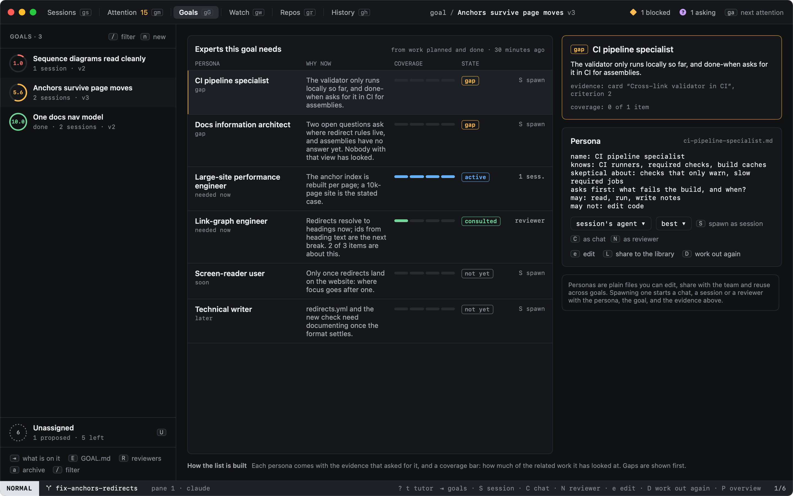
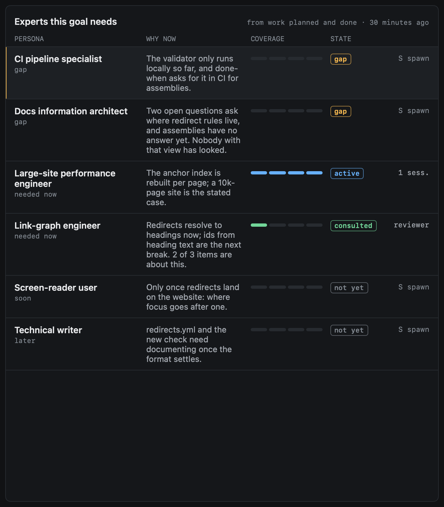
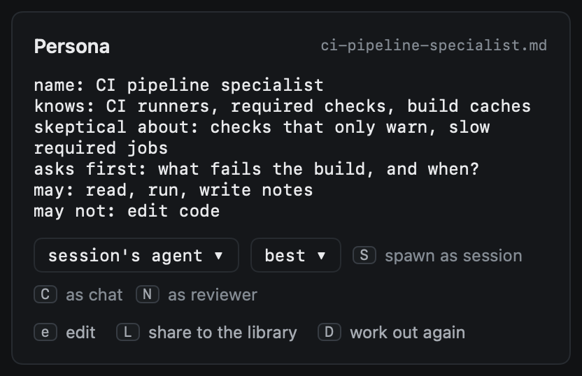

# Personas

A persona is a kind of expert a goal needs in the room: a CI specialist, a performance engineer, someone who will read
the docs cold. heed works out who from the goal's board (what is planned, what reviewers object to, what is unanswered,
what is failing), says why each one is needed now, and shows how much of the related work someone with that view has
looked at. `P` in Goals opens them; `P` again goes back to the overview.



## The list



| Column | What it says |
|---|---|
| Persona | Its name, and when it is needed: now, soon or later |
| Why now | A sentence or two on why, from the board |
| Coverage | The share of its items that a session, chat or review run with it has touched |
| State | `gap`, `active`, `consulted` or `not yet` |

The states, in the order the list shows them:

- **gap**: needed now, and nothing it is about has been looked at by it;
- **active**: a session or chat with it is open, or its reviewer is running;
- **consulted**: some of its items were looked at by it;
- **not yet**: needed soon or later, and not looked at yet.

Gaps come first, then sooner before later, then the least covered. Coverage counts an item when a session or chat
started as the persona is linked to it, or a reviewer spawned from the persona (or a reviewer of the matching kind,
such as the performance prober for a performance engineer) left evidence on it.

## Where the list comes from

A cheap model reads the goal's `GOAL.md` and its board and answers who is needed, when, why, and which items,
objections, criteria and open questions asked for each. Evidence it names that is not on the board is dropped. It asks
again when the board changes in a way that matters: an item added or done, an objection raised or fixed, a criterion
met, a question answered, something failing. A burst of changes is one ask: heed waits until the board has been still
for two minutes, and asks at most every fifteen. Each ask is one of the goal's model calls for the day, shared with the
planner and the proposer. `D` asks now.

## The persona's file

Each persona is a plain file you can edit, share and reuse: `personas/<name>.md` in the goal's folder
(`~/Library/Application Support/Heed/goals/<goal>/personas/`). heed writes it once, from the model's draft; after that
it is yours, and a new derivation never writes over it.



```text
name: CI pipeline specialist
knows: CI runners, required checks, build caches
skeptical about: checks that only warn, slow required jobs
asks first: what fails the build, and when?
may: read, run, write notes
may not: edit code
```

Lists are comma separated; questions end at their `?`. A value may go on over indented lines, or as `- ` lines under
its key. Anything else in the file is kept as notes and passed on with the rest. `e` edits it in place; `e` again, `⎋`
or `⌘S` saves it. A file that changes the name moves to the new name's file.

`L` copies the persona into the shared library, `~/Library/Application Support/Heed/personas/`, and
`:persona.use <name>` copies one from the library onto another goal. When the model names a persona the library has,
the goal gets the library's file instead of a new draft.

## Putting one to work

| Key | Spawns the persona under the cursor as |
|---|---|
| `S` | A session: Start work, filled in with the persona, the goal and the evidence |
| `C` | A chat, seeded the same way |
| `N` | A reviewer: read-only, in a worktree of its own, through the same machinery as the other [reviewers](reviewers.md) |

The agent picker beside the keys chooses the agent for all three; the model picker applies to the reviewer (sessions
and chats start on the agent's own model). A session or chat started from here goes on the goal and counts as the
persona's. A reviewer spawned from a persona shows under its name in Reviewers, scores like any other, and is told to
review as that expert.

Everything also takes the mouse: a click picks a persona, and a right-click offers what the keys do.

## On its own

A **strong gap** (needed now, with evidence that asked for it, and nobody with that view has looked) is spawned as a
reviewer without being asked, once per persona, while the goal's `reviewer_runs_per_day` lasts. Every other gap, and
strong ones past the budget, is suggested instead: one Attention item per goal (`persona gap`), and ↩ on it opens the
goal's personas. `auto_review = false` in `[goals]` turns the spawning off; the suggestions stay.
