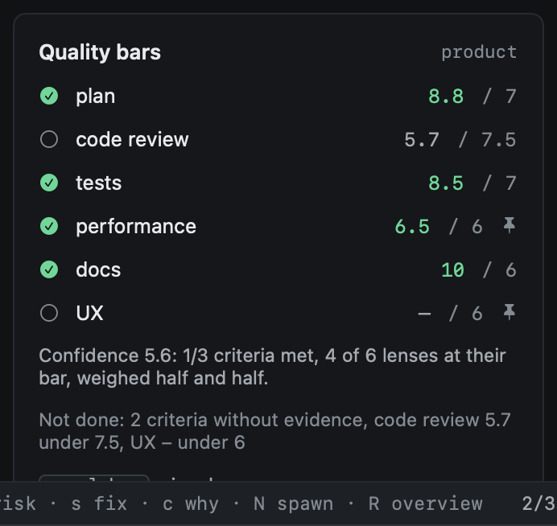

# Quality bars

Not every goal needs a 10. A spike needs its code to make sense; a public API needs its docs, its first run and its
security looked at too. heed decides how good is good enough for each goal, shows what it decided and why, and marks
the goal done once it gets there.



## The profile

When a goal gets a new `GOAL.md` version, heed asks a cheap model (through its own model calls, within their daily
budget, see Agents › Model calls) what kind of goal it is, from the `GOAL.md`, the repos its sessions work in and the
paths their work touched:

| | |
|---|---|
| Stakes | `spike` (finding out), `internal` (tools, refactors), `product` (something people use) or `public-api` (something other code depends on: a CLI, an API, a file format) |
| User-facing | People use what it changes through a screen or a page |
| Perf-sensitive | It is about speed or scale, or its paths are hot ones |
| Security-sensitive | It touches authentication, secrets, permissions or input from outside |

The decision is written down with the version it was made for. The model is asked once per version, not on every
look.

## Lenses and bars

Each lens is one reviewer kind's view of the work: plan, code review, tests, performance, security, docs, UX and DX
first run. The profile picks the lenses the goal requires and the bar (0 to 10) each must reach: the highest bar of
every row of the table that applies to it.

| Row | Lenses and bars |
|---|---|
| `spike` | plan 5, code 6 |
| `internal` | plan 6, code 7, tests 6 |
| `product` | plan 7, code 7.5, tests 7, docs 6 |
| `public-api` | plan 7, code 8, tests 7.5, docs 7, dx 8, security 7 |
| `user-facing` | ux 7 |
| `perf-sensitive` | perf 7 |
| `security-sensitive` | security 8 |

So an internal, security-sensitive goal needs plan 6, code 7, tests 6 and security 8. Each row can be changed in
config.toml; a row there replaces the built-in one:

```toml
[goals.bars]
spike = "plan 5, code 6"
public-api = "plan 7, code 8, tests 7.5, docs 7, dx 8, security 7"
```

When a new version changes the profile, the bars change with it at once, raised or lowered, and the Quality bars panel
says what moved and why (`v4: DX first run now 8 (was –)`). heed spawns a reviewer for each lens that now needs one.

### Pinning a bar

`:goal.bar <lens> <bar>` pins a bar for this goal only, over whatever the profile says; `:goal.bar perf off` drops a
lens, `:goal.bar perf auto` goes back to the profile's. Pinned bars show a pin.

## Scores

A reviewer's score is how happy it is, out of 10:

- 10, minus each **open** objection by severity: high 3, med 1.5, low 0.5;
- minus a quarter of that for each objection whose **risk you accepted**: accepted is not fixed;
- plus 0.3 for each objection a later review found **fixed**, at most 1.5;
- clamped to 0–10.

The basis under each score says the same in numbers, with how many files the reviewer read and commands it ran.

The goal's **confidence**, its ring, is half how many done-when criteria are met and half how close each required lens
is to its bar (a lens at or over its bar counts in full, one nobody scored counts nothing). With no criteria or no
lenses yet, the other half alone.

## Done

A goal is done when it has done-when criteria, every one is met with evidence, and every required lens is at or over
its bar. heed then marks it done on its own: it says so, and Attention lists it (`goal done`) for three days.
`:goal.reopen` undoes it; heed then waits until something changes (a score, a bar) before calling it done again. Until
then the Quality bars panel lists what is missing.
