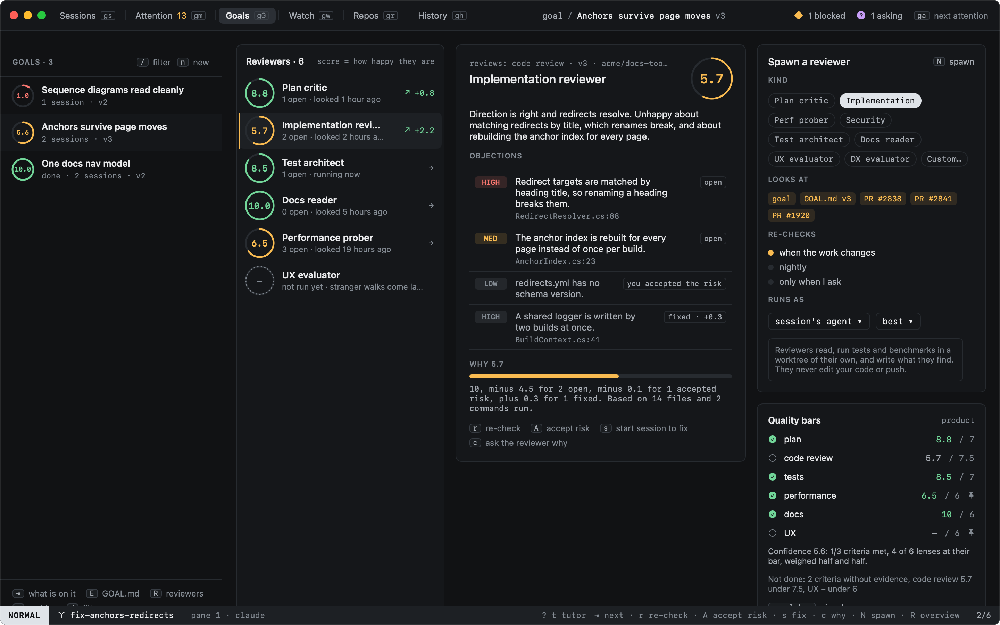
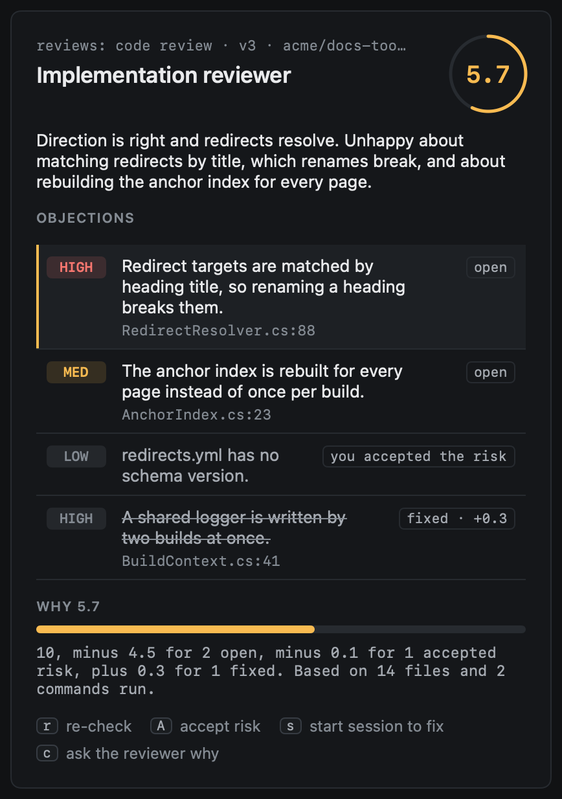
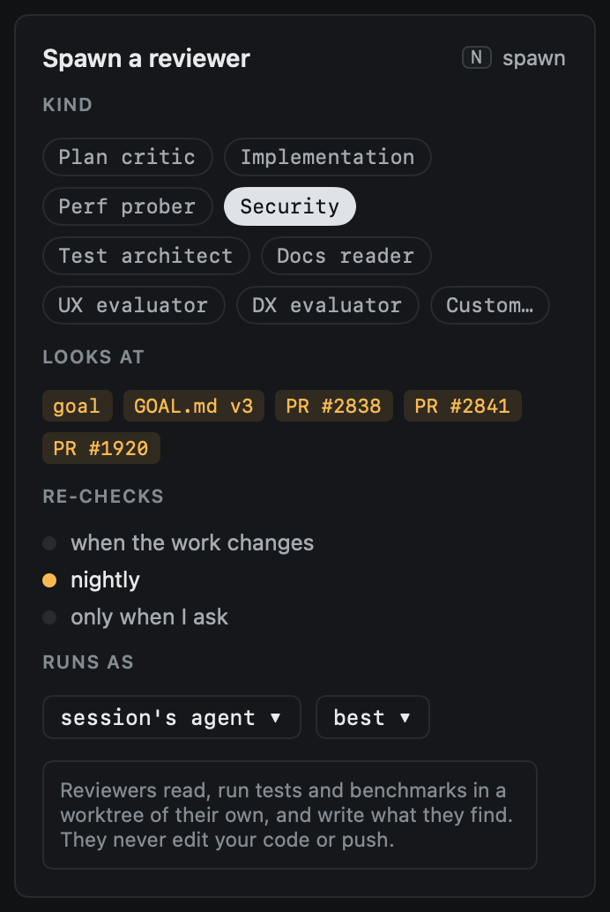
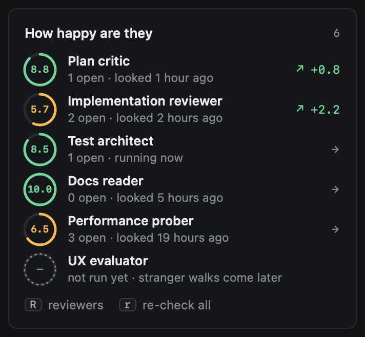

# Reviewers

Reviewers are agents that look at a goal's work and say what they would change before calling it good. Each keeps a
score of how happy it is and why. `R` in Goals opens them; `R` again goes back to the overview.



The score is a prompt, not a gate: it tells you where to look first. It moves when objections are fixed, when you
accept a risk, and when a reviewer looks again.

## Kinds

| Kind | Lens | Looks at |
|---|---|---|
| Plan critic | plan | Whether the goal and its done-when criteria are the right ones, and what the approach misses |
| Implementation | code review | Correctness, edge cases and structure against the goal; runs the tests |
| Performance prober | performance | Hot paths, timings, unbounded growth; says when a baseline is missing |
| Security | security | Input from outside, secrets, permissions, injection |
| Test architect | tests | Whether the tests cover the criteria and would fail if the code broke |
| Docs reader | docs | Whether what changed is documented, right and followable |
| UX evaluator | UX | What changed as someone new would meet it |
| DX evaluator | DX first run | A first run from the README, as a stranger |
| Custom | none | Your own instructions |

heed spawns one reviewer for each lens the goal's [profile](quality.md) requires. The UX and DX evaluators review
like the others for now; walks in a fresh clone, timed step by step, come later.

## When they run

Without being asked, within each goal's daily budget:

- when a PR on the goal opens, gets new commits or merges;
- when the goal gets a new `GOAL.md` version;
- once a night.

Only reviewers whose lens the goal requires run (custom ones always may), and a reviewer at or over its bar stays
quiet until there is something new to look at (a new version, a PR's new head). A reviewer under its bar with nothing
new does not run again either: it would say the same.

Each goal may start `reviewer_runs_per_day` runs a day (6 by default). Past it, the reviewers that were due wait, and
Attention says so (`reviewers wait`); ↩ on it opens the goal's reviewers. A re-check you press is never held back, but
counts.

```toml
[goals]
auto_review = true            # false: only when you press re-check
reviewer_runs_per_day = 6
reviewer_agent = ""           # empty: the agent of the session it runs in

[goals.reviewers]             # "best": the agent's default model, "cheap": its cheap one
implementation = "best"
docs-reader = "cheap"
```

## How a reviewer runs

A reviewer runs as a background run, like get it green: a tab in one of the goal's sessions (the one that tracks the
PR, else the newest open one), in a worktree of its own on `heed/review/<goal>-<reviewer>` at the PR's head (or, with
no PR, a session's branch). The worktree and branch are removed when it ends; the cleanup sweep removes any left
behind. A run still going after 30 minutes is stopped.

It is told the goal (its `GOAL.md`), its bar, what changed since its last review and the objections it raised before,
and writes its review to `.heed/review.json` in its worktree:

```json
{
  "summary": "how happy it is and why",
  "objections": [{"severity": "high", "text": "…", "evidence": "…", "file": "…"}],
  "ran": ["the commands it ran"],
  "files": 14
}
```

Reviewers never edit your code or push:

- claude runs with `--disallowedTools Edit Write NotebookEdit MultiEdit "Bash(git push:*)" "Bash(git commit:*)"`;
  it writes its review through the shell.
- codex runs with `--sandbox workspace-write`: writes stay inside its worktree and it has no network, so it cannot
  push. (Not `read-only`, which would keep it from writing its review.)
- Other agents have no such switch; the worktree of their own, removed when they end and never pushed, is the guard.

An agent that stops to ask for a permission ends its run without a review; the reviewer says so.

## Objections across re-checks

Each objection keeps its identity from one review to the next: the same words (ignoring case, punctuation and filler)
are the same objection, a rewording close enough in its words is too, and what is left a cheap model matches. An
objection a re-check no longer raises is **fixed** (an accepted one too); one raised again after being fixed is **open**
again; one whose risk you accepted stays accepted while it is raised.

High objections go to the goal's items once items exist; until then they stay on the reviewer.

## What you can do



`⇥` moves from the goals to the reviewers and to the objections of the one under the cursor.

| Key | |
|---|---|
| `r` | Re-check: the reviewer under the cursor looks again now (in the overview, every reviewer the goal needs) |
| `A` | Accept the risk of the objection under the cursor; again, open it |
| `s` | Start a session to fix it: Start work, filled in with the objection and the goal |
| `c` | Ask the reviewer why: a chat seeded with its review |
| `N` | Spawn a reviewer as the panel on the right says |

Everything takes the mouse too: a click picks a reviewer or an objection, a right-click offers what the keys do, and
the key hints run their command.

## Spawning one



The panel on the right picks the kind, shows what it looks at (the goal, its `GOAL.md` version and its PRs), when it
re-checks (when the work changes, nightly, or only when you ask) and what it runs as (the agent and `best` or `cheap`).
`N` spawns it; `:reviewer.spawn security` spawns one of a kind at once. A custom reviewer needs its instructions, typed
in the panel (`⌘↩` spawns). `:reviewer.remove` takes the one under the cursor off the goal; its history stays.

The overview's **How happy are they** shows the same scores:


