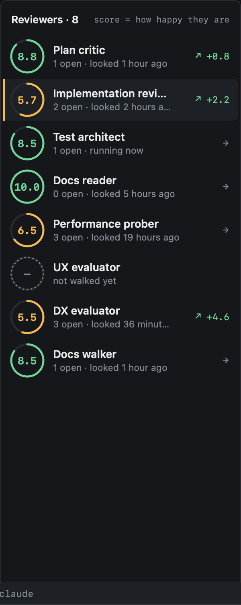
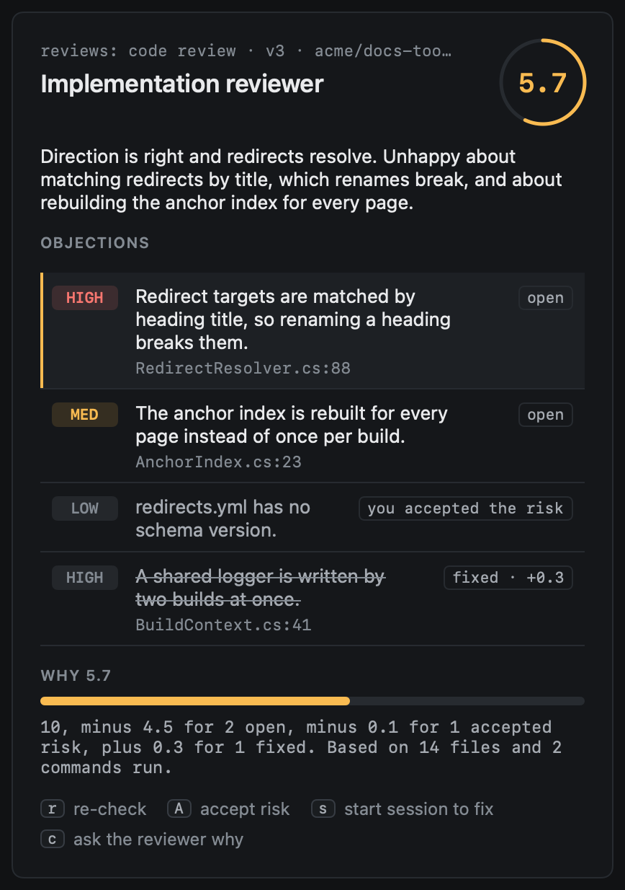
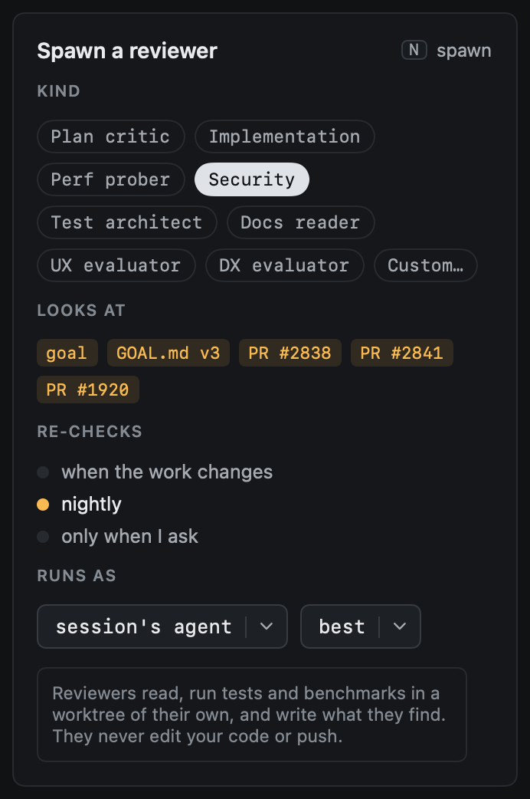
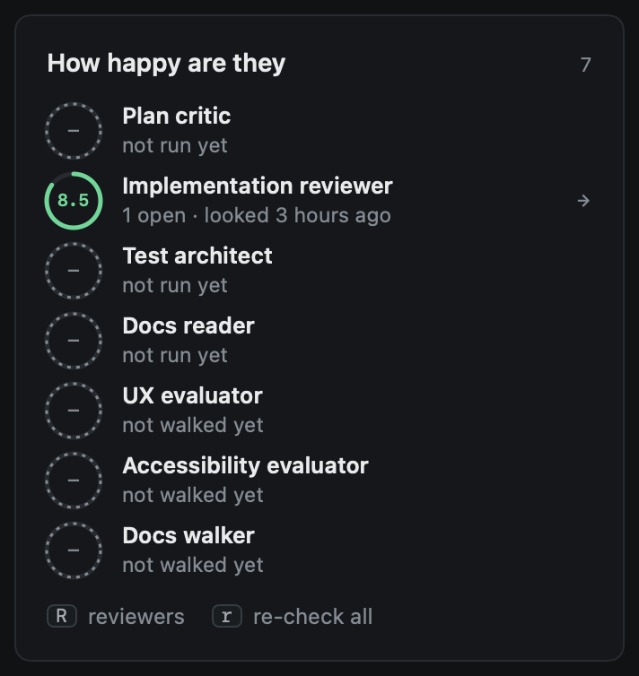

# Reviewers

Reviewers are agents that look at a goal's work and say what they would change before calling it good. Each keeps a
score of how happy it is and why. `R` in Goals opens them; `R` again goes back to the overview.



The score is a prompt, not a gate: it tells you where to look first. It moves when objections are fixed, when you
accept a risk, and when a reviewer looks again.

## Kinds

| Kind | Lens | Looks at |
|---|---|---|
| Plan critic | plan | Whether the goal and its done-when criteria are the right ones, and what the approach misses |
| Implementation | code review | Correctness, edge cases and structure against the goal; runs the tests |
| Performance prober | performance | Hot paths, timings, unbounded growth; says when a baseline is missing |
| Security | security | Input from outside, secrets, permissions, injection |
| Test architect | tests | Whether the tests cover the criteria and would fail if the code broke |
| Docs reader | docs | Whether what changed is documented, right and followable |
| UX evaluator | UX | Walks the product's screens as a stranger ([Evaluations](evaluations.md)) |
| DX evaluator | DX first run | Walks a first run from the README and the CLI, as a stranger ([Evaluations](evaluations.md)) |
| Custom | none | Your own instructions |

heed spawns one reviewer for each lens the goal's [profile](quality.md) requires. The UX and DX evaluators, and the
docs walker, do not review: they walk the goal's task in a fresh clone, step by step, and keep a friction log
([Evaluations](evaluations.md)).

## When they run

Without being asked, within each goal's daily budget:

- when a PR on the goal opens, gets new commits or merges;
- when the goal gets a new `GOAL.md` version;
- once a night.

Only reviewers whose lens the goal requires run (custom ones always may), and a reviewer at or over its bar stays
quiet until there is something new to look at (a new version, a PR's new head). A reviewer under its bar with nothing
new does not run again either: it would say the same.

Each goal may start `reviewer_runs_per_day` runs a day (6 by default). Past it, the reviewers that were due wait, and
Attention says so (`reviewers wait`); ↩ on it opens the goal's reviewers. A re-check you press is never held back, but
counts.

```toml
[goals]
auto_review = true            # false: only when you press re-check
reviewer_runs_per_day = 6
reviewer_agent = ""           # empty: the agent of the session it runs in

[goals.reviewers]             # "best": the agent's default model, "cheap": its cheap one
implementation = "best"
docs-reader = "cheap"
```

## How a reviewer runs

A reviewer needs no session of yours. It gets a worktree of its own on `heed/review/<goal>-<reviewer>`, started from
your clone of the repo on this Mac: at the head of the goal's open PR (fetched from `refs/pull/<n>/head`, so a PR from a
fork works too), else at a branch the goal's work is on (an open
session's, or a closed one's from the ledger). When a session on the goal is open, the reviewer runs in a tab there,
like get it green, so you can watch it; otherwise it runs headless (claude `-p`, codex `exec`). The worktree and branch
are removed when it ends; cleanup removes any left behind. A run still going after 30 minutes is stopped.
When the work is in a repo with no clone on this Mac, Attention says so (`reviewers blocked`) instead.

It is told the goal (its `GOAL.md`), its bar, what changed since its last review and the objections it raised before,
and writes its review to `review.json` in a folder of the run's own, outside its worktree
(`~/Library/Application Support/Heed/runs/<run>`, or `~/.heed/runs/<run>` on a host), ending its reply with the same
JSON (a headless run's reply is read when the file is missing). The folder is new for each run and heed reads only what
changed in it after the run started, so a `.heed/review.json` a branch carries is never taken for the review; heed
removes those from the worktree before the run starts.

```json
{
  "summary": "how happy it is and why",
  "objections": [{"severity": "high", "text": "…", "evidence": "…", "file": "…"}],
  "ran": ["the commands it ran"],
  "files": 14
}
```

Reviewers run the PR's code (its tests and benchmarks), so they run in the agent's own sandbox, without your logins:

- claude runs with `--allowedTools Bash Read Grep Glob`, its edit tools, `WebFetch`, `WebSearch`, `gh`,
  `git commit` and `git push` in `--disallowedTools`, and `--permission-mode dontAsk`: nobody is there to answer, so
  anything else is refused, not asked. Its shell runs in Claude Code's sandbox (`--settings` with `sandbox.enabled`,
  `failIfUnavailable`, and `allowUnsandboxedCommands` off): it writes only to its worktree and the run's folder, reaches
  no network, and cannot read `~/.ssh`, `~/.config/gh`, `~/.aws` and other credential folders. It reads only your user
  settings (`--setting-sources user`), none from the worktree, and no MCP servers (`--strict-mcp-config`).
- codex runs with `--sandbox workspace-write` and `sandbox_workspace_write.network_access=false`, the run's folder added
  with `--add-dir`: writes stay inside its worktree and that folder, and it has no network.
- Both start with no GitHub, ssh or cloud login: `GH_TOKEN`, `GITHUB_TOKEN`, `GH_ENTERPRISE_TOKEN`, `SSH_AUTH_SOCK`,
  `AWS_*`, `GOOGLE_*`, `AZURE_*` and other variables that look like a secret are unset, and `GH_CONFIG_DIR` points at an
  empty folder, so `gh` is not logged in. The agent's own key (`ANTHROPIC_API_KEY`, `OPENAI_API_KEY`) stays, and so does
  the cloud it runs on when you set `CLAUDE_CODE_USE_BEDROCK` or `CLAUDE_CODE_USE_VERTEX`.
- Other agents have no sandbox heed can ask for. Their worktree of their own, removed when they end and never pushed,
  is the only guard, so heed starts them on its own only on your work: on a PR from someone outside the repo (not you,
  the owner, a member or a collaborator, or from a fork), the reviewer records that it waits for you, and `r` runs it.
  They have no headless mode heed knows either, so they review only in a session's tab; set `reviewer_agent` to
  claude or codex for goals with no session open.

What a sandboxed review cannot do: download anything (a test that fetches packages, a benchmark that pulls a dataset),
write outside its worktree (a cache in your home folder, the repo's shared `.git` folder, so it cannot commit), or use a
login. A step that needs one fails, and the reviewer is told to say so in its review rather than retry it.

## Objections across re-checks

Each objection keeps its identity from one review to the next: the same words (ignoring case, punctuation and filler)
are the same objection, a rewording close enough in its words is too, and what is left a cheap model matches. An
objection a re-check no longer raises is **fixed** (an accepted one too); one raised again after being fixed is **open**
again; one whose risk you accepted stays accepted while it is raised.

Reviews go into the goal's [items and board](items.md) as evidence: the plan critic fills the **plan rev** column,
the implementation reviewer **code rev**, the performance prober **perf** and the DX evaluator **DX**, with its score,
on the items linked to the PR it looked at (or the goal as a whole). A review at its bar is done there, one with a
high objection open an issue. Each open **high** objection becomes an item of its own (source: reviewer) on the board;
once a re-check finds it fixed, or you accept its risk, that item gets done evidence and moves on. Columns for lenses
the goal does not require show n/a.

## What you can do



`⇥` moves from the goals to the reviewers and to the objections of the one under the cursor.

| Key | |
|---|---|
| `r` | Re-check: the reviewer under the cursor looks again now (in the overview, every reviewer the goal needs) |
| `A` | Accept the risk of the objection under the cursor; again, open it |
| `s` | Start a session to fix it: Start work, filled in with the objection and the goal |
| `c` | Ask the reviewer why: a chat seeded with its review |
| `N` | Spawn a reviewer as the panel on the right says |

Everything takes the mouse too: a click picks a reviewer or an objection, a right-click offers what the keys do, and
the key hints run their command.

## Spawning one



The panel on the right picks the kind, shows what it looks at (the goal, its `GOAL.md` version and its PRs), when it
re-checks (when the work changes, nightly, or only when you ask) and what it runs as (the agent and `best` or `cheap`).
`N` spawns it; `:reviewer.spawn security` spawns one of a kind at once. A custom reviewer needs its instructions, typed
in the panel (`⌘↩` spawns). `:reviewer.remove` takes the one under the cursor off the goal; its history stays.

The overview's **How happy are they** shows the same scores:


