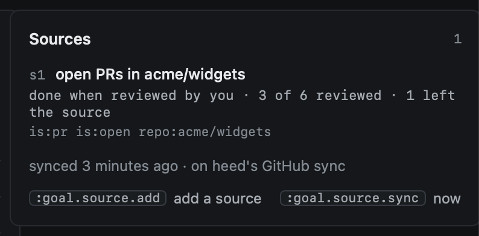
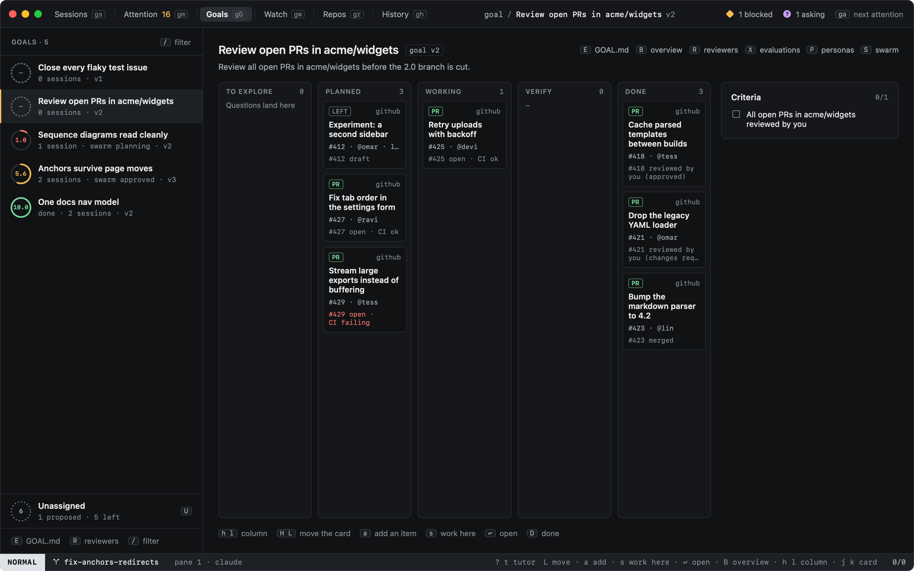
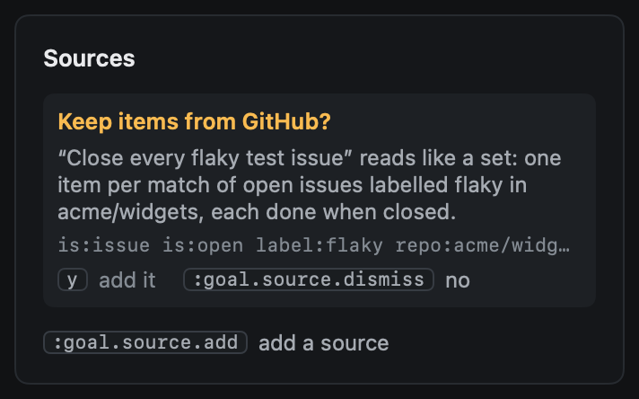

# Item sources

Some goals are a set of things on GitHub: review every open PR in a repo, close every issue labelled `flaky`, get the
dependency bumps merged. Typing an item per PR would be busywork, and the list would be out of date by tomorrow. A
**source** is the query instead: heed keeps one item per PR or issue it finds, adds the new ones as they appear, and
moves each one along the board as it is reviewed, merged or closed.



## Adding a source

`:goal.source.add <query>` on a goal (in Goals, on the list or the overview) adds one. The query is a few words or any
GitHub search:

| Words | What heed searches | Done when, unless you say |
|---|---|---|
| `prs acme/web` | `is:pr is:open repo:acme/web` | merged |
| `issues acme/web` | `is:issue is:open repo:acme/web` | closed |
| `label flaky acme/web` (`label "good first issue"`) | `is:open label:flaky repo:acme/web` | closed |
| `reviews [acme/web]` | `is:pr is:open review-requested:@me` | reviewed by you |
| `milestone v2.0 acme/web` | `is:open milestone:v2.0 repo:acme/web` | closed |
| `https://github.com/acme/web/pulls` | the repo's open PRs (`…/issues`: its issues) | merged |
| `is:pr author:app/dependabot repo:acme/web` | the search as typed, with `is:open` added unless it names a state | merged |

Words with no repo take the repo of the goal's sessions. A source adds its line to the goal's **Done when** in
`GOAL.md` (`All open PRs in acme/web reviewed by you`), as a version of yours you can restore away; once every item of
the source is done, heed checks the line off with the count as its evidence (`12 of 12 reviewed`).

## When an item is done

Each source has a **rule** for what done means for its items:

| Rule | A PR is done when | An issue is done when |
|---|---|---|
| `merged` | it merged | it closed |
| `closed` | it merged or closed | it closed |
| `reviewed` | you reviewed it: approved, requested changes or commented | it closed |
| `green` | every check on its newest commit passes | it closed |

Whatever the rule, a PR that merged or closed has nothing left to do: its card goes to Done too, and counts. Right-click
a source in the overview for **Done when**, or `:goal.source.rule s1 reviewed`.



On the board an item a source found is in **Planned** while it waits (for a review goal, a PR waiting for your review
is work to do), **Working** once a session works on it, **Verify** for a PR that waits to land (any rule but
`reviewed`), and **Done** once its rule is met. Its card says which PR or issue it is and who opened it.

## Keeping in step

On heed's GitHub sync, every few minutes (each poll while Goals is showing, five times less often otherwise), heed
runs each source's search and compares what it finds with the goal's items:

- **A new match** becomes an item, with its title, link and author. A PR the goal already had an item for (a session
  on the goal opened it) is taken in, not made twice, and a PR two sources find is one item.
- **A match that changed** gets evidence: the PR's state and checks, your review, whether the rule is met.
- **An item that no longer matches** is looked up by number. Merged or closed, it gets that evidence and moves on;
  still open (a label taken off, a review request withdrawn), it is marked as having left its source and no longer
  counts. Nothing is ever deleted; an item that matches again loses the mark.

Each search is one GraphQL call (and one more for the items that stopped matching), a `github` row in `:log` with its
rate-limit cost (caller `goals.sources`). heed follows the first 100 matches of a search, and the overview says when
there are more. A search that fails leaves its items as they are, and the overview says why.

## heed proposes one



When a goal reads like a set over GitHub (its title or its goal statement says "review all open PRs in acme/web",
"close every issue labelled flaky"), heed proposes the source on the goal's overview: `y` adds it, **no**
(`:goal.source.dismiss`) says not to propose it again. A cheap decision (`[decisions]`, when they are on) says what
kind of set it is; the words say which repo, label or milestone. With decisions off, or when the call fails, the words
alone decide. heed reads each `GOAL.md` version once, and never proposes for a goal that has a source.

## Starting work on an item

`s` (or `o`) on a card from a PR source starts a **review** of that PR: Start work opens in the PR's repo with a prompt
to check it out and review it on GitHub, and the session tracks the PR, so its state shows there. On an issue, it
starts work on the issue. `↩` opens the PR in heed's reader, or the issue in your browser.

## Agents

Agents on the goal add and list sources with `heed goal`:

```sh
heed goal source add prs acme/web --rule reviewed
heed goal source list
heed goal source remove s1
```

Sources an agent adds say so in the overview. See [heed goal](cli.md#sources).

## Commands

| Command | Key | What it does |
|---|---|---|
| `goal.source.add <query>` | | Add a source (no query: the command line, with the goal's repo) |
| `goal.source.accept` | `y` | Yes to heed's proposal |
| `goal.source.dismiss` | | No to heed's proposal: not proposed again |
| `goal.source.rule <id> <rule>` | | What done means for the source's items |
| `goal.source.edit <id> <query>` | | A new query; the items it found stay |
| `goal.source.remove [id]` | | Take it off: its items stay, the open ones marked; its Done when line goes unless met |
| `goal.source.sync` | | Sync the goal's sources now |
