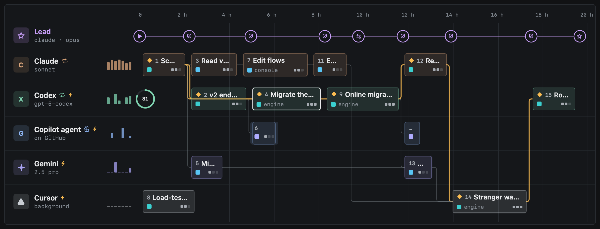
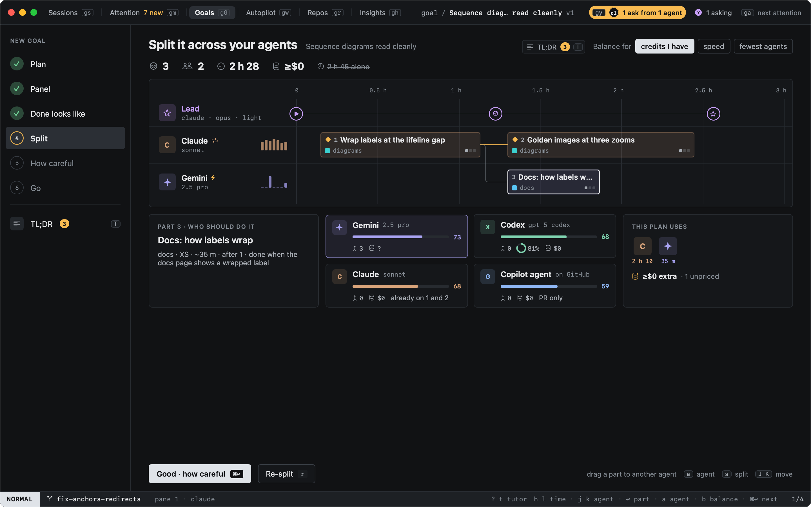
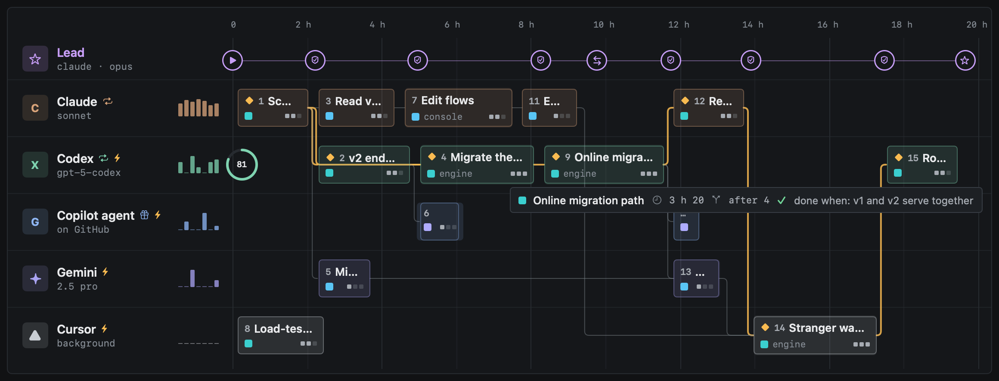
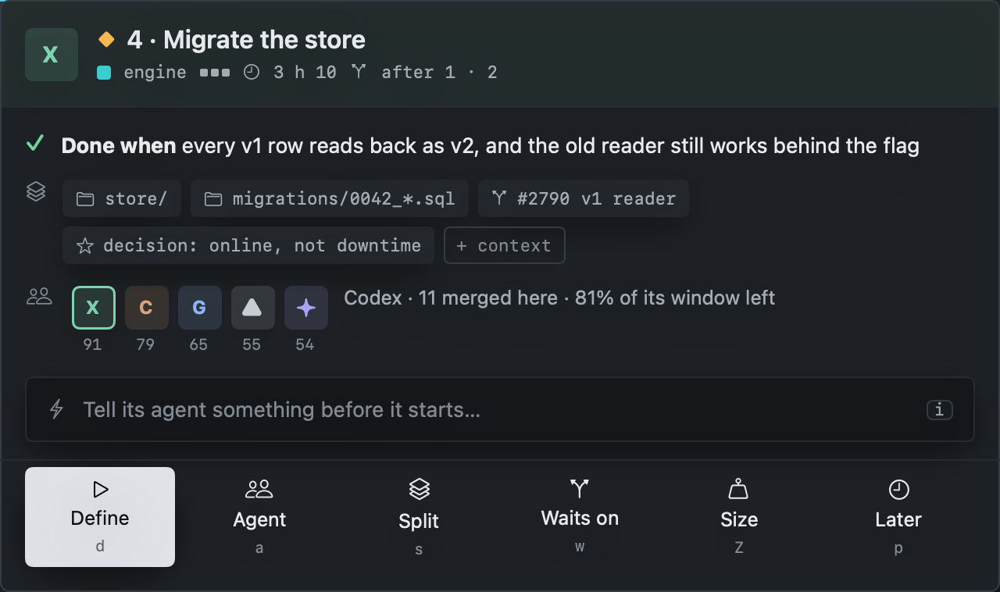
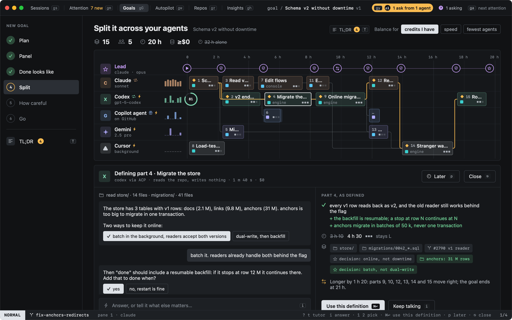
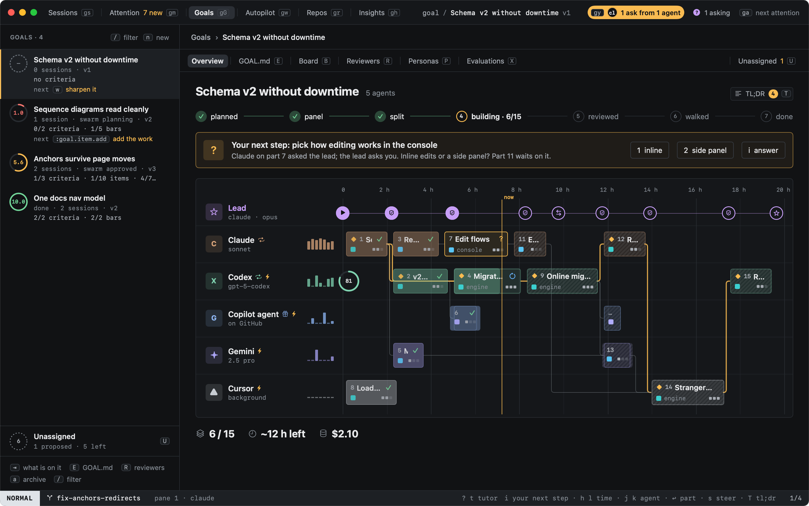

# Split it across your agents

The fourth step of [a new goal](first-goal.md). A cheap model call splits the agreed plan and its done-when into
**parts**: each one pull request in one repo, with a size (XS to L), an estimate, the parts it waits for, how it is
done, and the context its agent starts from. heed then puts every part on one of **your agents**, and draws it all on
one board.

## The board

- **Rows are your agents**: those installed and signed in (Claude Code, Codex, Gemini, OpenCode, Cursor), and GitHub's
  Copilot coding agent when one of the goal's repos lets it be assigned. Each row has the agent's tile, the plan icon
  heed has evidence for (a subscription: it ran into a rate-limit window; paid per use: it reports costs; included with
  GitHub), a ⚡ when it did little this week, a spark of the tokens it used each of the last seven days, and a **ring**
  with what is left of its limit.
- **The ring only shows what an agent reported.** Codex writes how full its rate-limit window is
  (`used_percent`) in its rollout, so Codex gets a ring. Any agent that ran into its limit gets an empty ring until
  the window resets. Claude Code, Gemini, OpenCode, Cursor and Copilot report no quota to heed: they show the spark
  only, and the ring's place says so when you point at it.
- **The lead's spine** runs on top, with its planned moves: it briefs the agents (▶), checks each part on the longest
  chain as it ends (shield), re-plans halfway on a goal of eight parts or more (⇄), and reports done (★).
- **Each part is a block** as wide as its estimate, tinted by its agent, with the repo's swatch, its size as pips, and
  ◆ when it is on the **longest chain** (the parts waiting for each other that take the most hours together). Elbows
  connect a part to what it waits for; the longest chain's are heavier and amber.
- On top: parts, agents, hours together, the extra spend (≥ when some parts are on agents heed cannot price), and the
  hours one agent alone would take, struck through.

A small goal uses the same board: three parts on two agents, and a light lead.

## Who should do it

Under the board, the part under the cursor and the agents who could do it, best fit first. **Fit** comes from heed's
records ([the ledger](../insights/ledger.md)): an agent's PRs in the part's repo, how many merged, and how many it left
(abandoned or closed). An agent new to the repo borrows half its record elsewhere; Copilot needs a repo to open its PR
in. Each card shows the fit as a meter with its score, the merged PRs there, the quota ring (when known), the extra
cost, and one reason (`PR only`, `already on 1 and 3`, `shares the lead's window`). **This plan uses** shows each
agent's hours of parts and the extra spend.

**Balance for** decides how parts are assigned:

| | |
|---|---|
| **credits I have** | Agents with room this week and quota left are used first, and each part an agent takes makes it less likely to get the next: work spreads over what you pay for already. |
| **speed** | Each part goes where it finishes soonest (after what it waits for and the agent's earlier parts), among agents that fit it fairly. |
| **fewest agents** | The agent that fits the most parts best takes them all, but for parts it fits poorly. |

A part you placed yourself (a drag, `a`, `J` `K`) stays where you put it when assignment runs again.

## A part: hover, fold out, steer

Pointing at a part shows a one-line preview: its repo, estimate, what it waits for and when it is done.

`↩` (or a click) folds it out: how it is done, its context as chips (`+ context` adds some), the agents who could do it
with their fit (a click moves it there), a field to tell its agent something before it starts, and its actions.

| Key | |
|---|---|
| `h` `l` | The part before or after in time (on the same agent, else the nearest) |
| `j` `k` | The agent's row below or above |
| `↩` | Fold the part out; again, or `⎋`, folds it in |
| `J` `K` | Move the part to the agent below or above (dragging a block to another row does the same) |
| `a` | The part on the next agent who should do it |
| `d` | Define it with its agent (below) |
| `s` | Split it in two (a cheap call) |
| `w` | What it waits on: type part numbers |
| `Z` | Its size, round from XS to L; its estimate follows |
| `p` | Later: put it off the timeline (hatched), or bring it back |
| `i` | Tell its agent something before it starts |
| `b` | Balance for the next of credits, speed, fewest agents |
| `r` | Split the plan again; your changes go |
| `⌘↩` | Good: on to How careful |

`Z` is the size rather than `z`, which starts NORMAL's `z` keys (`zz` parks a session).

## Define a part with its agent

`d` opens a split under the board: an [ACP](../autopilot/helpers.md) session with the part's agent (else your helpers'
agent) in the part's repo, which **reads the repo and writes nothing**: heed allows its read and search tool calls,
refuses every edit, delete, move or command, and serves no file or terminal methods. It asks one question at a time
with options; on the right, the part as it would be defined: the done-when lines it adds, the estimate before and
after, new context (a decision becomes `decision: …`), and what that does to the rest of the plan ("Longer by 1 h 20:
parts 9 and 12 move right; the goal ends at 21 h").

| Key | |
|---|---|
| `i` | Answer, or tell it what else matters |
| `1` `2` `3` | Answer its question with that option |
| `⌘↩` | Use this definition: the part takes it |
| `p` | Later: put it off; `d` on the part comes back to the conversation |
| `⎋` | Close it; nothing changes |

## The goal's page

A goal that went through Split (or whose swarm has an approved plan) opens on the same board, live: done parts
filled with a check, running ones filling up to the **now** line, the part that asks you in amber, the rest hatched
while they wait. Over it, the goal's way from plan to done (planned, panel, split, building with its count, reviewed,
walked, done), and **one next step** for you: the oldest question the lead (or a worker through the lead) asks you,
with its options. Under it: parts done, hours left, and what it spent so far.

| Key | |
|---|---|
| `i` | Answer your next step (its options are buttons) |
| `h` `l` | Onto the board: the part before or after in time |
| `j` `k` | With a part under the cursor, the agent below or above; without one, the goals |
| `↩` | Fold the part out; without one, open the goal |
| `s` | Steer a running part: its worker's tab opens |
| `⎋` | Fold in, then off the board |

A goal without a plan of parts keeps the overview it always had.

## What it costs

The split is one cheap [model call](../configuration/inference.md); splitting a part in two is another. Defining a
part runs the part's agent over ACP and costs what that agent's session costs, as it reports it. In the tutor and the
docs' pictures nothing is called: the answers are scripted.
