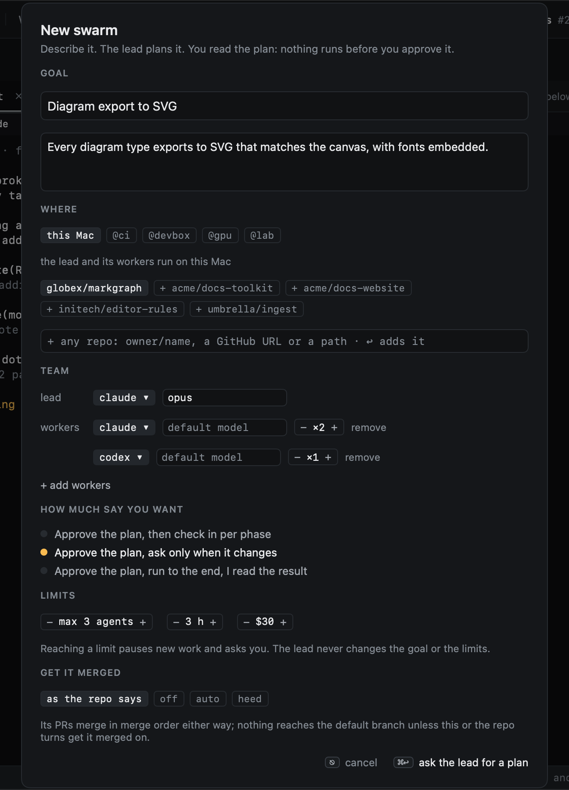
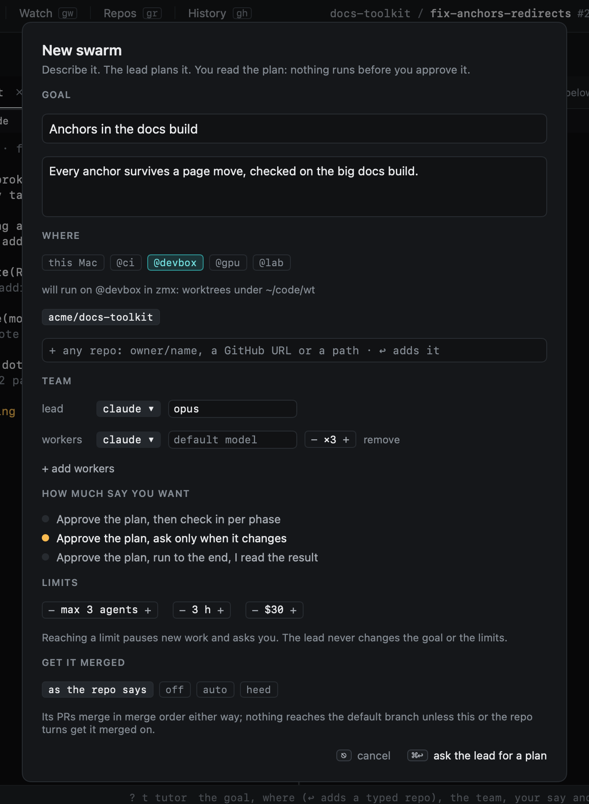
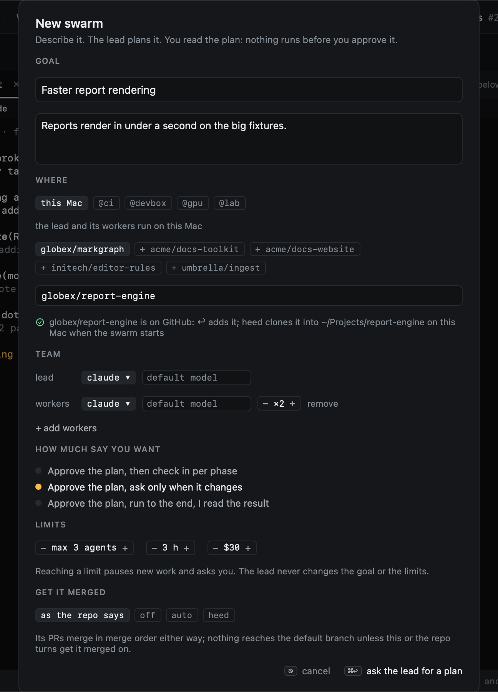
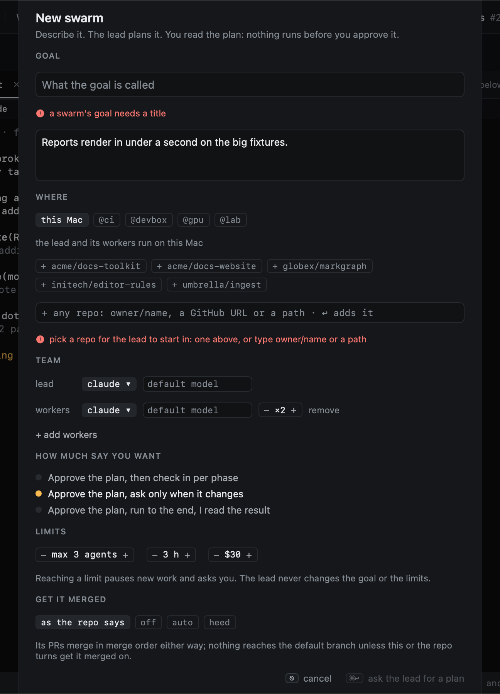
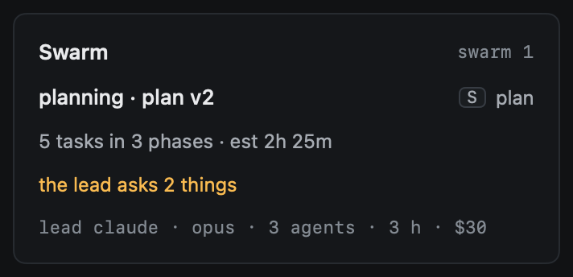

# Swarms

A swarm is a burst of parallel work on a goal: a lead agent breaks the goal into a plan, you read it, change it and
approve it, and a team of agents works the plan's tasks side by side, each in a worktree of its own. A swarm is not
something next to Goals: it is a goal in swarm mode. It reuses the goal's `GOAL.md`, its items and board, its
evidence, reviewers and done rule, the GitHub mirror and `heed goal`.

The goal outlives the swarm. A goal has at most one swarm going at a time; when it ends the goal carries on as a
normal goal, and a follow-up swarm is the next run on the same goal. Old runs stay readable with their plans and
steering.

:::{note}
A swarm plans, approves, runs and lands: workers start on ready tasks and open their pull requests
([Running](running.md)), the PRs merge in a merge order, stacked ones moved on as their parents merge
([Landing](landing.md)), and you steer it: agents' questions go to whoever may answer them, heed's controller answers
what is within its authority, and what is yours waits in Needs you ([Steering](steering.md)). You watch it in the
agents pane and on its map, where a stuck worker is nudged and helped on its own ([Watching](watching.md)), and a done
swarm writes its end-of-build summary, from which one key starts a follow-up ([The summary](summary.md)).
:::

## Starting one

There are three ways in:

- `n` in Goals, with **start as a swarm** ticked: ⌘↩ goes on to the swarm form with the title and goal you typed.
- `:swarm.new` (on a session: from its prompt) opens the swarm form for a new goal.
- `:swarm.start`, or **Swarm this goal** in an empty swarm pane, swarms the goal under the cursor.

| Field | What it is |
|---|---|
| Goal | A title and what done looks like (for a new goal; an existing one keeps its `GOAL.md`) |
| Where | This Mac or one of your hosts, then the repos it works in: picked from the ones there, or any repo typed (below); the lead starts in the first ([On a host](running.md#on-a-host)) |
| Team | The lead's agent and model, and the workers: agents, their models and how many of each |
| How much say you want | Approve the plan, then check in per phase; ask only when the plan changes (the default); or run to the end |
| Limits | Agents at once, hours, dollars. Reaching one pauses new work and asks you |
| Get it merged | For the swarm's PRs: as each PR's repo says (the default), `off`, `auto` or `heed` ([Landing](landing.md#get-it-merged)) |

A click on a place runs the swarm there (`:swarm.host devbox`); the line under it says how its agents will run, or
why they cannot (a host that does not answer, or has no zmx). A click on an agent picks the next one; the model field is free text (empty: the agent's default). ⌘↩ makes the goal
if it is new, starts the swarm, and starts its lead; ⎋ leaves.

### Any repo

The repo chips are the repos heed knows where the swarm runs, but the field under them takes any repo:

- `owner/name`, or its GitHub URL (`https://github.com/owner/name`, `git@github.com:owner/name.git`). The format is
  checked as you type; a repo heed has not seen (not on this Mac, a host, or in the PRs and issues it follows) is then
  looked up on GitHub with a read-only `gh repo view`.
- A path to a checkout on this Mac (`~/src/name`): it joins Repos.

↩ adds it to the picked repos once the line under the field says it is fine (⌘↩ adds it too). A picked repo that is
not where the swarm runs yet is cloned there with `gh repo clone` when you press ⌘↩, into the first repo root:
`[worktrees] repo_roots` on this Mac (`~/Projects` by default), a host's own `repo_roots` there. The form stays open
while it clones, and says so under the repos, or why the clone failed.

### What is missing

What stops the form shows under the field it is about, not in the status bar: a title for a new goal, a repo for the
lead to start in, a typed repo that is misspelled, missing on GitHub or still being checked, or a place the swarm
cannot run. Until it is fixed, ⌘↩ is greyed and its tooltip says why; pressing it shows what is missing under each
field. The new goal dialog and the plan pane's editor work the same way.

## The lead

The lead is a real session: heed starts it with Start work's machinery in the swarm's first repo, on the goal
(attached with origin `swarm`, never asked about), with the chosen agent and model, and with the `heed-goal` skill.
Its first prompt tells it to read `GOAL.md`, draft the plan with `heed goal plan propose` and ask what it cannot
decide with `heed goal ask` ([The lead and heed goal](lead.md)). While a swarm is going, the lead plans the goal
instead of the cheap-model planner, which comes back when the swarm ends.

The lead never changes the goal or the limits, and never approves its own plan. When the plan needs the goal to
change (a new criterion, a new non-goal) it says so, and that becomes a `GOAL.md` proposal that waits for you like any
other.

## On the goal's page

The goal's overview shows its swarm: its state and plan version, the tasks and estimate, what waits for you, and past
runs; once it runs, its progress (tasks done of all) and its agents at work against the cap. `S` opens the swarm's
plan ([The plan](plan.md)); `S` again goes back. The goal's row in the list says `swarm planning`, `swarm approved`,
`swarm running` and so on while one is going.

`:swarm.stop` ends the goal's swarm: nothing more starts, its workers' tabs close (their worktrees stay), and its plan
and steering stay readable.
