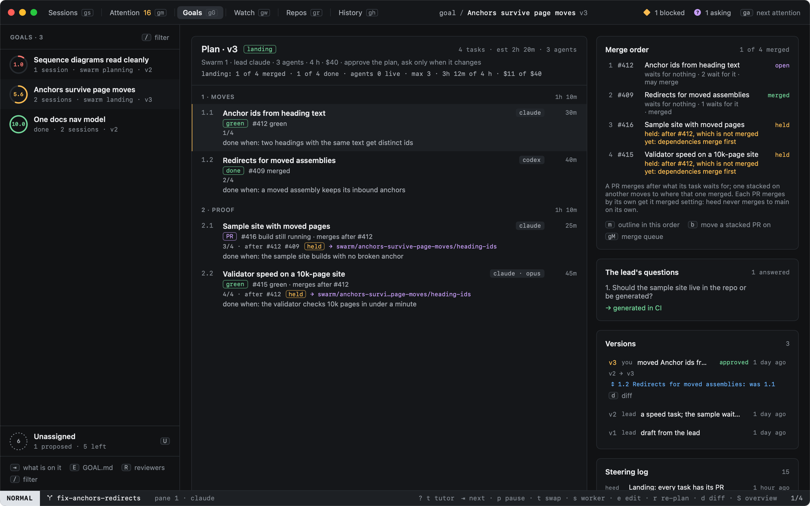
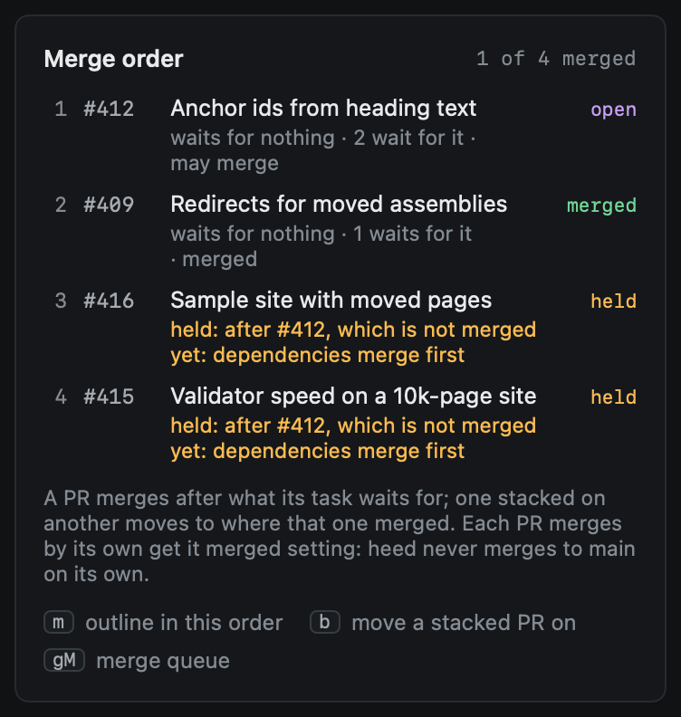
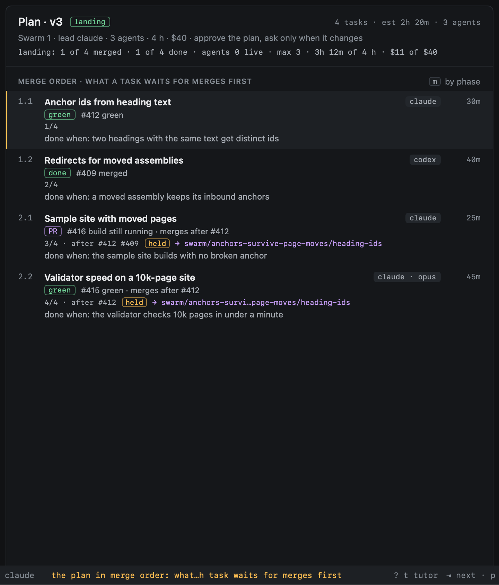
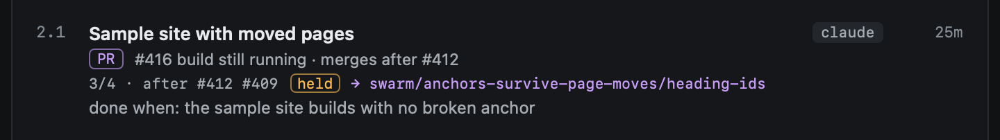
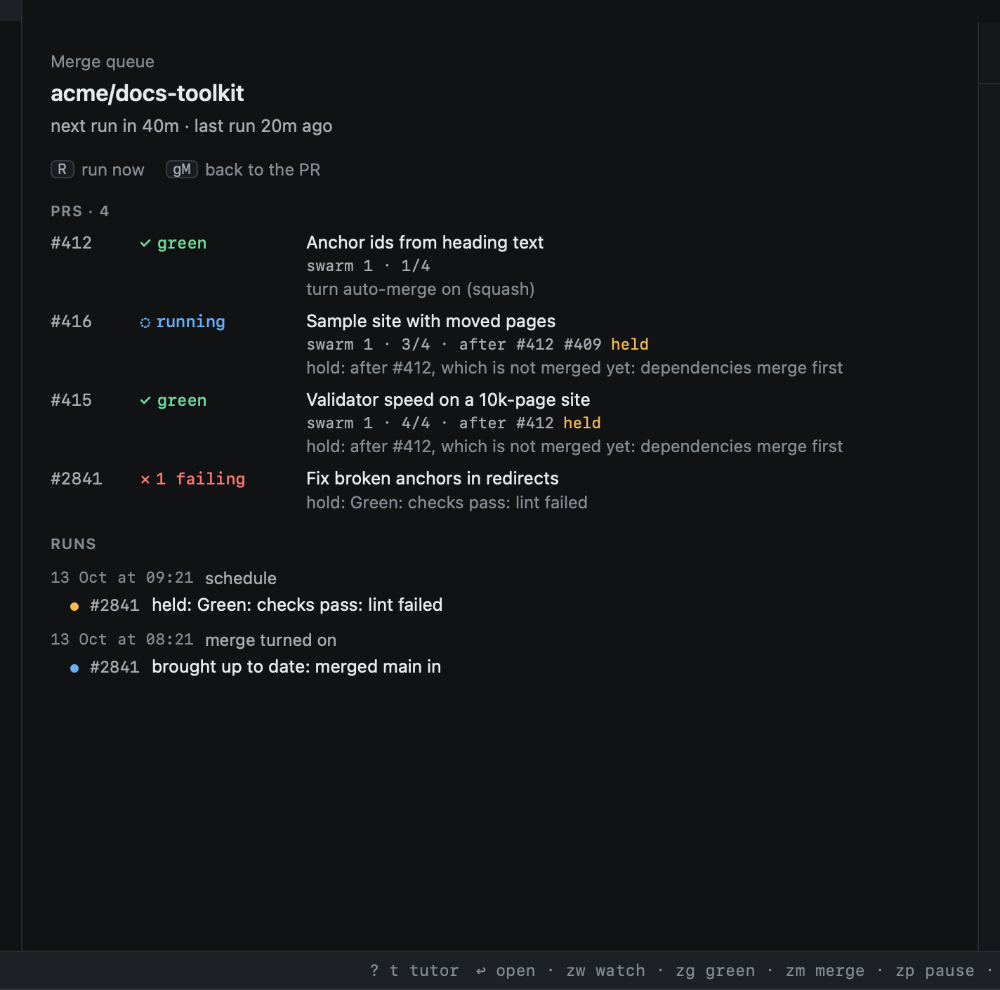
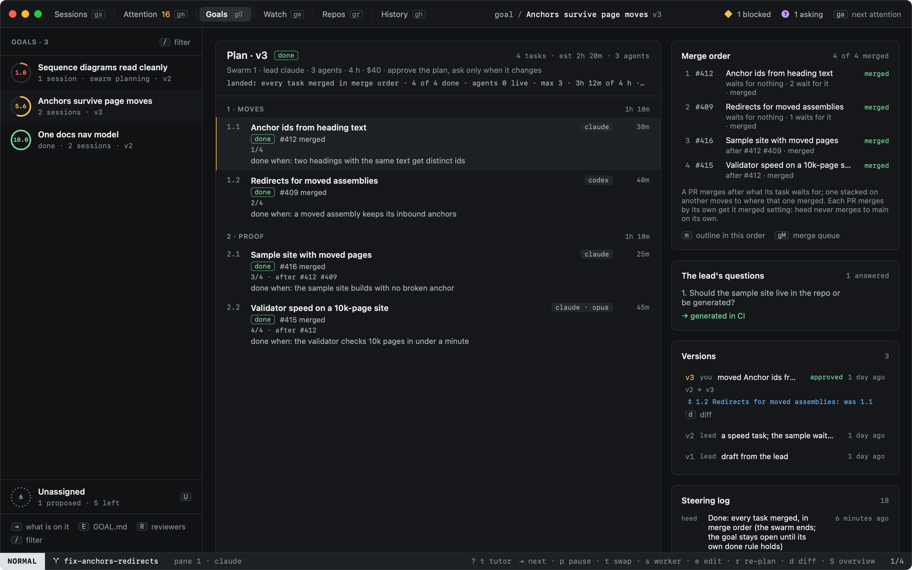
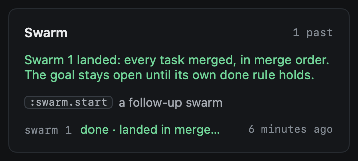

# Landing

Once every task has its pull request, a swarm is **landing**. Its PRs merge in a **merge order**: what a task waits
for merges first, and otherwise the plan's order. heed shows that order everywhere the swarm's PRs are, holds a PR
back while what it waits for is unmerged, moves a stacked PR on once the PR it stacks on merged, and ends the swarm
once every task merged. The merging itself is the pilot's: each PR merges by its own
[get it merged](../../github/watch.md) setting, and a swarm never merges anything to main on its own.

## The merge order

The order is the plan's tasks with every task after the tasks it waits for (its `after`), and otherwise as the plan
lists them. Only the plan's own tasks order it: what a task waits for outside the plan does not.

Each task shows its place as `2/4 · after #412`: its position, then the PRs it waits for (a task's plan number when it
has no PR yet). A task that waits for nothing and that nothing waits for says `any order`: it may merge before or after
the others, so not every position is a real constraint. The **Merge order** panel in the plan pane lists every task in
turn with its PR and its state (no PR, open, held, merged, closed):

`m` in the plan pane (`:swarm.order`) shows the outline itself in merge order instead of by phase; `m` again goes back.
Tasks move up and down (`J` `K`) only by phase: the merge order follows what each task waits for.

The same label is on the swarm's PRs in Watch, in the PRs view, in the inspector and in the merge queue:
`swarm 1 · 3/4 · after #412 held`.

## Held

A PR whose task waits for a task that has not merged is **held**, however green it is:

- The merge queue (`gM`, `:merge.run`) holds it with the reason, and turns GitHub's auto-merge off on it if it was on
  (auto-merge would merge it the moment GitHub's own requirements are met).
- Merge now (`zM`) refuses it and says why: `#415 waits (swarm 1, 4/4 · after #412): after #412, which is not merged
  yet: dependencies merge first`.
- It does not count as ready to merge on the rows.

So a stacked child never merges before its parent, into its parent's branch or past it.

## Green

A task's PR is `green` by the pilot's verdict (the rules `z?` lists: no conflicts, up to date when required, checks
pass, threads resolved, no changes requested) once heed has fetched its detail; before that, by its checks passing. A
PR that is not green says what holds it (`#416 conflicts with main`), and a green one that waits says so too
(`#415 green · merges after #412`).

## The merge queue

`gM` (`:merge.queue <repo>`) on the swarm's repo takes the swarm's PRs in merge order. Its other PRs keep their places
(oldest first): the swarm's PRs are put in its order into the places they hold among them.

The queue only holds PRs with get it merged on. heed tracks each swarm PR in the session its worker ran in (the
lead's), so the pilot watches it by the repo's settings like any PR a session opened; get it merged is still yours to
turn on (`zm`), or the repo's `[pilot]` settings turn it on.

## When a parent merges

A stacked PR goes against its parent's branch. Once the parent merges, heed:

1. Moves it to where the parent merged: `gh pr edit --base <that branch>`, the default branch unless the parent was
   itself stacked on a PR still open (then that PR's branch). GitHub moves a PR itself when its base branch is
   deleted; then only heed's record changes.
2. Records the new base on the task's worker and as a steering row by heed: `#415 now goes against main: #412 merged
   (was swarm/<goal>/heading-ids)`.
3. Has its branch rebased there: a **rebase** item on the PR's get it green feedback, which a get it green run picks up
   (queued when its get it green is auto; otherwise New, for you to send). A squash merge leaves the parent's commits
   on the child as different commits, so the run rebases onto the new base past them
   (`git rebase --onto origin/main <the parent's last commit>`), resolves any conflicts, runs the tests and pushes with
   `--force-with-lease` to the PR's own branch only. Nothing is ever forced to main. Conflicts go to that run, as any
   conflict does.

A PR's feedback for a swarm goes to a run of its own even when the repo's `run_in` is `session`: the session is the
lead's.

If `gh` refuses the move, a steering row says why and heed tries again after ten minutes; `b` in the plan pane
(`:swarm.land`) on the task tries at once, or says why there is nothing to move (`#415 goes against main already`).

## Two open blockers

A task that waits for two tasks whose PRs are both open does not start: it waits until one merges, then stacks on the
other ([Running](running.md)). heed does not make a combined base for it. A branch that merges two open PRs is nobody's
PR: it could not be retargeted when either parent merges, and a change to either parent would leave it stale. Waiting
keeps every stacked PR on exactly one parent, which is what holding and moving on rely on.

## Done

Once every task of the plan has merged (or is done by its evidence, with no PR), the swarm is **done**: a steering row
by heed says `Done: every task merged, in merge order`, and the swarm ends. The holds are what keep the merges in
order.

Done ends the swarm, not the goal. The goal is done only by its own rule (every criterion has evidence and every lens
meets its bar), which may need a follow-up swarm. The goal's page says so:

## On GitHub

With the goal's [GitHub mirror](../github.md) on, each item's sub-issue says what it comes after (`After #12, #14.`,
the other sub-issues), and the meta issue gains a section for the swarm going (or the last one, once it is done): its
state, how many tasks merged, and every task in merge order with its PR and what it comes after. These are ordinary
edits of heed's issues: written in the same batches, at the same rate, as every mirror write.

## Keys

| Key | Command | |
|---|---|---|
| `m` | `swarm.order` | The plan in merge order, or by phase again |
| `b` | `swarm.land` | Move the task's stacked PR to where its parent merged, now |
| `gM` | `merge.queue` | The repo's merge queue, in the swarm's order |
| `zM` | `pilot.merge.now` | Merge now: refused for a held PR |

A right-click on a task offers both, and the hints in the Merge order panel are clickable.
