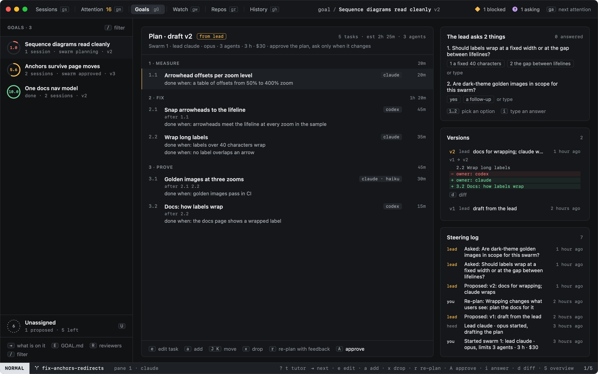
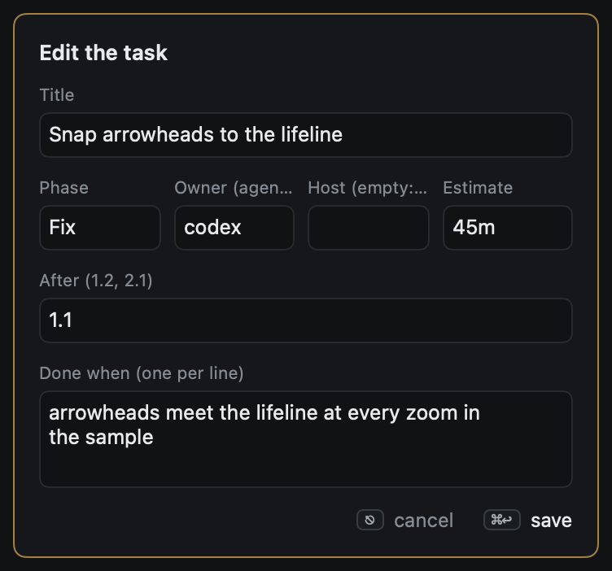
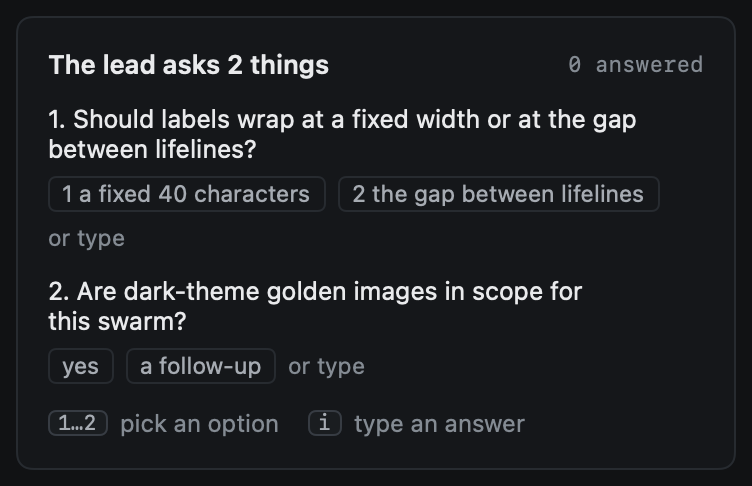
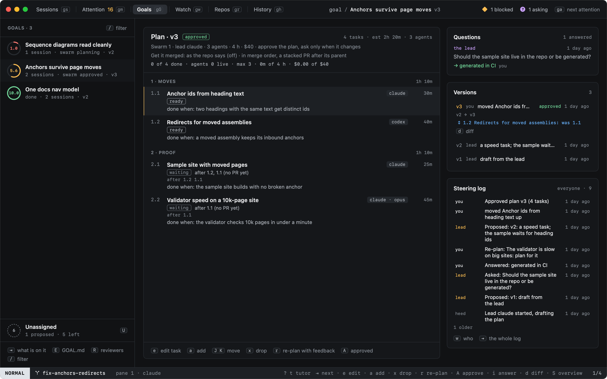
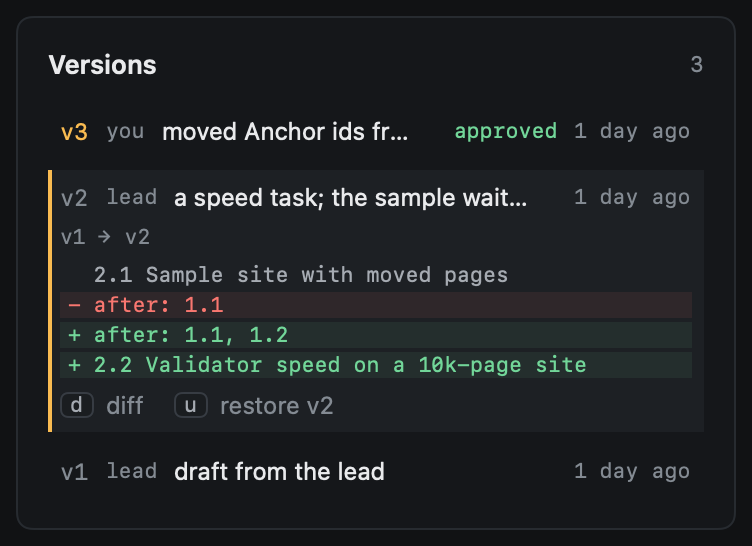

# The plan

`S` on a goal opens its swarm: the plan on the left, and on the right what the lead asks, a change waiting for you,
every version of the plan and the steering log.

## The outline

The plan reads by phase. Each task has a number (`2.1`: the first task of the second phase), a title, the agent (and
model) that owns it, an estimate, the tasks it waits for (`after 1.1`) and how we will know it is done. The header
says whether it is the lead's draft, your edit or the plan you approved, and the plan's numbers: tasks, estimate,
agents.

| Key | |
|---|---|
| `⇥` | The goals, the tasks, the versions, the steering log, in turn |
| `j` `k` | Move through the tasks, the versions or the steering log |
| `e` | Edit the task under the cursor: title, phase, owner (`agent` or `agent:model`), host, estimate, after, done when |
| `a` | Add a task after the one under the cursor, in its phase |
| `J` `K` | Move the task down or up; past the edge of its phase it joins the next |
| `x` | Drop the task; nothing waits for it any more |
| `r` | Re-plan: tell the lead what should change |
| `1`…`9` | Answer the question under the cursor in the steering log (else the first open one) with that choice; on an answer someone else gave, an overrule |
| `i` | The same, in words |
| `c` | Hand that question to heed's controller ([Steering](steering.md)) |
| `w` | The steering log by who decided: everyone, you, the controller, the lead, agents, heed |
| `q` | Between a question and its answer in the steering log |
| `A` | Approve the plan |
| `y` | Yes to the change waiting for you, as in `GOAL.md` |
| `n` | Say no to the change waiting for you |
| `d` | The version under the cursor's whole diff; again, its first lines |
| `u` | Restore the version under the cursor, as a new version |
| `p` `t` `s` | Once it runs: pause the task, hand it to another agent, its worker's tab ([Running](running.md)) |

Everything takes the mouse too: a click puts the cursor on a task, a double-click edits it, a right-click offers what
the keys do; a click on a question's choice answers with it.

Every change you make is a new plan version, and a row in the steering log saying what you did. In the editor ⌘↩
saves and ⎋ leaves; `after` takes task numbers (`1.2, 2.1`) or ids, and a plan where tasks wait for each other in a
circle is refused with the circle named.

## Questions

What the lead or a worker cannot decide from the goal and the code, it asks, with the choices it sees and what each
would change. Each question says who asks, what it is about, and its answer with who gave it, or whom it waits for.
The first open question's choices are numbered: `1` answers with the first, `2` the second, and a click on any choice
answers with it; `i` answers in words. In this pane a digit picks a choice rather than starting a count. Who may answer
which question, the ladder it climbs and Needs you are in [Steering](steering.md); the asker's waiting
`heed goal ask` prints your answer.

## Approving

`A` approves the plan. Its tasks become the goal's items, with source `swarm` and the plan's owner, phase, estimate,
after and done when; items already on the goal that the lead took into the plan keep their history and gain those
fields. They show on the board and in the overview's matrix like any other item, and workers start on the ready ones
([Running](running.md)).

After approval the default is to ask only when the plan changes. A change from the lead is small or structural:

- **Small** applies by itself and the plan stays approved: tasks reordered, another owner, host, phase or estimate.
- **Structural** waits for you: a task added, dropped or renamed, what a task waits for, or when it is done. It shows
  as **The lead proposes a change** with its diff; `y` takes it, `n` says no (the lead hears why), as with a
  change to `GOAL.md`. `A` takes it too.

Run to the end applies every change. A plan never changes the goal: what the goal would need goes to `GOAL.md` as a
proposal.

## Versions and the steering log

The versions list says who made each one (the lead, you, a restore) and why; the one under the cursor shows what it
changed from the one before: tasks added and dropped, fields changed, tasks moved. `u` restores an old version as a new
one, so nothing is lost.

The steering log keeps every decision: who decided (you, the lead, heed), what, when and why. Rows are only ever
added: an answer, an approval or a no is a new row pointing at the one it is about.

Each version is also written as `PLAN.md` next to the goal's `GOAL.md`, for agents and editors; heed does not read it
back.
