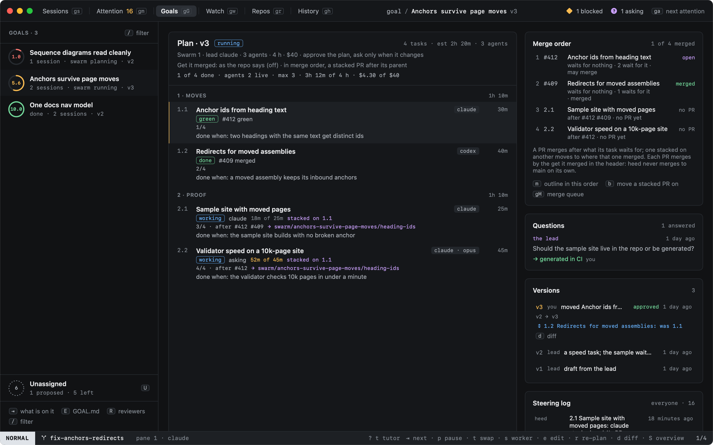
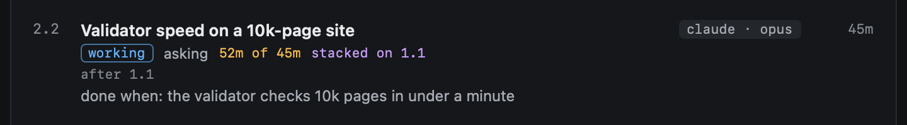
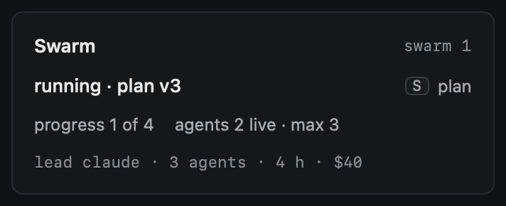
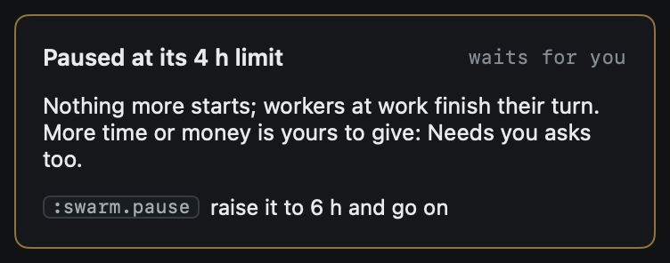
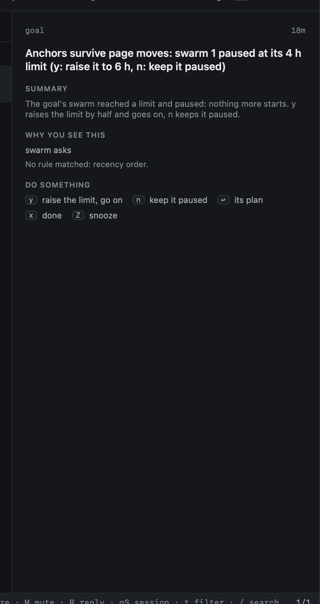
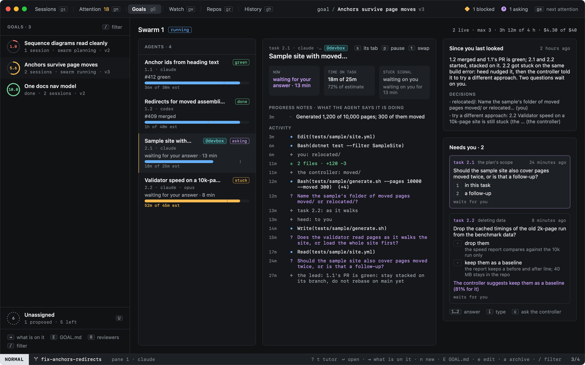

# Running

Once you approve the plan, heed starts workers on the tasks that are ready, up to the swarm's limit on agents at
once. Each worker is the task's agent in a tab of the lead's session, in a worktree of its own on the task's branch,
with heed's hooks: its state, its usage and its end are heed's to see, as for a get it green run. Workers commit,
push and open their pull request; heed never merges for them.

## When a task starts

A task is **ready** when everything it waits for (its `after`) is merged or done, or when exactly one of them still
has its pull request open. Then it starts:

| What it waits for | Where it starts | Its PR goes against |
|---|---|---|
| Nothing, or all of it merged or done | The repo's default branch | The default branch |
| One task whose PR is open (the rest merged) | That task's branch: it **stacks** on it | That task's branch |
| A task with no PR yet | It waits | |
| Two tasks with open PRs | It waits until one merges: a branch stacks on one parent | |
| A task whose PR was closed unmerged | It waits for you | |

A task stacks as soon as its blocker's PR is open, failing checks or not. Its worker's first prompt names the base
twice: where its branch was made from, and that `gh pr create --base` takes that branch, not the default branch.
Once its parent merges, a stacked PR moves to where the parent merged and is rebased there
([Landing](landing.md)).

Ready tasks start in plan order while the swarm is under its limits:

- **Agents at once**: a cap, not a limit. A task waits for a free slot (`3 of 3 agents at work`).
- **Hours** (counted from the first worker) and **dollars** (what its workers cost, reported or estimated): reaching
  one pauses the swarm and asks you in Needs you.
- **Rate limits**: a task whose agent is rate limited waits until the limit lifts (`claude is rate limited until
  14:00`); the others go on.

The swarm's limits replace the goal's spawn caps while it runs.

## Where each task stands

| State | |
|---|---|
| `waiting` | What it comes after has no PR yet |
| `ready` | It could start; the reason says what holds it (a slot, a rate limit, a pause) |
| `working` | Its worker is at it: its agent, `asking` or `blocked` when it is, its time against its estimate (amber when over), `stacked on 1.1` when it stacks |
| `paused` | You paused it |
| `stalled` | Its worker ended without a PR, or its PR closed unmerged: it waits for you (resume it, or hand it to another agent) |
| `PR` | Its PR is open: a draft, checks running or failing |
| `green` | Its PR is open and green: the pilot's verdict once heed has its detail, else its checks pass ([Landing](landing.md)) |
| `merged` | Its PR merged; its done-when has no evidence yet |
| `done` | Every line of its done-when has evidence, and nothing of it is still open; with no done-when, its PR merged |

Evidence moves the task's item on the board as for any item: a worker starting is `built`, its PR puts it in Verify,
the merge in Done. A worker checks its done-when with `heed goal criterion check <n> --item <id> --evidence <text>`.

The plan's header adds the run's numbers: tasks done, agents at work against the cap, hours and dollars against the
limits. The goal's page shows progress and agents too.

## The run's state

| State | When |
|---|---|
| `planning` | The lead drafts; after approval, until the first worker starts |
| `running` | Workers start and work |
| `paused` | You paused it, or it reached a limit |
| `landing` | Every task has its PR (or is done); a task that loses its PR makes it run again |
| `stopped` | You stopped it |

Every change is a row in the steering log by heed: a worker starting (which agent, from which base, stacked or not),
a worker ending and how, running, landing, a limit reached.

## Steering it

| Key | |
|---|---|
| `p` | Pause the task under the cursor: its worker stops, its worktree stays; again, it resumes (a stalled task too) |
| `t` | Hand the task to another agent (`:swarm.task.swap claude:opus`). A worker at it stops and the new agent starts in its worktree, told what it takes over |
| `s` | The task's worker, in its tab |
| `:swarm.pause` | Pause the swarm: nothing more starts, workers at work finish their turn; again, it resumes |
| `:swarm.stop` | Stop it: its workers' tabs close, their worktrees and branches stay until you remove them |

A right-click on a task offers the same, and the hints under the plan are clickable.

Swapping is a small plan change: the plan stays approved. Dropping a task (`x`) stops its worker too.

## At a limit

A swarm that reaches its hours or dollars stops starting work and asks you in Needs you: `y` raises that limit by half
(at least an hour or $5) and it goes on, `n` keeps it paused and stops asking. `:swarm.pause` on a paused swarm does
the same as `y`. Workers at work when it paused finish their turn. The dollars count what workers at work used so far, not only what
ended workers cost: heed writes each worker's cost and tokens onto its record as it works, so a restart loses none of
it ([Watching](watching.md#what-it-used)).

## A dropped task

A task dropped from an approved plan stays on the goal as an item: on the board it keeps the column its evidence
gives it and wears **DROPPED**, and the swarm no longer counts it, starts it or waits for it. Its worker, if one was
at it, stops; its worktree and branch stay. An item the swarm took in (the goal had it before) goes back to being an
ordinary item.

## What a worker leaves

A worker's branch is `swarm/<goal>/<task>`, outside `heed/`, so the cleanup sweep never removes it: it holds the
task's pull request. Its worktree is under `heed/<repo>/swarm-<goal>-<task>` in your worktree root and is kept when
the worker ends, so a resumed or handed-over task carries on where it was. A worker on a task heed was quit during is
recorded as interrupted at the next launch; the task then waits for you.

Workers' tabs are in the lead's session (or the newest open session on the goal when the lead's is closed).

## On a host

A swarm runs where its form's **Where** says: this Mac, or one of your [hosts](../../hosts/index.md). On a host its
lead is a session there, and each worker runs there as a session on a host does:

- its worktree is made on the host, in the host's clone of the repo, under its `worktree_root`
  (`<worktree_root>/heed/<repo>/swarm-<goal>-<task>`); nothing is cloned to this Mac;
- heed's hook files go on the host first, so its state, its usage and its tool calls come back through the host's
  event log, as a remote session's do;
- its agent runs in zmx there, in a tab of the lead's session whose pane is an ssh to the host, with the host's strip
  over it; messages and answers heed hands it are typed into that pane like any worker's;
- `heed goal` and `heed swarm` work in it: heed's `heed` on the host passes them to heed on this Mac
  ([On a host](../cli.md#on-a-host));
- its worktree's file changes are read over the host's shared ssh connection every three minutes (once a minute here),
  only while the host answers;
- its worktree is kept on the host when it ends, so a resumed or handed-over task carries on there; it is registered
  in [Repos](../../worktrees/repos.md), so `dd` removes it on the host once you are done with it.

A task can run somewhere else than the swarm: its `host` in the lead's plan, the plan editor's **Host** field, or
`:swarm.task.host <host|local|->` on the task (`local` is this Mac, `-` where the swarm runs; a right-click offers the
hosts). It is a small plan change: the plan stays approved, and a worker already at it stays where it is. Its row in the
plan wears the host's chip, as its row in the agents pane does.

A host that does not answer when a task should start stalls that task, saying why (`@devbox does not answer: gH shows
why`); resume it once the host is back. Pull requests, stacking and moving a stacked PR on are GitHub's: heed runs
`gh` for them on this Mac, against the branch the worker pushed ([Landing](landing.md#where-it-runs)).
