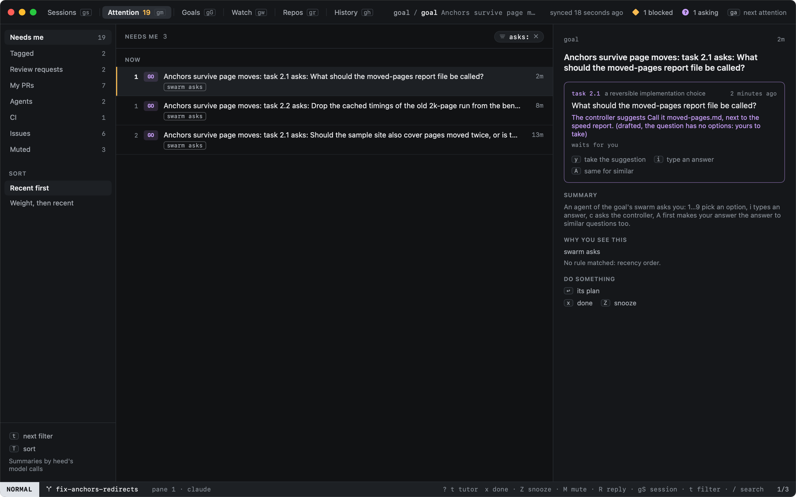
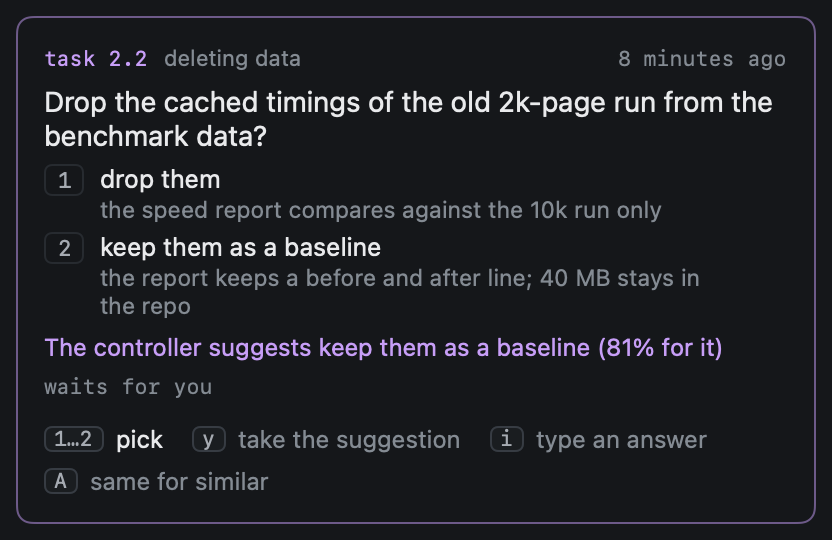
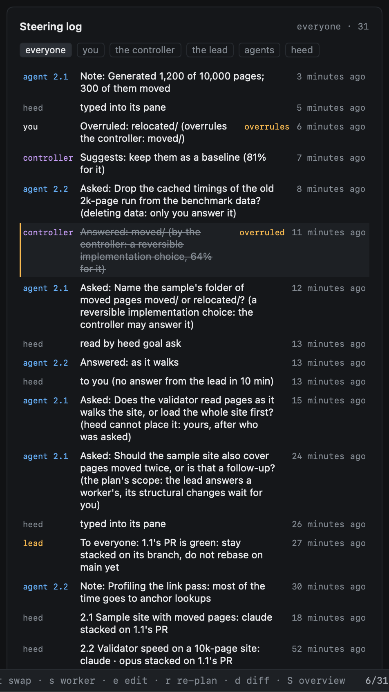
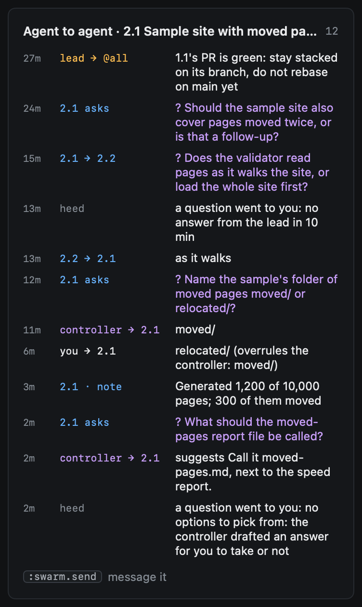

# Steering

Once a swarm runs, its agents ask what they cannot decide, tell each other what they need, and say what they are
doing. heed decides who may answer each question, walks it up a ladder until someone does, answers what is within its
own authority through your deciders, and brings you only what is yours. Every step is a row in the swarm's steering
log, kept for good: who decided what, when, why, and whether you overruled it.

## Who may answer

What a question is about decides who may answer it, never how sure a model is. heed reads the question's words and its
options; the categories that are always yours are checked first, so a question that mentions deleting data is yours
whatever else it says, and what the words do not place goes to you too.

| The question is about | Who may answer, in order |
|---|---|
| The goal (`GOAL.md`, done when, non-goals) | You |
| Limits (budget, cost, quota) | You |
| Deleting data, force pushing | You |
| Merging to main (or the default branch) | You |
| More agents or more time | You |
| The plan's scope (split, add or drop a task, follow-up), from a worker | The lead, then you |
| The plan's scope, from the lead | You |
| A reversible implementation choice (naming, defaults, test strategy) | A peer, then the controller, then you |
| Reassigning an idle agent | A peer, then the controller, then you |
| Anything else | A peer, then you |

**A peer** is the task that owns the nearest work: the one named with `--to 1.2`, else the task the asker's task waits
for, else one that waits for it, as long as its worker is at work. `--to lead` asks the lead first; `--to you` asks you
straight away.

**The controller** is heed's deciders, as set up in Settings › Inference & decisions: Hunch for small choices, the rest
routed on as everywhere else ([Inference & decisions](../../configuration/inference.md)). It only ever picks one of the
asker's options, so a question without options passes it by. Each decision writes a `decide` row in the call log and a
steering row marked **by controller**.

**Repeats.** A question you answered before (the same words once normalised, and the same options) that is not always
yours is answered at once by the controller with your answer, marked as a repeat. A question that is only like one you
answered goes to a decider as a yes/no statement ("these two ask the same thing"), and only a clear yes counts.

## The ladder

A question starts at the first step its category allows and moves on when that step does not answer in time:

| Step | Moves on after |
|---|---|
| A peer | 8 minutes (the swarm's "waiting on a peer" setting, [Watching](watching.md#when-a-worker-is-stuck)) |
| The lead | 10 minutes |
| The controller | Its answer, a decline (not its question, no options, the decider off or failing), or 3 minutes |
| You | Never: it waits in Needs you |

Before asking, an agent is told to try another way once. Each move is a row by heed (`to the controller`, `to you`) with
why. A worker that looks stuck climbs the same ladder without asking: heed nudges it first, then asks on its behalf
([Watching](watching.md#when-a-worker-is-stuck)).

## Asking, from an agent

```sh
heed goal ask "Keep the old benchmark timings?" \
  --option "drop them" --effect "the report compares against the new run only" \
  --option "keep them" --effect "40 MB stays in the repo" \
  --to 2.2
```

`heed goal ask` waits for the answer and prints it on stdout, the answer alone on the first line, then who gave it. It
waits 9 minutes by default (`--timeout <minutes>`; `--no-wait` returns at once), under the ten minutes an agent's
shell tool runs a command at most. With no answer by then it exits 6 and the question stays open:
`heed goal ask --id <n>` waits again, and `heed goal plan show` lists it with its answer once there is one.

| Exit | |
|---|---|
| 0 | Answered: the answer on stdout |
| 1 | Refused: no swarm going, no such question or task, the swarm stopped |
| 2 | Wrong usage |
| 3 | heed is not reachable |
| 4 | No goal: attach first or pass `--goal` |
| 6 | No answer before the timeout; the question stays open |

## Needs you

A question that is yours waits in Needs you (Attention), one item per question, from every agent of every swarm, and
notifies as an agent asking does. The item shows who asks and about what, each choice with what it would change (when
the asker said), and the controller's suggestion if you asked for one.



| Key | |
|---|---|
| `1` … `9` | Answer with that option |
| `i` | Type an answer (`:swarm.answer <text>`) |
| `c` | Hand it to the controller: it answers what is within its authority; on a question that is always yours it only suggests |
| `y` | Take the controller's suggestion |
| `n` | Not the suggestion: type another answer |
| `A` | Your next answer to it also answers similar questions (a repeat rule); `A` again: only this one |



A repeat rule is a steering row of its own. The controller gives its answer to questions like it in this goal's swarms
from then on, marked as such; never to a question that is always yours.

A stacked PR heed could not move to its new base after its parent merged also waits in Needs you: `y` tries again, `n`
leaves it where it is (`b` on the task in the plan still moves it).

## Answers reach the agent

The asker's waiting `heed goal ask` reads its answer itself. Anything else for an agent (a message, a question handed
to a peer or the lead, an answer the asker stopped waiting for, an overrule) is typed into its pane, one at a time, only
when its agent is idle and you have not typed there in the last 20 seconds, the same rule feedback for a PR follows. A
worker whose turn ends while something waits for it is kept going until it has it. A worker also finds what waits for
it under **For you** in `heed goal plan show`. Each hand-over is a row by heed.

## Overruling

Answering a question someone else answered (the controller, the lead, a peer, a repeat) overrules it: a new row of its
own, marked **overruled**, pointing at the answer it overrules, which reads struck through from then on. The new answer
is typed to the agent, and an overrule of the controller is a label Hunch learns from (Settings › Inference & decisions
› Hunch, **Swarm answers**).

In the plan's steering log, put the cursor on the answer, or its question, and press the option's digit, or `i` to type
one: one key.

## The steering log

`⇥` in the plan pane reaches the steering log: the whole history, newest first, with the keyboard on it.



| Key | |
|---|---|
| `j` `k` | Move through the rows |
| `w` | Who decided: everyone, you, the controller, the lead, agents, heed, in turn (`:swarm.log.who you`) |
| `q` | Between a question and its answer; elsewhere, to the newest open question |
| `c` | Hand the question under the cursor to the controller |
| `1` … `9`, `i` | Answer the question under the cursor; on an answer someone else gave, overrule it |

## Agent to agent

With the cursor on a task, the plan shows its agent-to-agent log: what was said to it and by it, its questions and
their answers, its progress notes.



From an agent's pane:

| Command | |
|---|---|
| `heed swarm send <to> <text>` | A message to a task (its number, `2.1`, or id), `lead`, or `@all` (the lead and every task at work) |
| `heed swarm note <text>` | A progress note: what it is doing now, in a line |
| `heed swarm answer <n> <text>` | Answer a question heed handed it: a peer's, or a worker's scope question when it is the lead |

From heed, `:swarm.send <to> <text>` sends one from you.

## Not yet

- Conflicts after a parent's merge go to a get it merged run, not back to the task's own worker.
- A question that waits on you is reminded once ([Watching](watching.md#when-a-worker-is-stuck)); it is not answered
  for you.
