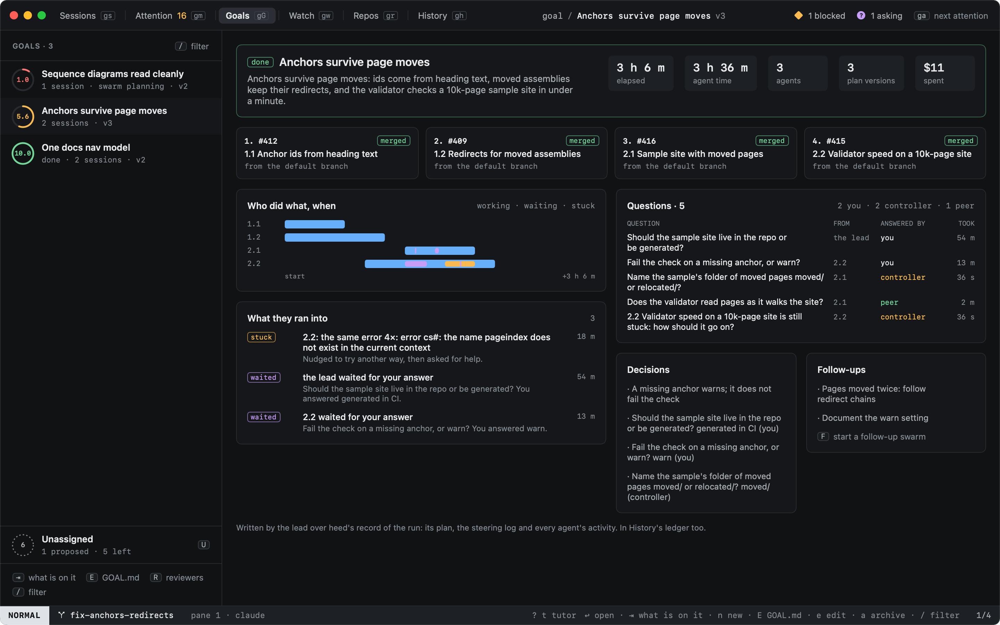

# The summary

When a swarm is done (every task merged, in merge order), heed writes its end-of-build summary from the run's record,
and asks the lead to write its part. The summary is on the swarm's agents pane (`W`), on the goal's page, and in
History's ledger; its decisions go into `GOAL.md`.



## What is in it

| Part | From |
|---|---|
| The outcome | The lead's words; until it writes them, heed's: tasks merged, PRs opened, how many stacked |
| Elapsed, agent time, agents, plan versions, spent | The run's record: from its first worker to its end, every worker's time and cost |
| The PRs | Each task's PR in merge order, its state, and what it stacked on |
| Who did what, when | A lane per task: its workers at work, its waits for an answer, its stuck stretches; the lead's acts |
| What they ran into | Stuck episodes (and how they ended), waits of five minutes or more for your answer, PRs heed could not move |
| Questions | Every question, who asked it, who answered it (you, the controller, a peer, the lead) and how long it took |
| Decisions | The lead's, then every answer you or the controller gave |
| Follow-ups | The lead's, then every question left unanswered |

## The lead's part

When the swarm goes done, heed types into the lead's pane (once it is idle) that the summary is due:

```sh
heed swarm summary --outcome "Anchors survive page moves: ids come from heading text." \
  --decision "A missing anchor warns; it does not fail the check" \
  --follow-up "Pages moved twice: follow redirect chains"
```

`--decision` and `--follow-up` repeat. The newest summary counts; writing it again rewrites it everywhere. Only the
lead writes it (or you, from a terminal outside heed). `:swarm.summary` assembles it again and asks the lead again.

## Where it goes

- **The goal's swarm**: `W` on a done swarm shows the summary instead of the agents.
- **History's ledger**: one entry per swarm, titled `Swarm: <goal>`, with its PRs, agent time, spend, decisions and
  follow-ups (`L` in History).
- **`GOAL.md`**: the lead's decisions are recorded under Decisions, as records (they apply at once and can be undone,
  like any decision an agent records).

## A follow-up swarm

`F` on the summary (`:swarm.followup`) opens the swarm form on the same goal with the last run's repos, lead, workers,
limits and stuck settings, and its follow-ups in the statement; ⌘↩ starts it. Its lead's first prompt says what the
last swarm ended with and the follow-ups it left. The new run is the goal's next swarm; the old one stays readable
with its plan, steering and summary.

## Repeat rules

"Same answer for similar questions" (`A` in Needs you) makes a repeat rule the controller answers with in every swarm
on the goal. The plan pane lists the goal's rules; `:swarm.rule.delete <n>` (or a right click on one) deletes it, as a
steering row: the controller stops answering with it.
