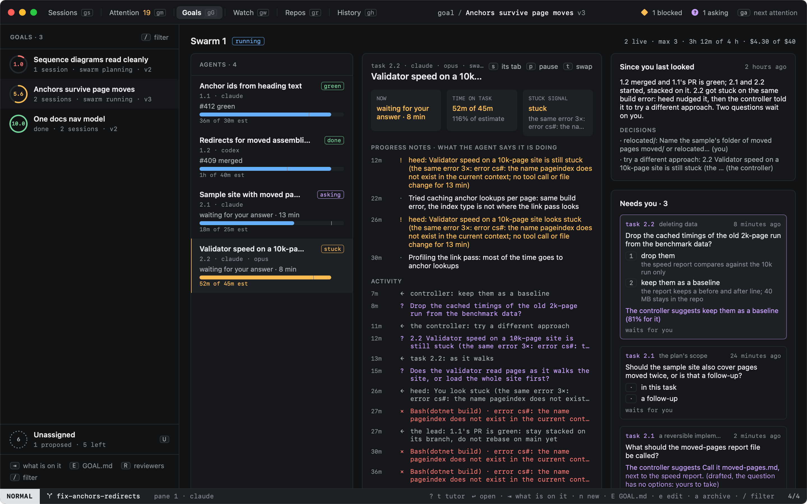
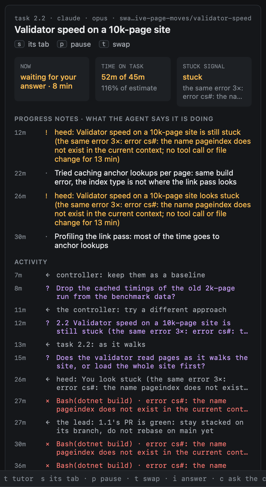
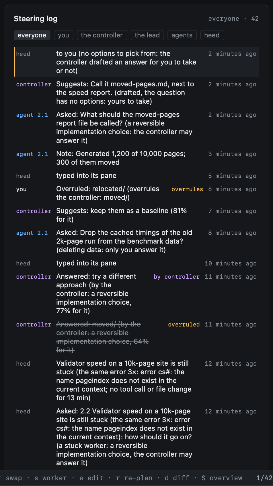
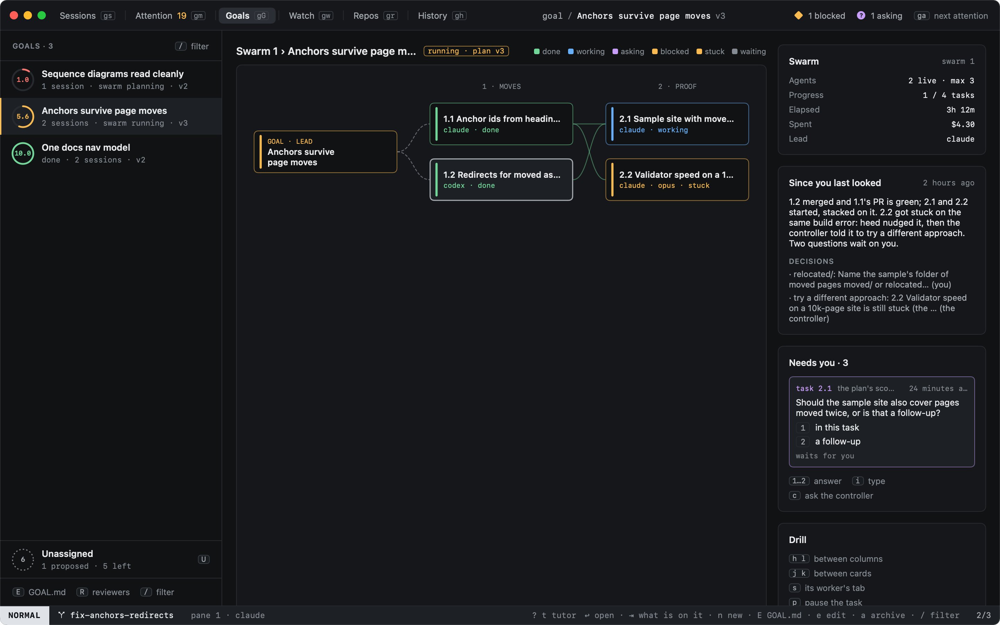
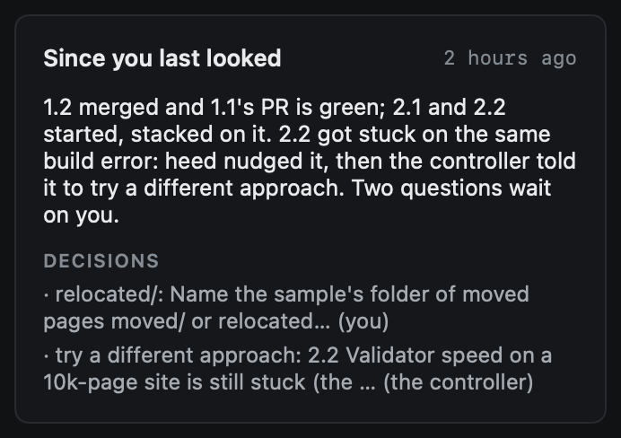

# Watching

A running swarm has several agents at work at once, each in a tab of its own. You do not have to open those tabs to
know how it goes: the agents pane shows what every agent is doing, for how long and whether it looks stuck, the map
shows the whole swarm at a glance, and "since you last looked" says what changed while you were away. heed watches the
workers for you too: one that looks stuck is nudged, then helped, on its own.

## The agents pane

`W` on a goal (`:goal.agents`) opens its swarm's agents; `W` again goes back to the overview.

| Where | What it shows |
|---|---|
| Left | Every task a worker ran on: its state (working, asking, stuck, or where its PR is), what it is doing now and since when, and its time on the task against its estimate. The bar turns amber over the estimate or when it looks stuck |
| Middle | The worker under the cursor: what it does now and what it blocks, its time on the task, its stuck signal; its progress notes (`heed swarm note`) and heed's stuck episodes; its activity, newest first: tool calls (failures in red), files changed, and what was said to it and by it |
| Right | What changed since you last looked, and Needs you: this swarm's questions that are yours, the selected worker's first, each with what every choice would change |

The cursor starts on the worker that most needs a look: a stuck one, else the first at work.

| Key | Does |
|---|---|
| `j` `k` | Move between workers |
| `s`, `↩` | The worker's tab (its whole transcript) |
| `p` | Pause or resume its task |
| `t` | Hand its task to another agent |
| `1`…`9` | Answer the first question in Needs you with that option |
| `i` | Type an answer to it |
| `c` | Ask the controller |
| `F` | Once the swarm is done: a follow-up swarm ([The summary](summary.md)) |

A click selects a worker, a double click opens its tab, a right click has the task's menu. The menu bar's Goals menu
has the same under **A swarm's agents**.

## Activity

heed keeps two kinds of activity for every worker, in its event log next to everything else it records:

- **Tool calls**, from the agent's `PostToolUse` hook (and, for Claude Code, `PostToolUseFailure` for a call that
  failed; one you stopped with Esc is not counted as a failure): the tool, its most telling argument cut to 80 characters
  (`Bash(dotnet build)`, `Edit(src/Links/LinkPass.cs)`), and whether it failed. A failure keeps a digest of its error:
  its telling line with numbers, hashes and quotes evened out, so the same error twice has the same digest. The tool's
  whole input and output are never kept. At most one call every two seconds is kept (a failure always is); the ones
  in between are counted on the next one.
- **File changes**, from the worker's worktree: `git status` and `git diff --stat` once a minute while it works (every
  three minutes for a worker on a host, over its shared ssh connection, and only while it answers), and a row only
  when something changed (files, lines, or a new commit).

Activity is kept 14 days and at most 4 MB of it; the oldest goes first. Measured on a fixture of one busy worker-hour
(every hook payload of the hour, and a worktree read a minute):

| | One busy worker-hour |
|---|---|
| Tool calls the agent made | 463 (225 KB of hook payload) |
| Kept, after the two-second throttle | 366, 13 of them failures |
| File changes kept (of 60 reads) | 27 |
| Rows | 393, 97 bytes each on average (38 KB) |
| Database growth, indexes included | 140 KB |

So the cap holds about 110 such hours, some 15 MB of database. The test that measures this runs with the rest of
heed's tests, so the numbers stay true.

## When a worker is stuck

A worker looks stuck when any of these holds:

| Signal | Default | Starts the ladder |
|---|---|---|
| The same error, so many times in a row | 3× | Yes |
| No tool call and no file change for | 10 min | Yes |
| Its screen reads waiting while its hooks say working | | Yes |
| Time on the task over its estimate | 1.5× | No: amber only |

Waiting for an answer is not being stuck: while a question of its own waits, its quiet does not count (the question
has its own ladder). Two more settings belong to that ladder: how long a question may wait on a peer before it moves
on (8 min), and how long one may wait on you before heed reminds you (15 min). A reminder is a steering row, and
Needs you notifies again, once.

When a worker is stuck, heed climbs the ladder for it, and every step is a steering row:

1. **Try another way.** heed tells the worker what it saw and to note what it tried, then take a different approach.
   The nudge is a message like any other: typed into its pane once its agent is idle and you are not typing there.
2. **Ask.** Still stuck ten minutes later, heed asks on its behalf how it should go on ("try a different approach" or
   "stop and wait for the owner"). Getting a worker unstuck is a reversible choice, so the question goes to a peer at
   work nearby, then the controller, then you, as any question climbs ([Steering](steering.md#the-ladder)). The answer
   is typed into the worker's pane.
3. **Over.** Once it moves again (or its worker ends), the episode ends.

`:swarm.stuck <estimate|errors|quiet|peer|you> <value>` changes a setting for the goal's swarm (`0` turns one off;
the estimate is a ratio), and is a steering row. A follow-up swarm starts with the same settings.

## What it used

Each worker's hooks report its tokens and cost (estimated from `[usage.prices]` when the agent reports none). heed
keeps them on the worker's record as it works, every cent or ten thousand tokens, not only when it ends, so the swarm's
dollars count work in progress, a restart loses nothing, and reaching the dollar limit pauses it as before
([Running](running.md#at-a-limit)). The agents pane's header and the map show the swarm's spend and tokens against its
limits.

## The map

`T` on a goal (`:goal.map`) draws its swarm as a map: the goal and its lead on the left, the plan's phases as columns,
each task a card coloured by its state (done, working, asking, blocked, stuck, waiting), and an edge for every task it
waits for. A task that waits for nothing hangs off the goal. The plan is drawn whole, scaled to fit.

| Key | Does |
|---|---|
| `h` `l` | Between columns: the goal, then each phase |
| `j` `k` | Between the cards of a column |
| `s`, `↩` | The card's worker, in its tab |
| `p` | Pause or resume its task |
| `t` | Hand its task to another agent |
| `e` | Edit the task, in the plan |

On the right: the swarm's numbers, what changed since you last looked, the first question that is yours, and the keys.

## Since you last looked

Opening a swarm's agents or its map shows what changed since you last opened them: tasks started and merged, workers
that got stuck and moved again, PRs moved, a limit reached, questions asked, the answers you and the controller gave,
and plan versions made. With model calls on, a cheap model puts it in two or three sentences (cached until something
new happens); without them, heed's own list of what happened is the text.

## Not yet

- heed has no screen label of its own for "stuck"; the screen signal is heed's screen guess (a permission or question
  prompt on a pane whose hooks say working).
- Codex and other agents report failures only as far as their tool output says so.
