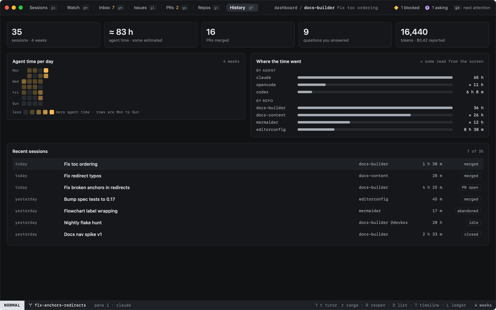
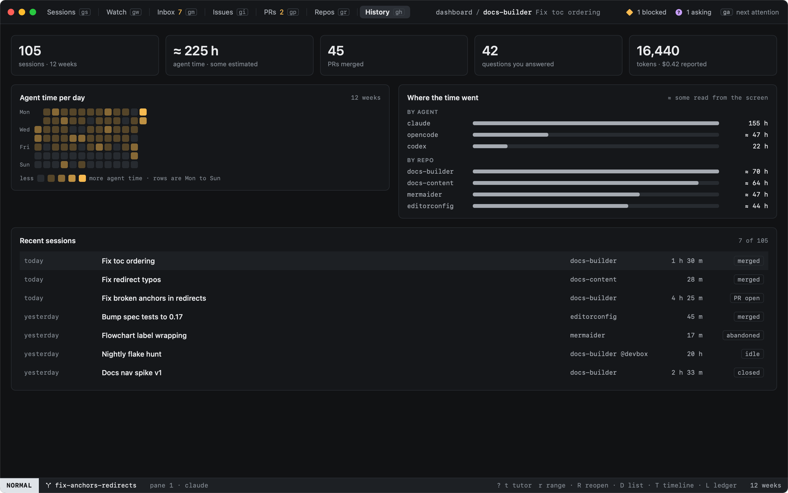

# Dashboard

`D` in History (or `:dashboard`, `history.dashboard`) sums up the last four weeks. `r` steps the range to twelve weeks,
then a week (`:dashboard.range 14` or `2w` for any other); `D` again goes back to History's list.

| | From |
|---|---|
| Sessions | Sessions started in the range |
| Agent time | The time agents spent **working**, from the states their hooks reported. Where some was read from the screen (an agent whose hooks do not report every state), it is marked `≈` |
| PRs merged | PRs heed saw merge |
| Questions you answered | Times an agent was asking and you answered |
| Tokens and cost | What the agents of the range's sessions reported; a cost only where an agent reported one |

**Agent time per day** is a heatmap, a column per week and Monday at the top: one colour, darker is more, and each day
says its date and time when you point at it. **Where the time went** splits it by agent and by repo. **Recent sessions**
lists the newest sessions with their time and how they went, in words (merged, PR open, parked, closed, abandoned).
`R` reopens one that is in History.

Everything comes from heed's event log on this Mac; nothing is estimated where nothing was recorded. A new install
starts empty and fills as you work.

