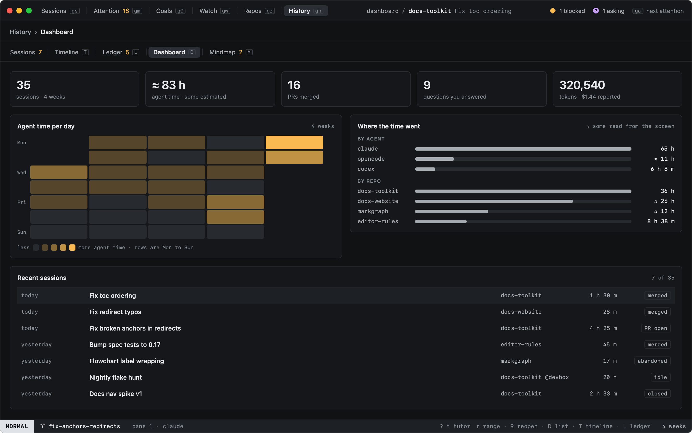
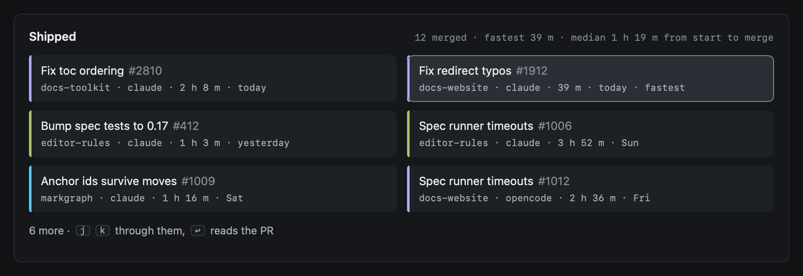
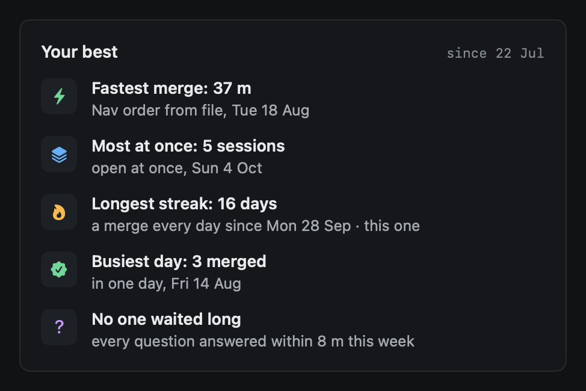
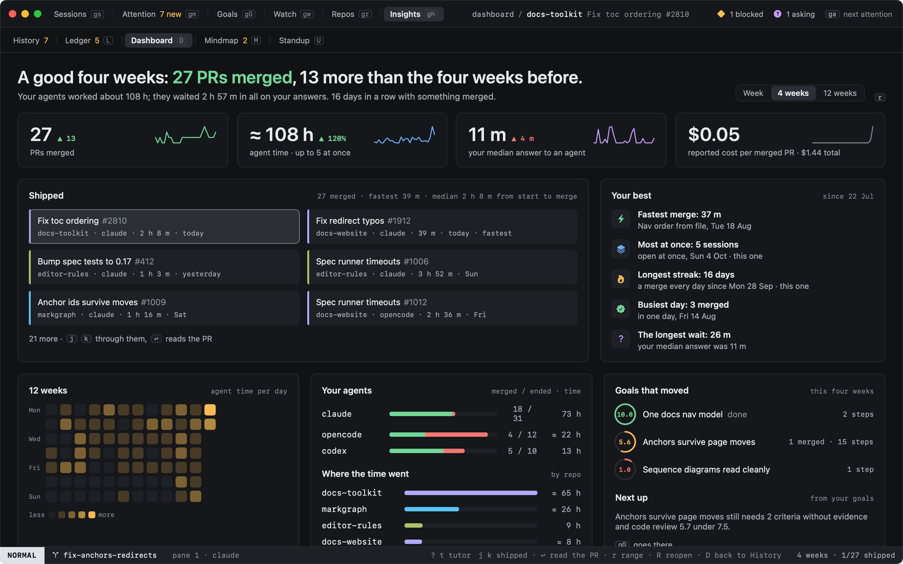

# Dashboard

`gh` opens Insights here (so do `D` in any Insights view, `:dashboard` and `history.dashboard`). It sums up the last
week against the week before; `r` steps the range to four weeks, then twelve, then back (`:dashboard.range 14` or `2w`
for any other). `H` goes to [History](index.md#history).

The sentence at the top says how many PRs merged against the range before, how long your agents worked, how long they
waited on your answers in all, and how many days in a row something merged.

| Tile | From |
|---|---|
| PRs merged | PRs heed saw merge, with the change against the range before and a line of each day |
| Agent time | The time agents spent **working**, from the states their hooks reported (`≈` where some was read from the screen), and the most working at the same moment |
| Your median answer | From an agent asking (`question.asked`) to your answer, the median of the range |
| Reported cost per merged PR | What the agents of the range's sessions reported spending, over the PRs merged. Only where an agent reported a cost; without one, the tile counts the questions you answered |

**Shipped** shows the PRs merged in the range as cards, edged in their repo's colour, with the agent, how long from the
session's start to the merge, and the day; `j` `k` move through them, `↩` reads the PR, `gB` opens it in the browser
and `R` reopens its session when it is in History.

**Your best** keeps what heed's log has seen since it began: the fastest merge, the most sessions open at once, the
longest run of days with a merge, the busiest day; and whether anyone waited long for you this range.

The **12 weeks** calendar is agent time per day, a column per week and Monday at the top, whatever the range: one
colour, stronger is more, and each day says its date and time when you point at it. **Your agents** sets what each
agent's sessions that ended came to (merged, in green, and abandoned, in red, of those that ended) beside its working
time; **Where the time went** splits that time by repo. **Goals that moved** lists the [goals](../goals/index.md) that
had evidence come in or were done in the range, with their score now, and **Next up** says what the goal closest to
done still needs.

Everything comes from heed's event log and goals on this Mac; nothing is estimated where nothing was recorded. A new
install starts empty and fills as you work.

