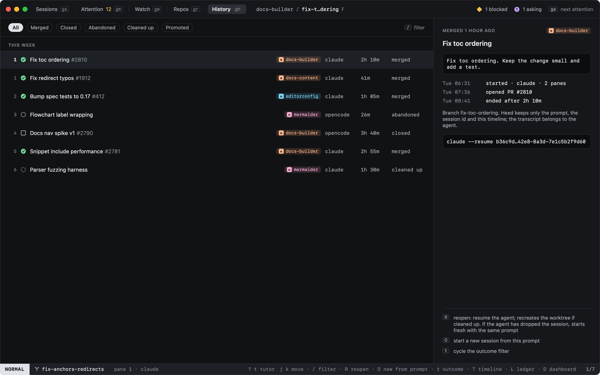

# History

`gh` lists sessions that ended, grouped by day, with their outcome.

| Outcome | |
|---|---|
| merged | Its pull request was merged |
| closed | Closed by you, with a pull request |
| abandoned | Closed without one |
| cleaned up | Its worktree was removed by cleanup |
| promoted | A [chat](../sessions/chats.md) that became work (`:promote`) |

`t` cycles the outcome filter and `/` searches titles, prompts and branches. The detail shows the prompt, the
timeline (started, PR opened, ended) and the agent's resume command.

Heed keeps the prompt, the agent's session id, the timeline and the agent's last message, plus what its event log
recorded and the [ledger](ledger.md)'s summary; the transcript belongs to the agent.

`T` shows the same history as a [timeline](timeline.md): sessions, worktrees, PRs and questions, by day. `L` shows the
[ledger](ledger.md): a short summary of each piece of work, kept after its worktree is gone. `D` shows the
[dashboard](dashboard.md): sessions, agent time and PRs over a range.

See [Reopening](reopening.md) to pick a session up again.
