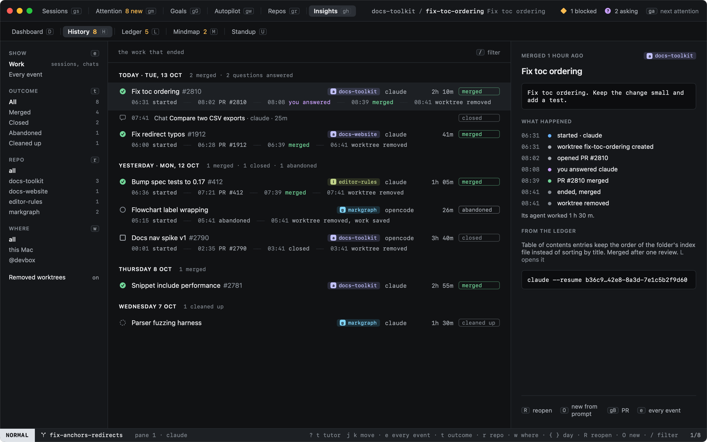
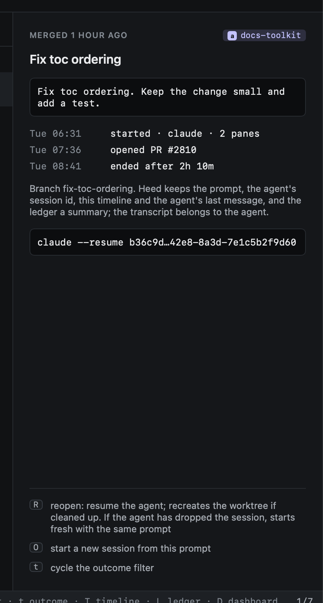
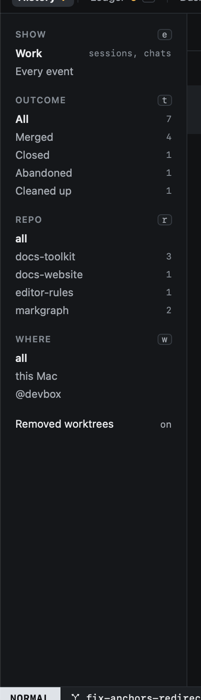
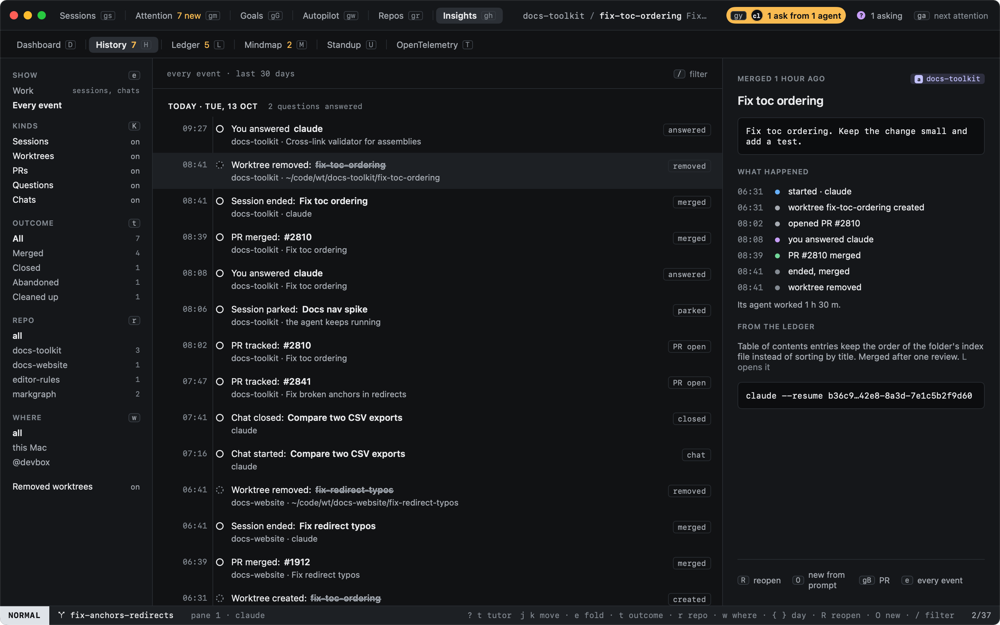
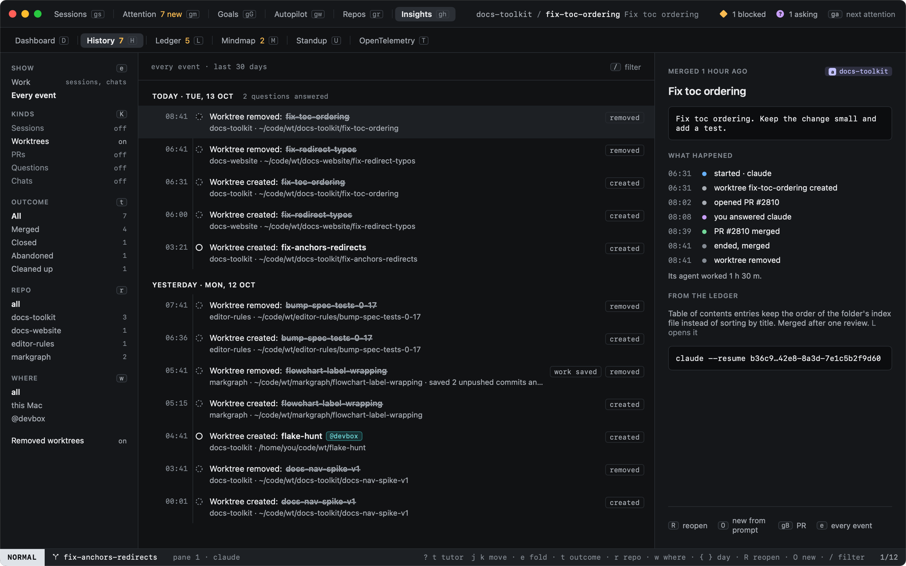
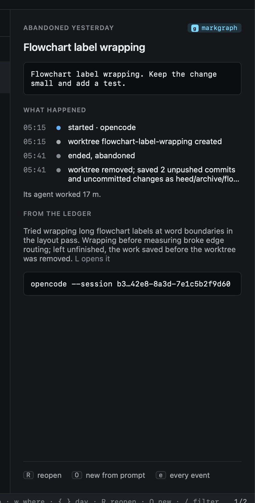

# Insights

`gh` opens Insights on its [dashboard](dashboard.md): what shipped this week, agent time set against the week before,
your bests and the goals that moved. A strip of tabs under the title bar names every Insights view with its key and how
much is in each: Dashboard `D`, History `H`, Ledger `L`, Mindmap `M`, Standup `U` and OpenTelemetry `T`. The same keys
work in every one of them; a view's own key again comes back to the dashboard, and a click on a tab opens it.

| View | |
|---|---|
| [Dashboard](dashboard.md) | Where `gh` opens: the range in numbers, what shipped, bests, agent time, goals |
| History | The work that ended, by day, each with its story (below) |
| [Ledger](ledger.md) | A short summary of each piece of work, kept after its worktree is gone |
| [Mindmap](mindmap.md) | The work grouped into campaigns, one Mindmap per org |
| [Standup](standup.md) | Your own questions answered from each Mindmap, on the days you choose |
| [OpenTelemetry](opentelemetry.md) | The agents' own spans: latency by tool, waits for your OK, cost by model, and each session's trace |

## History

`H` (or `:history`, `history.list`) shows History: the sessions and chats that ended, grouped by day,
newest first, each day's header saying what it came to (`2 merged · 1 abandoned · 2 questions answered`).

A row is a piece of work: how it ended, its title and PR, repo, agent, how long it was open and its outcome in words.
The line under it is its story, from heed's event log: started, PR opened, you answered, merged, worktree removed,
each with its time. A chat that ended is a quiet line of its own, and so is anything that belongs to no session (a
worktree made by hand). Events of a session that is still open stay in Sessions until it ends.

| Outcome | |
|---|---|
| merged | Its pull request was merged |
| closed | Closed by you, with a pull request |
| abandoned | Closed without one |
| cleaned up | Its worktree was removed by cleanup |
| promoted | A [chat](../sessions/chats.md) that became work (`:promote`) |

The detail on the right tells the work under the cursor in full: its prompt, what happened as a timeline, how long
its agent worked (from the states its hooks reported; `about` when some were read from the screen), the
[ledger](ledger.md)'s summary when there is one, and the agent's resume command. Heed keeps the prompt, the agent's
session id, the story and the agent's last message; the transcript belongs to the agent.

### Filters

The column on the left narrows the list, and a click on any of it does what its key does.

| Key | |
|---|---|
| `e` | Every event as its own line, or folded into its work again |
| `t` | Every outcome, then each one alone |
| `r` | Every repo, then each one |
| `w` | Everywhere, then this Mac, then each host |
| `K` | Every kind, then each one alone: sessions, worktrees, PRs, questions, chats |
| `c` | Show or hide removed worktrees |
| `{` `}` | The previous and next day |
| `/` | Search titles, prompts, branches and lines |

Each takes a name on the command line too: `:history.outcome merged`, `:timeline.kind worktrees`,
`:timeline.repo docs-toolkit`, `:timeline.where devbox`, `all` to go back.

### Every event

`e` unfolds every event of the last 30 days as its own line, on one vertical rule per day: what the timeline was
(`:timeline` and `history.timeline` open History this way). `e` again folds them back into their work.

| Line | When |
|---|---|
| Session started, ended, parked, reopened | A session's life; ended says how (merged, closed, abandoned, cleaned up) |
| Worktree created, removed | A worktree appeared or went, here or on a host |
| PR tracked, merged | A session started following a PR, and the PR merged |
| You answered | A question an agent asked was answered |
| Chat started, closed | A [chat](../sessions/chats.md)'s life |

A solid ring is something that still exists. A **dashed ring** and a **struck-through name** mark a worktree that no
longer does. When heed [saved its work](../worktrees/removing.md#saved-first) before removing it, the line says so
("work saved") and the detail names the ref.

`R` (or `↩`) reopens the work under the cursor, or the session of the event under it, as [Reopening](reopening.md)
describes; `O` starts a new session from its prompt. Right-click a line for the same.
