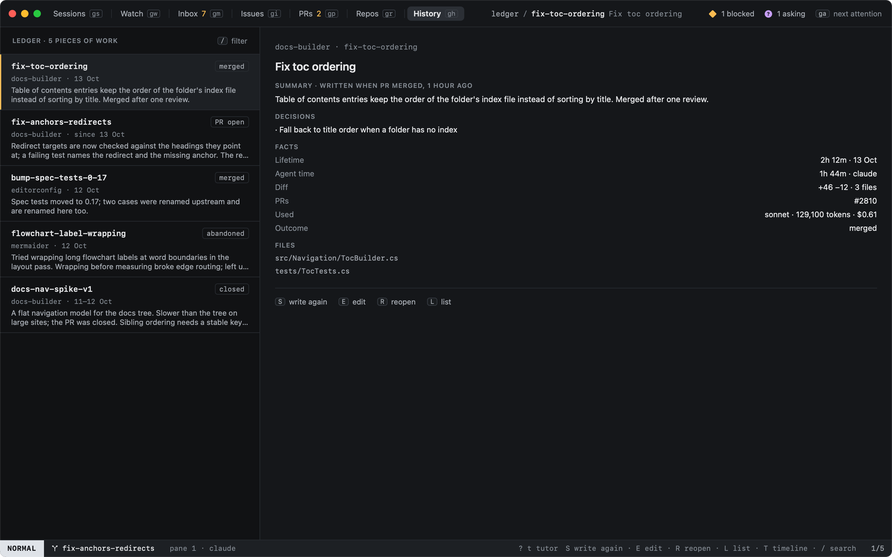
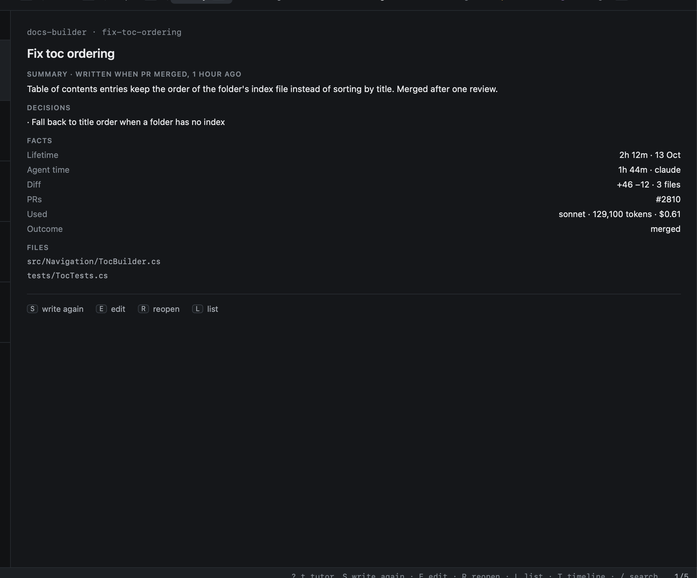

# Ledger

`L` in History (or `:ledger`, `history.ledger`) shows the ledger: one entry per session or chat, newest first, with a
short summary of what the work did and where it stands. It stays after the worktree is removed. `L` again goes back to
History's list.



## What an entry holds

| Part | From |
|---|---|
| Summary, decisions, follow-ups | A cheap model, through heed's [model calls](../agents/model-calls.md) |
| Diff and files | git, in the worktree, or its branch, or the work [saved when it was removed](../worktrees/removing.md#saved-first) |
| Lifetime, PRs, outcome | The session |
| Agent time | The states the agent's hooks reported (`≈` when some were read from the screen) |
| Model, tokens, cost | What the agent reported for the session |

The model reads the work's commits and diff against its base branch, its pull request (description, reviews, review
threads), heed's timeline of the session, and the agent's last message. Your `summary_instructions` (Settings › Pilot,
or per org and repo) are added to heed's prompt. Summaries and the ledger stay in `heed.sqlite` on this Mac.

## When it is written

```toml
[summary]
when = ["pr_opened", "pr_merged", "worktree_removed", "idle"]
idle_hours = 24
include = ["summary", "decisions", "follow_ups", "files"]
```

| `when` | |
|---|---|
| `pr_opened` | The session starts tracking a PR |
| `pr_merged` | One of its PRs merges |
| `worktree_removed` | Before its worktree is removed: the removal waits for the summary, 30 seconds at most |
| `idle` | Nothing happened in the session for `idle_hours`, and nothing was written since |
| `chat_closed` | A chat closes (off by default) |

Settings › General › History ledger has the same switches. With model calls off (`[llm] enabled = false`) nothing is
written; the daily caps of `[llm]` apply.

| Key | |
|---|---|
| `S` | Write the summary again now (`ledger.summarize`) |
| `E` | Edit it: the command line opens with the summary typed (`ledger.edit`) |
| `R` | Reopen the session, when it is in History |
| `/` | Search titles, summaries, decisions and follow-ups |

An edited summary says so, and stays until you write it again.


