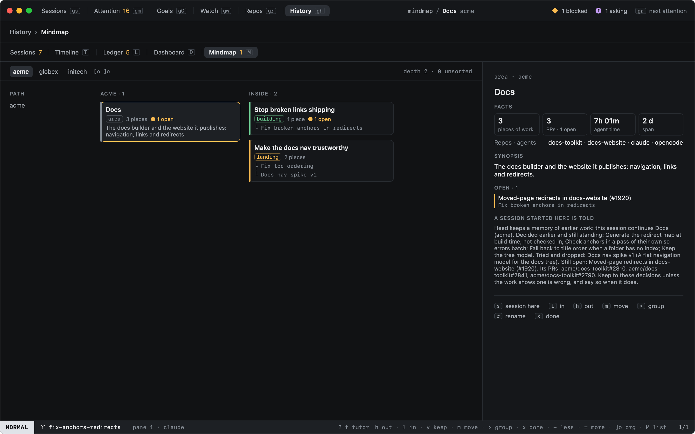

# Mindmap

`M` in History (or `:mindmap`, `history.mindmap`) shows the Mindmap: the work heed's [ledger](ledger.md) wrote up,
grouped the way you would tell it at a standup. Areas hold campaigns (what a run of work was for), campaigns hold
the pieces of work, and you can group further yourself. `M` again goes back to History's list.



## One Mindmap per org

Every GitHub org has its own Mindmap, and so does your personal work: repos under your own login, repos with no
GitHub remote, and chats with no repo. Nothing crosses from one to another: not the grouping, not the synopses,
not search. A fork goes with the org it was forked from (its `upstream` remote), and a chat in a folder that is a git
repo goes with that repo's org. `[o` and `]o` switch between them; each lives in its own file under
`~/Library/Application Support/Heed/mindmap/`.

## Every node reads the same

| Part | From |
|---|---|
| Facts | Counted from the ledger each time: pieces of work, PRs, agent time, the span, repos and agents, the file touched most |
| Synopsis | A piece of work's ledger summary; above it, written from the synopses of what it holds |
| Decisions | The ledger's decisions, with the work they came from. One rises to the node above when two of its children take it, or you pin it (`p`). One that later work went against is struck through |
| Open | Follow-ups nobody did yet. Later work that does one closes it; `x` marks it done |

## How work gets placed

When the ledger writes an entry, heed places the work. Clear cases are settled by the words and files alone. The
rest is one question, sized so [Hunch](../configuration/local-learning.md) answers it on this Mac: which of the four
closest campaigns this work continues, or something new. Work that fits none waits in Unsorted until a cheap model
names a campaign for it ([model calls](../agents/model-calls.md), six times a day per Mindmap at most).

While `[mindmap] shadow` is on (the default), every placement waits for you: `y` keeps it, `m` moves it. What you do
is what Hunch learns from, and Settings › Inference & decisions shows how often heed had it right.

```toml
[mindmap]
enabled = true
shadow = true
```

## What sessions are told

`s` on a node starts a session in the repo of its newest work: type the prompt, and the agent is told at launch
what was decided there and still stands, what was tried and dropped, what is still open, and its PRs. The detail
pane shows that text under "A session started here is told". A session on a [goal](../goals/index.md) is told the
same about the campaign most of the goal's work sits in. It comes from that org's Mindmap only.

claude gets it with `--append-system-prompt`, codex as `developer_instructions`; other agents are not told.

```toml
[memory]
brief = "node_and_goal"   # or "off"
```

## Keys

| Key | |
|---|---|
| `j` `k` | The next or previous node beside this one |
| `h` `l` | Out to what holds it, in to what it holds |
| `-` `=` | Draw one level less or more to the right |
| `[o` `]o` | The previous or next org's Mindmap |
| `y` | Keep a suggested placement |
| `m` | Move it into a campaign or group, by title (`:mindmap.move top` to the top) |
| `>` `<` | Group it with the next one; lift it out |
| `r` | Rename |
| `J` | Join it into another, by title |
| `x` | Its first open follow-up done |
| `p` | Pin its first decision |
| `S` | Name campaigns for Unsorted work now |
| `s` | Start a session here, told what was decided and what is open |
| `↩` | A piece of work's ledger entry |

What you moved, grouped or renamed stays when heed places work again.
