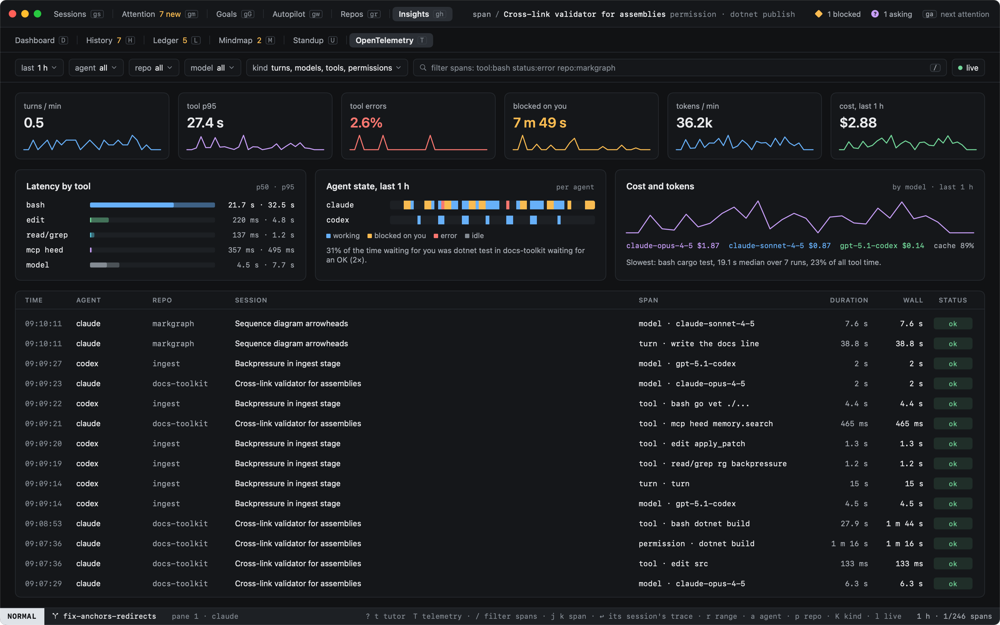
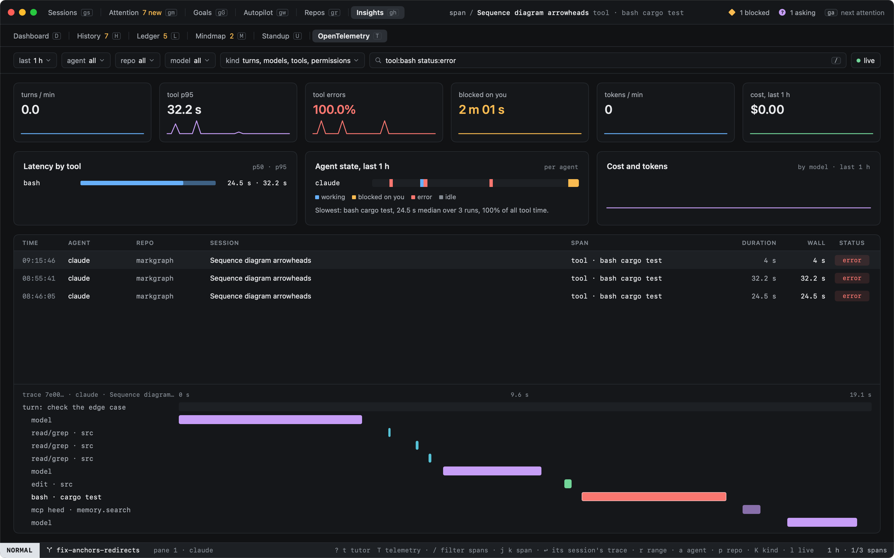
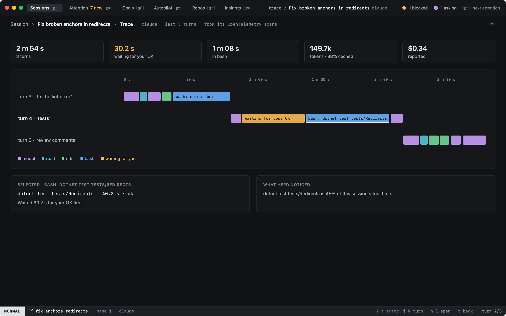

# OpenTelemetry

Claude Code and Codex can export their own OpenTelemetry: a span for each turn, model request and tool call, events
for what they cost, metrics for tokens. heed listens for it on this Mac and shows it. `T` in Insights (or
`:telemetry`, `:otel`, `history.telemetry`) opens it as an observability view, and `t` on a session (or `:trace`)
shows that session's own trace.

Nothing leaves this Mac. The receiver listens on `127.0.0.1` only, and heed sends nothing anywhere: what the agents
send stays in `telemetry.sqlite`, beside heed's other files, for a week.



## How the agents get there

Every session heed starts with claude or codex is told to export to heed, unless you already send that agent's
telemetry somewhere yourself.

| Agent | What heed adds to its command line |
|---|---|
| claude | `CLAUDE_CODE_ENABLE_TELEMETRY=1`, OTLP exporters for metrics, logs and traces (`CLAUDE_CODE_ENHANCED_TELEMETRY_BETA=1`), `OTEL_EXPORTER_OTLP_PROTOCOL=http/json`, `OTEL_EXPORTER_OTLP_ENDPOINT=http://127.0.0.1:4318`, shorter export intervals so the view is live, and `OTEL_LOG_TOOL_DETAILS=1` so a span says which command or file |
| codex | `-c otel.exporter=…`, `-c otel.trace_exporter=…` and `-c otel.metrics_exporter=…`, each `otlp-http` to `127.0.0.1` with `protocol = "json"`, for this run only |

The variables are set on the agent's own command, so the pane's shell never has them. heed leaves an agent alone when
any of these is set:

| Agent | Left alone when |
|---|---|
| claude | `OTEL_EXPORTER_OTLP_ENDPOINT` (or a per-signal endpoint), `OTEL_METRICS_EXPORTER`, `OTEL_LOGS_EXPORTER`, `OTEL_TRACES_EXPORTER` or `CLAUDE_CODE_ENABLE_TELEMETRY` is set in your login shell, in heed's own environment, or in the `env` of `~/.claude/settings.json` |
| codex | `~/.codex/config.toml` (or `$CODEX_HOME/config.toml`) sets `exporter`, `trace_exporter` or `metrics_exporter` under `[otel]` |

Settings › History › OpenTelemetry says, per agent, which it is, and the pill at the end of Insights' tabs says
whether the receiver is listening and how many agents sent anything in the last ten minutes. heed reads your shell
for those variables only (`env | grep -E '^(OTEL_|CLAUDE_CODE_ENABLE_TELEMETRY)'`), once when the receiver starts.

Other agents (opencode, gemini, pi, cursor) are not pointed at heed; if you set one up yourself to send OTLP/HTTP
JSON to `127.0.0.1:4318`, heed reads it too, as spans named by the agent's `service.name`.

A session started before heed listened, or while the receiver was off, sends nothing until it is reopened. On a
[host](../hosts/index.md), agents are not pointed at heed: `127.0.0.1` there is the host, not this Mac.

## The view

| Part | |
|---|---|
| Filter bar | The range (`r`: 15 m, 1 h, 6 h, 24 h, 7 d), agent (`a`), repo (`p`), model (`m`), kind (`K`), the span query (`/`) and live (`l`) |
| Numbers | Turns a minute, tool p95, the share of tool calls that failed, time blocked on you, tokens a minute, and the cost the agents reported for the range, each with its line across it |
| Latency by tool | p50 and p95 per tool group (bash, edit, read/grep, mcp and its server, web, agent), the most time first, the model's requests last |
| Agent state | Each agent across the range: working, blocked on you, an error, idle |
| Cost and tokens | The reported cost across the range, each model's share, and how much input was read from the prompt cache |
| Spans | Newest first: time, agent, repo, session, span, its duration, wall time (with the wait for your OK before a run) and status. A wait heed sees from the hooks that no span has reported yet is on top, `waiting` |
| Trace | The selected span's trace under the table: every span of its turn along the turn's time |

`j` `k` move through the spans and `↩` opens the span's session's trace on its turn. A line under the agents' states
says what stood out: where the time waiting for you went, and the command that took the most tool time.

The kind filter starts on turns, tools, waits for your OK and model requests; `K` steps on to every kind, then one
kind at a time.

### The span query

`/` types a query into the bar. Words match what the span was (its command, file or model), its session's title and
repo; `key:value` terms narrow by one field.

| Term | Keeps |
|---|---|
| `tool:bash` | Tool calls of that group |
| `status:error` | `ok`, `error` or `waiting` |
| `repo:markgraph` | Spans of sessions in a repo whose name holds it |
| `agent:codex`, `model:opus`, `kind:permission`, `session:anchors` | By agent, model, kind and session title |
| `over:30s` | Spans that took at least that long (`500ms`, `2m`) |



## A session's trace

`t` on a session in Sessions (or `:trace`, `:trace <title>`, or `↩` on a span) shows its last three turns from its
agent's own spans, each a line of what it did in order: the model, reads, edits, bash and the waits for your OK. The
time between turns, when nothing ran, takes no room. `j` `k` move through the turns, `h` `l` through a turn's spans,
and `t` or `⎋` goes back.



Above the turns: how long they took, the time spent waiting for your OK, the time in bash, the tokens and how many were
cached, and the cost the agent reported. Under them, the selected span in full (a run you approved says how long it
waited for you first), and what heed noticed: the command that took most of the session's tool time, set against its
runs in the repo's other sessions.

## Where it changes what heed shows

A session's cost in the [inspector](../sessions/inspector.md) is what its agent's OpenTelemetry
reported, when it reported one; else what its hooks reported, else the estimate from `[usage.prices]`, as before.

## How spans are read

| From | heed reads |
|---|---|
| Claude Code's traces | `claude_code.interaction` as a turn, `claude_code.llm_request` as a model request, `claude_code.tool` as a tool call, its `claude_code.tool.blocked_on_user` as a wait for your OK and its `claude_code.tool.execution` as the run |
| Claude Code's events | `api_request` for each request's cost and tokens, `tool_result` for a tool call when no trace was sent, `user_prompt` to start a turn |
| Codex's events | `codex.tool_result` as a tool call, `codex.sse_event` (`response.completed`) and `codex.api_request` as model requests, `codex.user_prompt` to start a turn |
| Metrics | `claude_code.cost.usage`, `claude_code.token.usage` and Codex's turn usage, only for sessions whose requests carried no cost |

A span and an event about the same request or tool call count once. A span is tied to its heed session by the
agent's own session id (`session.id`, `conversation.id`), which heed knows from the agent's hooks.

The receiver takes OTLP/HTTP with JSON bodies (`http/json`), gzipped or not, at `/v1/traces`, `/v1/logs` and
`/v1/metrics`. Protobuf (`http/protobuf`) and gRPC are refused, with a 415 that says so.

## Configuration

```toml
[telemetry]
enabled = true       # false: no receiver, and the agents are not pointed at heed
port = 4318          # on 127.0.0.1; a port another collector holds leaves the receiver off
days = 7             # kept this long
max_rows = 200000    # spans kept at most, newest first
tool_details = true  # ask Claude Code for each tool's command or file
prompts = false      # ask the agents to include your prompts' text, so a turn reads by what you asked
```

Every key is in the [configuration reference](../configuration/reference.md).
