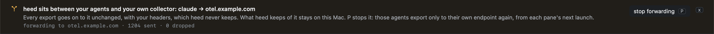

# OpenTelemetry

Claude Code and Codex can export their own OpenTelemetry: a span for each turn, model request and tool call, events
for what they cost, metrics for tokens. heed listens for it on this Mac and shows it. `T` in Insights (or
`:telemetry`, `:otel`, `history.telemetry`) opens it as an observability view, and `t` on a session (or `:trace`)
shows that session's own trace.

The receiver listens on `127.0.0.1` only, and what heed keeps of the agents' telemetry stays in `telemetry.sqlite`,
beside heed's other files, for a week. heed sends none of it anywhere of its own; the one thing that leaves this Mac
is an export an agent already sent to a collector of yours, which heed passes on there ([below](#when-you-already-export)).


## How the agents get there

Every session heed starts with claude or codex is told to export to heed.

| Agent | What heed adds to its command line |
|---|---|
| claude | `CLAUDE_CODE_ENABLE_TELEMETRY=1`, OTLP exporters for metrics, logs and traces (`CLAUDE_CODE_ENHANCED_TELEMETRY_BETA=1`), each signal's endpoint at `http://127.0.0.1:4318` with `http/json`, shorter export intervals so the view is live, and `OTEL_LOG_TOOL_DETAILS=1` so a span says which command or file |
| codex | `-c otel.exporter=…`, `-c otel.trace_exporter=…` and `-c otel.metrics_exporter=…`, each `otlp-http` to `127.0.0.1` with `protocol = "json"`, for this run only |

The variables are set on the agent's own command, so the pane's shell never has them. Settings › History ›
OpenTelemetry says, per agent, what heed does: "exporting to heed", "forwarding to <host> through heed", or "your own
setup, heed not involved", with why. The pill at the end of Insights' tabs says whether the receiver is listening and
how many agents sent anything in the last ten minutes.

If the receiver cannot listen (another collector holds the port, `[telemetry] enabled = false`), panes start exactly
as they would without heed. Other agents (opencode, gemini, pi, cursor) are not pointed at heed; one you set up to
send OTLP/HTTP to `127.0.0.1:4318` is read too, by its `service.name`. A session started before heed listened sends
nothing until it is reopened. On a [host](../hosts/index.md), agents are not pointed at heed: `127.0.0.1` there is the
host, not this Mac.

## When you already export

An agent you already send telemetry from is pointed at heed too (`[telemetry] proxy = true`, the default), and heed
forwards every export to where it went before: the same bytes, path aside, with the same content type and encoding,
and with your headers. Each signal goes to its own endpoint, as yours did; a signal you did not export goes to heed
alone. Your intervals, what your exports include, and your headers stay as you set them: heed changes only where the
agent sends, and keeps your protocol (`http/protobuf` or `http/json`) so your collector gets what it expects.

| Agent | Forwarded when |
|---|---|
| claude | `CLAUDE_CODE_ENABLE_TELEMETRY=1` with an `otlp` exporter for a signal (traces with the enhanced beta), over HTTP, set in your login shell or heed's environment. Its endpoint: the signal's own `OTEL_EXPORTER_OTLP_<SIGNAL>_ENDPOINT`, else `OTEL_EXPORTER_OTLP_ENDPOINT` with `/v1/<signal>` |
| codex | An `otlp-http` exporter under `[otel]` in `~/.codex/config.toml` (or `$CODEX_HOME`): heed overrides only its `endpoint` for the run, so your `protocol` and `headers` there still apply |

heed leaves an agent alone, "your own setup, heed not involved", when it exports over gRPC (a `grpc` protocol, an
endpoint on port 4317, Codex's `otlp-grpc`), when Claude Code's telemetry is set in the `env` of
`~/.claude/settings.json` (Claude Code applies that itself), and for every agent you set up when `proxy = false`.

Your headers carry your credentials. The agent sends them with each export, as it always did; heed passes them on and
never writes them anywhere: not to disk, not to the call log, not to Settings, which shows the collector's host only.
It reads your shell for the telemetry variables only, headers filtered out before it sees a line
(`env | grep -E '^(OTEL_|CLAUDE_CODE_ENABLE_TELEMETRY|…)' | grep -v '_HEADERS='`), once when the receiver starts.

heed answers the agent at once and passes the export on in the background, one at a time and in order. While your
collector is down (no answer, 408, 429, 5xx) heed holds what arrives, up to 512 exports or 32 MB, and tries again with
backoff from one second to a minute; when that is full the oldest goes. A collector's other refusals (a 4xx) are not
retried. Settings counts each: `forwarding to otel.example.com · 1204 sent · 0 dropped`. What is held is held in
memory, so exports still waiting when heed quits are lost.

While heed forwards anything, the OpenTelemetry tab says so in a banner: which agent goes to which host, that what
heed keeps stays on this Mac, and that `P` stops it. `P` writes `[telemetry] proxy = false`: from each pane's next
launch, those agents export only to their own endpoint again; panes already running keep forwarding through heed
until then. `x` puts the banner away until heed starts again.



## The view

| Part | |
|---|---|
| Filter bar | The range (`r`: 15 m, 1 h, 6 h, 24 h, 7 d), agent (`a`), repo (`p`), model (`m`), kind (`K`), the span query (`/`) and live (`l`) |
| Numbers | Turns a minute, tool p95, the share of tool calls that failed, time blocked on you, tokens a minute, and the cost the agents reported for the range, each with its line across it |
| Latency by tool | p50 and p95 per tool group (bash, edit, read/grep, mcp and its server, web, agent), the most time first, the model's requests last |
| Agent state | Each agent across the range: working, blocked on you, an error, idle |
| Cost and tokens | The reported cost across the range, each model's share, and how much input was read from the prompt cache |
| Spans | Newest first: time, agent, repo, session, span, its duration, wall time (with the wait for your OK before a run) and status. A wait heed sees from the hooks that no span has reported yet is on top, `waiting` |
| Trace | The selected span's trace under the table: every span of its turn along the turn's time |

`j` `k` move through the spans and `↩` opens the span's session's trace on its turn. A line under the agents' states
says what stood out: where the time waiting for you went, and the command that took the most tool time.

The kind filter starts on turns, tools, waits for your OK and model requests; `K` steps on to every kind, then one
kind at a time.

### The span query

`/` types a query into the bar. Words match what the span was (its command, file or model), its session's title and
repo; `key:value` terms narrow by one field.

| Term | Keeps |
|---|---|
| `tool:bash` | Tool calls of that group |
| `status:error` | `ok`, `error` or `waiting` |
| `repo:markgraph` | Spans of sessions in a repo whose name holds it |
| `agent:codex`, `model:opus`, `kind:permission`, `session:anchors` | By agent, model, kind and session title |
| `over:30s` | Spans that took at least that long (`500ms`, `2m`) |


## A session's trace

`t` on a session in Sessions (or `:trace`, `:trace <title>`, or `↩` on a span) shows its last three turns from its
agent's own spans, each a line of what it did in order: the model, reads, edits, bash and the waits for your OK. The
time between turns, when nothing ran, takes no room. `j` `k` move through the turns, `h` `l` through a turn's spans,
and `t` or `⎋` goes back.


Above the turns: how long they took, the time spent waiting for your OK, the time in bash, the tokens and how many were
cached, and the cost the agent reported. Under them, the selected span in full (a run you approved says how long it
waited for you first), and what heed noticed: the command that took most of the session's tool time, set against its
runs in the repo's other sessions.

## Where it changes what heed shows

A session's cost in the [inspector](../sessions/inspector.md) is what its agent's OpenTelemetry
reported, when it reported one; else what its hooks reported, else the estimate from `[usage.prices]`, as before.

## How spans are read

| From | heed reads |
|---|---|
| Claude Code's traces | `claude_code.interaction` as a turn, `claude_code.llm_request` as a model request, `claude_code.tool` as a tool call, its `claude_code.tool.blocked_on_user` as a wait for your OK and its `claude_code.tool.execution` as the run |
| Claude Code's events | `api_request` for each request's cost and tokens, `tool_result` for a tool call when no trace was sent, `user_prompt` to start a turn |
| Codex's events | `codex.tool_result` as a tool call, `codex.sse_event` (`response.completed`) and `codex.api_request` as model requests, `codex.user_prompt` to start a turn |
| Metrics | `claude_code.cost.usage`, `claude_code.token.usage` and Codex's turn usage, only for sessions whose requests carried no cost |

A span and an event about the same request or tool call count once. A span is tied to its heed session by the
agent's own session id (`session.id`, `conversation.id`), which heed knows from the agent's hooks.

The receiver takes OTLP/HTTP at `/v1/traces`, `/v1/logs` and
`/v1/metrics` (and a forward's `/forward/<agent>/v1/<signal>`), and reads JSON (`http/json`) and protobuf
(`http/protobuf`, Codex's `binary`), gzipped or not. gRPC is not taken.

## Configuration

```toml
[telemetry]
enabled = true       # false: no receiver, and the agents are not pointed at heed
proxy = true         # an agent you already export from goes through heed, forwarded on; false: left alone
port = 4318          # on 127.0.0.1; a port another collector holds leaves the receiver off
days = 7             # kept this long
max_rows = 200000    # spans kept at most, newest first
tool_details = true  # ask Claude Code for each tool's command or file
prompts = false      # ask the agents to include your prompts' text, so a turn reads by what you asked
```

Every key is in the [configuration reference](../configuration/reference.md).
