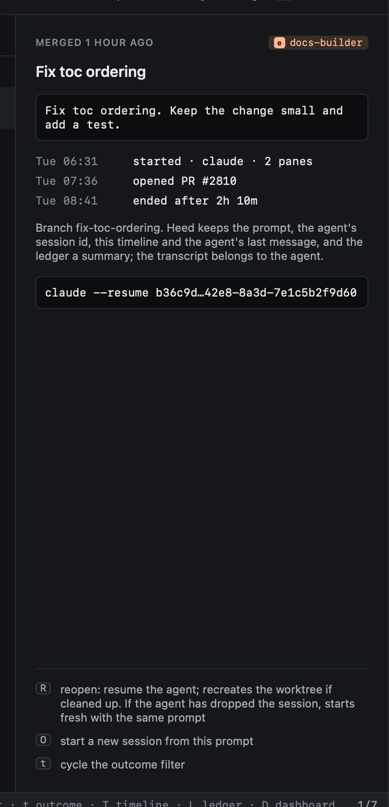

# Reopening

| Key | |
|---|---|
| `R` | Reopen: resume the agent's session, recreating the worktree from its branch if it was removed |
| `O` | Start a new session from this prompt ([Starting again](../start-work/again.md)) |

If the agent no longer has the session, reopening starts it fresh with the same prompt.

## A removed worktree comes back

When the worktree was removed, reopening makes it again where new worktrees go:

1. From the local branch, when it is still there.
2. Otherwise from what was [saved when it was removed](../worktrees/removing.md#saved-first): the branch is made again
   at `heed/archive/<branch>`, and the uncommitted changes saved with it are put back, uncommitted.
3. Otherwise from the branch on `origin`.

The session's timeline says which. A worktree made again runs the repo's [setup](../worktrees/setup.md) before the
agent starts, as a new session's does.

