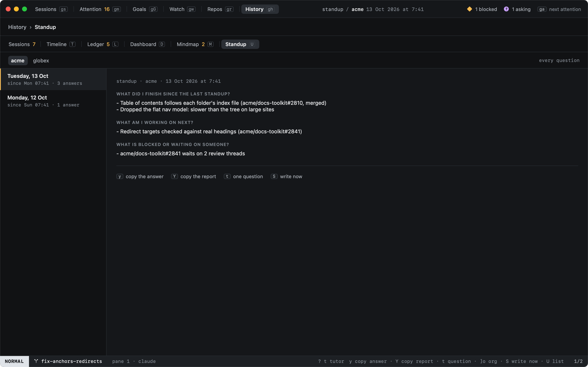

# Standup

`U` in History (or `:standup`, `history.standup`) shows standup reports: your own questions answered from what the
[Mindmap](mindmap.md) and the [ledger](ledger.md) hold. There is one report per Mindmap, so each org gets its own,
and so does your personal work; nothing from one ever shows in another's.



## When reports are written

Off until you turn it on: each report is a cheap [model call](../agents/model-calls.md) per question, for every
Mindmap that had work since the last report.

```toml
[standup]
enabled = true
days = ["mon", "tue", "wed", "thu", "fri"]
at = "08:40"
# range_days = 1        # unset: since the last report
questions = [
  "What did I finish since the last standup?",
  "What am I working on next?",
  "What is blocked or waiting on someone?",
]
```

A report missed while the Mac slept, or heed was quit, is written once, when heed next looks. `S` writes one now for
the org shown.

## Keys

| Key | |
|---|---|
| `j` `k` | The next or previous report |
| `[o` `]o` | The previous or next org's reports |
| `t` | Only one question's answers, the next, or all again |
| `y` | Copy the answer shown (every answer when no question is picked), as markdown; `:standup.copy plain` as plain text |
| `Y` | Copy the whole report |
| `S` | Write a report now |
