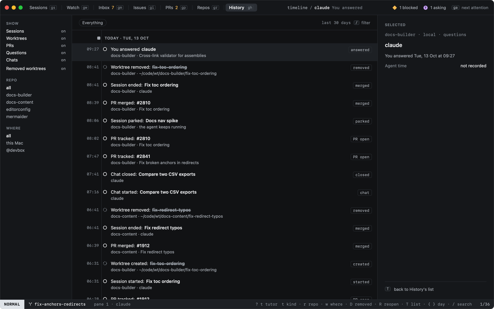
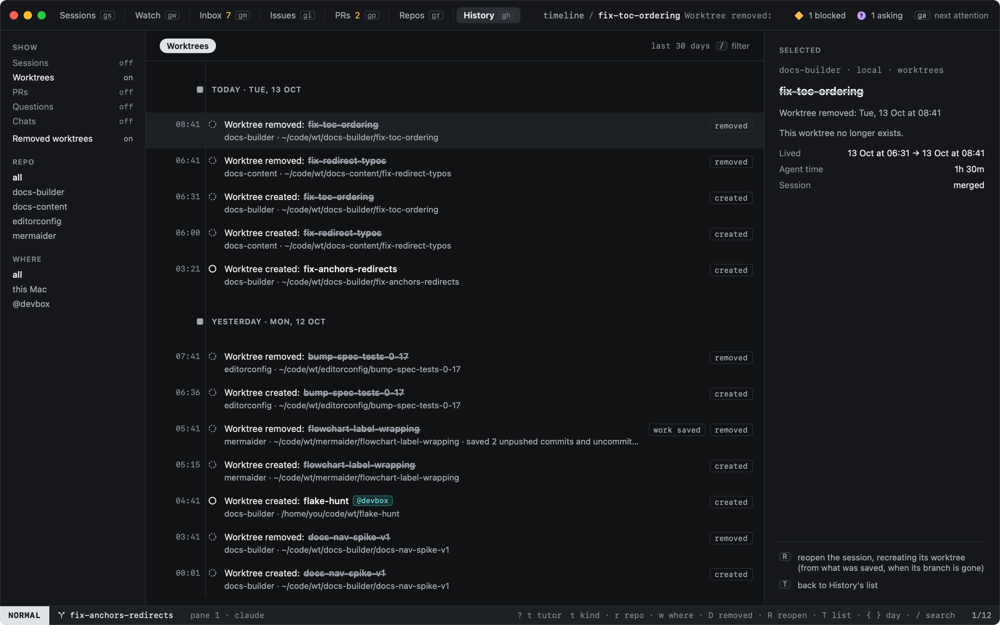
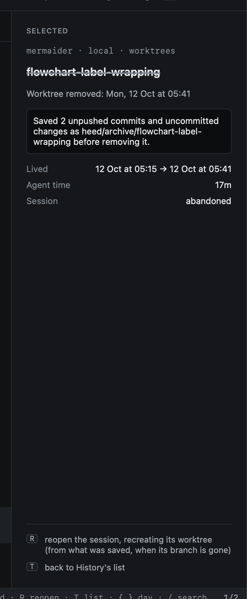

# Timeline

`T` in History (or `:timeline`, `history.timeline`) shows what happened as a timeline: one vertical line, grouped by
day, newest first. `T` again goes back to History's list. It reads heed's event log, so it shows the last 30 days of
what heed saw, and stays live while it is open.

| Line | When |
|---|---|
| Session started, ended, parked, reopened | A session's life; ended says how (merged, closed, abandoned, cleaned up) |
| Worktree created, removed | A worktree appeared or went, here or on a host |
| PR tracked, merged | A session started following a PR, and the PR merged |
| You answered | A question an agent asked was answered |
| Chat started, closed | A [chat](../sessions/chats.md)'s life |

A solid ring is something that still exists. A **dashed ring** and a **struck-through name** mark a worktree that no
longer does. When heed [saved its work](../worktrees/removing.md#saved-first) before removing it, the line says so
("work saved") and the detail names the ref.

## Filters

| Key | |
|---|---|
| `t` | Every kind, then each one alone: sessions, worktrees, PRs, questions, chats |
| `r` | Every repo, then each one |
| `w` | Everywhere, then this Mac, then each host |
| `D` | Show or hide lines about removed worktrees |
| `{` `}` | The previous and next day |
| `/` | Search the lines |

Each takes a name on the command line too: `:timeline.kind worktrees`, `:timeline.repo docs-builder`,
`:timeline.where devbox`, `all` to go back. Clicking a filter in the left column does the same.

## The detail

The line under the cursor, in full: where it happened, how long its worktree lived (from its creation to its removal),
the agent's working time in its session (from the states its hooks reported; marked `≈` when some were read from the
screen), and what was saved. `R` reopens the session when it is in History, recreating its worktree as
[Reopening](reopening.md) describes; right-click a line for the same.

