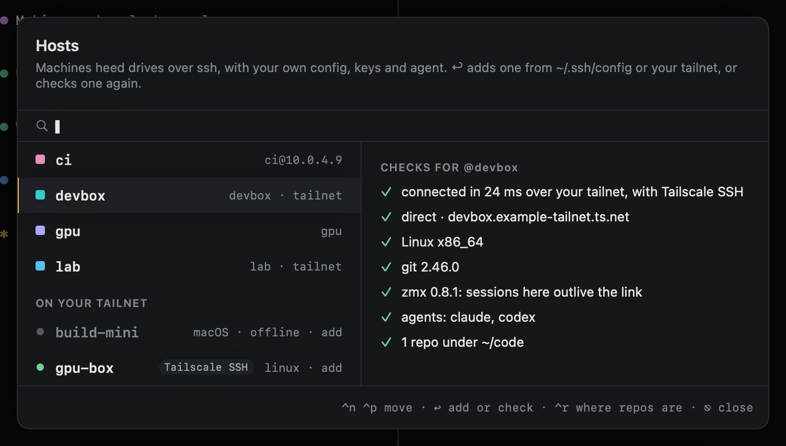
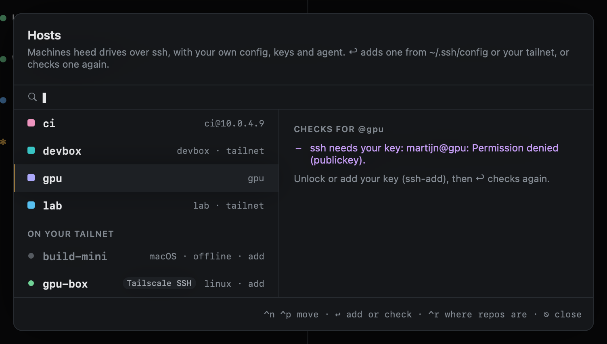
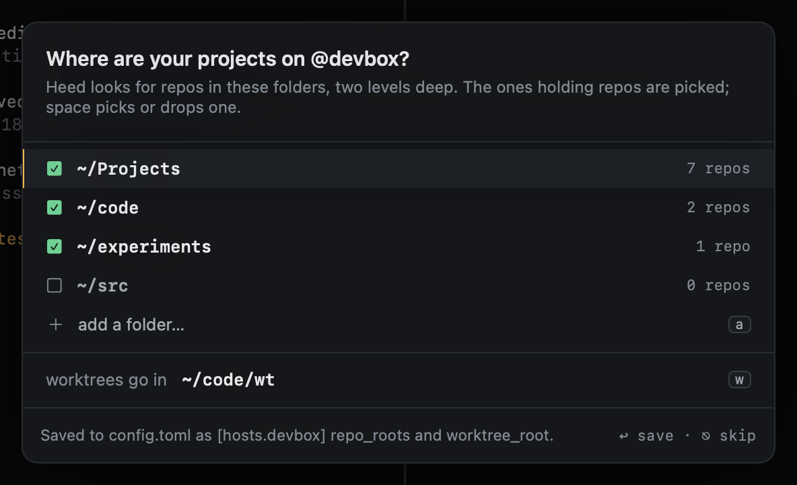
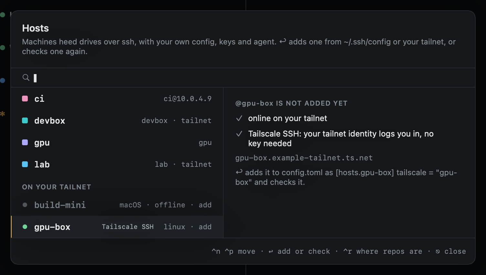
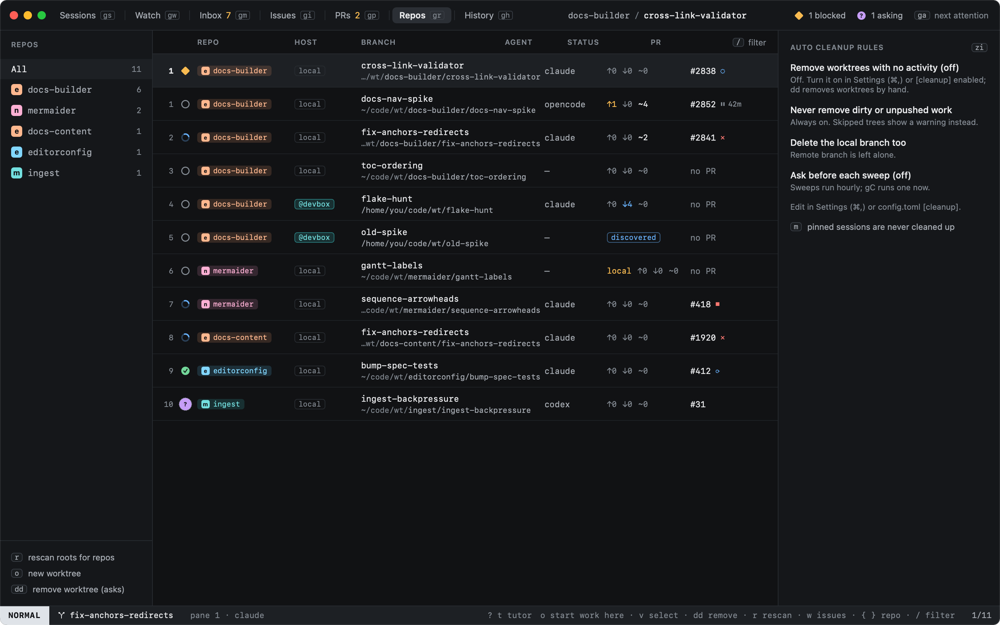
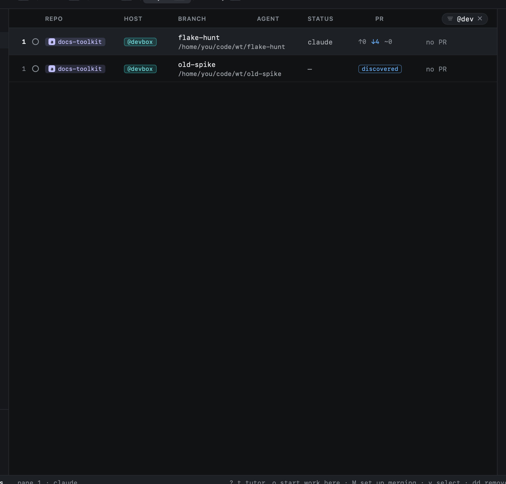
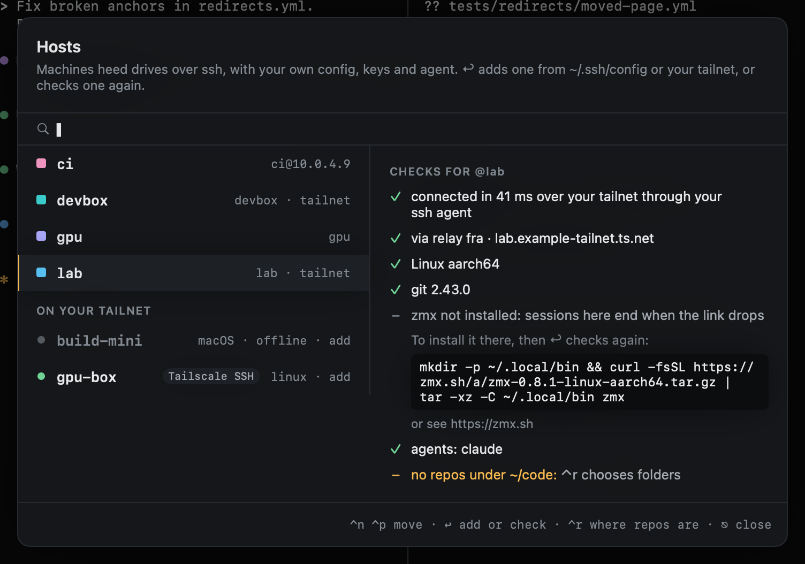
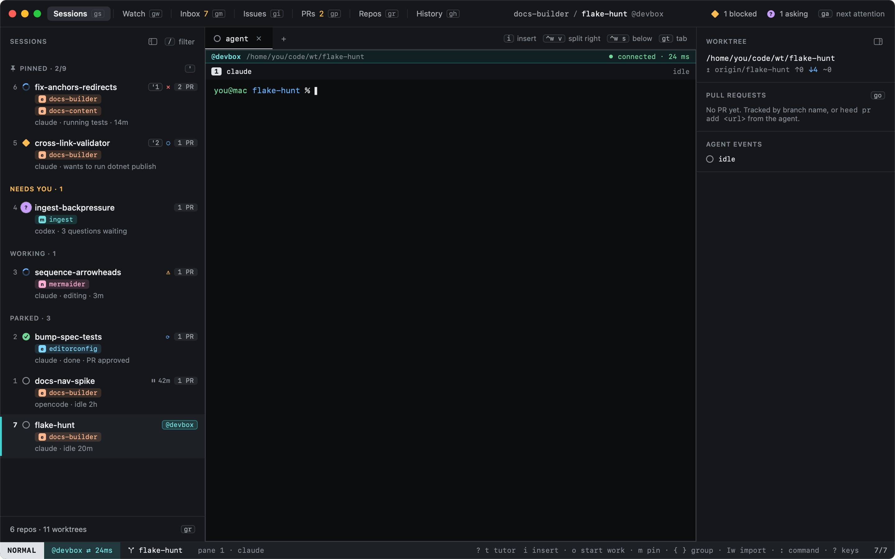
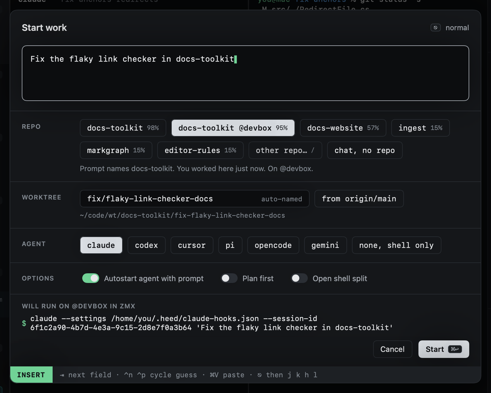

# Hosts

A host is a machine Heed reaches over ssh: a devbox, a GPU box, a build runner. Heed uses your own ssh: your
`~/.ssh/config`, keys, agent and jump hosts, or your [tailnet](#tailscale). It never reads a key, and it shares one
connection per host, so its calls are fast.

Heed finds the repos and worktrees on your hosts and shows them next to the ones on this Mac, and runs sessions there:
the agent runs on the host, in a [zmx](../sessions/zmx.md) session when the host has zmx, so a dropped connection, a
closed lid or a restarted Heed never stops it.

## Adding a host

`gH` opens the hosts: the ones Heed has, and the ones in `~/.ssh/config` or on your [tailnet](#tailscale) it could
add. `↩` on one from your ssh config adds it to `config.toml`; `↩` on one Heed has checks it again. The checks say
how it answers:



| Check | Means |
|---|---|
| connected in 24 ms | It answers, through your ssh agent, without a prompt |
| ssh needs your key | Your key is locked or not loaded: `ssh-add`, then `↩` |
| host key not known yet | Connect once in a terminal to check and accept its key |
| host key changed | The key does not match `known_hosts`: blocked until you find out why |
| offline | It does not answer; what Heed saw of it last stays, marked stale |



### Where its projects are

Heed looks for repos on a host in its `repo_roots`, `~/code` unless you say otherwise. When you add a host, or check
one whose `repo_roots` you have not set, heed asks where your projects are after its first check answers. It looks in
the usual folders under the host's home (`~/Projects`, `~/code`, `~/src`, `~/dev`, `~/repos`, `~/git`, `~/work`,
`~/Developer`, `~/workspace`, `~/go/src`) and in any other folder there that holds a git checkout, and lists the ones it
found with how many repos each holds:



The folders holding repos start picked; `space` picks or drops one, `a` adds one by hand (a folder under `~`), and `w`
changes where heed puts the worktrees it makes there (`~/code/wt` unless config already says). `↩` writes both to
`config.toml` as `[hosts.<name>] repo_roots` and `worktree_root`, and looks for repos again. `⎋` leaves config as it
is; heed does not ask again on its own. `⌃r` in `gH` (or `:host.roots devbox`) asks any time.

A host's checks say where heed looks and how many repos it found there, or that it found none:

| Check | Means |
|---|---|
| 12 repos under ~/Projects | Found by the last scan |
| no repos under ~/code | Nothing there: `⌃r` chooses the folders your projects are in |

A host in `config.toml`:

```toml
[hosts.devbox]
# ssh = "devbox"                 # what ssh connects to; the name by default (an alias from ~/.ssh/config)
repo_roots = ["~/code"]          # where repos are looked for on it, two levels deep (heed asks when unset)
worktree_root = "~/code/wt"      # where Heed will put the worktrees it makes there
color = "teal"                   # teal, periwinkle, pink or sky
```

Amber and green are never host colours: they mean "needs you" and "done".

## Tailscale

When this Mac is on a [Tailscale](https://tailscale.com) tailnet, `gH` lists its machines that are not hosts yet
under **On your tailnet**, each with its system, whether it is online, and a **Tailscale SSH** badge when it runs
Tailscale SSH. `↩` on one adds it as a host:



```toml
[hosts.gpu-box]
tailscale = "gpu-box"            # the machine on your tailnet
# user = "you"                   # who to log in as, when no ssh alias says so
```

A machine running Tailscale SSH needs no key of yours: your tailnet identity logs you in, and heed checks the
machine's host keys against the ones your tailnet publishes, the way `tailscale ssh` does. A machine without it is
reached over the tailnet too, by its MagicDNS name, with your own keys and `known_hosts`. Its key is looked up under the name you
connected with (your ssh alias, or the machine's name), so a key you already accepted still counts.

Heed prefers the tailnet. A host whose ssh alias or name matches a machine on it (its machine name or hostname,
ignoring case) goes over it, so an existing `[hosts.devbox]` starts using the tailnet as soon as `devbox` is on it.
Your alias stays what ssh connects to, pointed at the machine's MagicDNS name, so `~/.ssh/config`'s `User` and
`IdentityFile` still apply; a `ProxyJump` there is skipped, since the tailnet already reaches the machine. To keep a
host off the tailnet:

```toml
[hosts.devbox]
transport = "ssh"                # ssh | tailscale
```

Heed finds the `tailscale` command on your PATH or inside the Tailscale app (Settings > General shows which, and
`[tools] tailscale` sets it). The checks say what stands in the way:

| Check | Means |
|---|---|
| Tailscale is not installed | `brew install --cask tailscale`, or the Mac app from tailscale.com |
| Tailscale is off | Turn it on from the menu bar, then `↩` |
| Sign in to Tailscale | `↩` opens the sign-in page |
| Tailscale SSH wants you to confirm | The machine's check mode wants you to confirm it is you: `↩` opens the page |
| offline on your tailnet | Tailscale says the machine is offline; heed does not try ssh, and shows it stale |

Over the tailnet the pane strip says how the link goes, with its latency: **direct · 12 ms** when traffic goes
straight to the machine, **via relay fra · 48 ms** through one of Tailscale's relays (its region), or **via peer
relay** through a machine of yours. A relay works, just slower; it usually turns direct once the two machines find
a path.

## Repos on hosts

On each refresh Heed checks every host and, for each one that answers, finds its repos and lists their worktrees
with their status. In [Repos](../worktrees/repos.md) they appear with their host:



A worktree on a host is one of:

| State | |
|---|---|
| **registered** | Heed's to manage: it made it, or you registered it |
| **discovered** | Found by a scan and never touched. `↩` registers it |
| **stale** | Its host does not answer: shown as last seen |
| **missing** | Registered, but no longer on its host |

The cleanup sweep never touches a host's worktrees. `dd` [removes](../worktrees/removing.md) one on its host, in the
host's clone, saving its work there first; [reopening](../history/reopening.md) a session that ran on a host makes its
worktree again on that host.

`@` narrows the view you are on to one host: it starts the filter with `@`, so `@dev` keeps what is on `@devbox`
(`:host.filter devbox` does the same).



## Sessions on a host

`↩` on a registered worktree on a host makes it a session there. The first time, Heed puts what its hooks need on the
host, all inside `~/.heed` and without root:

- `~/.heed/bin/heed-hook`, a few lines of POSIX sh that agents' hooks call;
- `~/.heed/bin/heed`, a few more, which passes `heed goal` and `heed swarm` to heed on this Mac
  ([On a host](../goals/cli.md#on-a-host));
- the hook settings and plugins the agents are started with (the same ones Heed uses on this Mac).

For the agent to outlive the link, the host needs [zmx](https://zmx.sh), which you install there yourself. Heed copies
no programs to your hosts. The host's checks (`gH`) say whether it has zmx, and if not, the line that installs it for
that host's system and architecture:



Heed looks for zmx on the host's PATH and in `~/.local/bin`, `~/bin`, `~/.nix-profile/bin`, `/usr/local/bin` and
`/opt/homebrew/bin` (a non-interactive ssh often has no `~/.local/bin` on its PATH). Without zmx, a session there is a
plain login shell over ssh, marked **not persistent**: it ends when the link drops.

The checks also read your login shell there (`$SHELL`), and an agent starts as on this Mac: the host's login shell runs
its command line, written in that shell's syntax (fish gets fish's, sh, bash and zsh get sh's), as the zmx session's
process, then becomes the session's shell. The prompt goes along in the session's environment as `HEED_PROMPT`; nothing
is typed into the remote shell.



A remote session shows where it runs without your reading anything: an `@host` chip and a rail in the host's colour
in the sidebar, a tinted strip over its panes with the link's state and latency, and the host in the title bar and
status bar. Local sessions stay unmarked.

What runs where:

| | |
|---|---|
| The agent, git, its worktree | On the host. Your Mac never clones the repo |
| The terminal you see | Here: ssh to the host, attached to the pane's zmx session there |
| Agent state (working, asking, blocked) | The agent's hooks write it to `~/.heed/events.log` on the host; Heed reads that over the shared ssh connection, and catches up on anything it missed while away |
| PRs | Here, through `gh`, matched by repo and branch as for local sessions |

When the link drops, the pane says so and reconnects every few seconds. zmx kept the session, so the screen and
scrollback come back as they were. (Without zmx the pane says the session ended with the link, and closes.) `exit` in the pane, closing it, or closing the session ends the zmx session on the
host. Cursor's hooks are not set up on hosts yet; its state is read from the screen there.

## Starting work on a host

[Start work](../start-work/index.md) offers a host's repos next to the ones on this Mac, each chip naming its host.
A repo on two machines appears once for each, and recent sessions count only where they ran, so if you
usually work in `docs-toolkit` on `@devbox`, that chip comes first.



With a host's repo picked:

- the worktree goes under that host's `worktree_root` (`~/code/wt` unless you set it), as
  `<worktree_root>/<repo>/<name>`;
- Heed puts its hook files on the host if they are not there yet, as `↩` does;
- the agent starts there with the host's hook paths, and the line over the command says **will run on @host in zmx**,
  or **not persistent** when the host has no zmx.

A session runs in one place: a cross-repo session takes repos all on this Mac or all on one host. A
[swarm](../goals/swarms/running.md#on-a-host) can run on a host too: its lead and workers there, each worker in a
worktree of its own under the host's `worktree_root`. The host has to
answer when you start; if it does not, `gH` shows why.

The [tutor](../getting-started/tutor.md)'s Hosts lesson (`:tutor hosts`) walks through the hosts dialog, the `@`
filter and starting work on a pretend `@devbox`.
