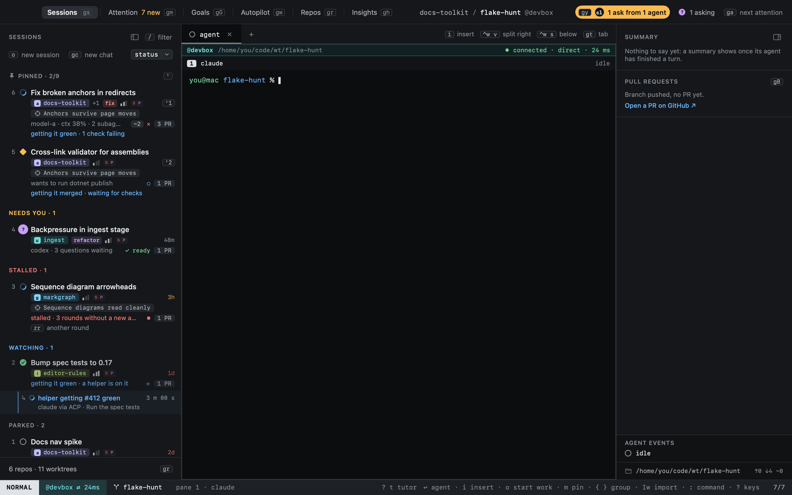
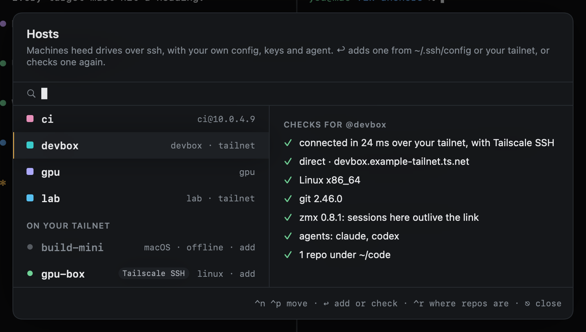
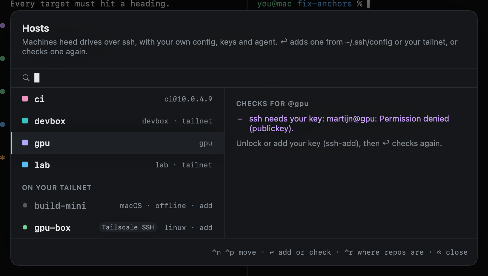
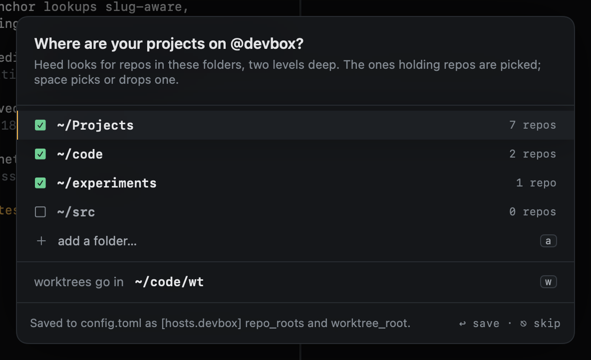

# Hosts

Agents on your other machines appear in the same window as the ones on this Mac.



A host is a machine Heed reaches over ssh: a devbox, a GPU box, a build runner. Heed uses your own ssh: your
`~/.ssh/config`, keys, agent and jump hosts, or your [tailnet](tailscale.md). Heed never reads a key, and Heed shares one connection per host, so calls are fast.

Heed finds the repos and worktrees on your hosts and shows them next to the ones on this Mac. Heed also runs sessions there. The agent runs on the host, in a [zmx](../sessions/zmx.md) session when the host has zmx, so a dropped connection, a closed lid or a restarted Heed never stops the agent.

## Adding a host

`gH` opens the hosts: the ones Heed has, and the ones in `~/.ssh/config` or on your [tailnet](tailscale.md) it could
add. `↩` on a host from your ssh config adds the host to `config.toml`; `↩` on a host Heed has checks the host again. The checks say how the host answers:



| Check | Means |
|---|---|
| connected in 24 ms | The host answers, through your ssh agent, without a prompt |
| ssh needs your key | Your key is locked or not loaded: `ssh-add`, then `↩` |
| host key not known yet | Connect once in a terminal to check and accept its key |
| host key changed | The key does not match `known_hosts`: blocked until you find out why |
| offline | The host does not answer; what Heed saw of the host last stays, marked stale |



### Where its projects are

Heed looks for repos on a host in its `repo_roots`, `~/code` unless you say otherwise. When you add a host, or check
one whose `repo_roots` you have not set, heed asks where your projects are after the host's first check answers. Heed looks in the usual folders under the host's home (`~/Projects`, `~/code`, `~/src`, `~/dev`, `~/repos`, `~/git`, `~/work`,
`~/Developer`, `~/workspace`, `~/go/src`) and in any other folder there that holds a git checkout. Heed lists the folders it found with how many repos each holds:



The folders holding repos start picked. `space` picks or drops a folder, `a` adds a folder by hand (a folder under `~`), and `w` changes where heed puts the worktrees it makes there (`~/code/wt` unless config already says). `↩` writes both settings to `config.toml` as `[hosts.<name>] repo_roots` and `worktree_root`, and looks for repos again. `⎋` leaves config as it is, and heed does not ask again on its own. `⌃r` in `gH` (or `:host.roots devbox`) asks any time.

A host's checks say where heed looks and how many repos it found there, or that it found none:

| Check | Means |
|---|---|
| 12 repos under ~/Projects | The last scan found them |
| no repos under ~/code | Nothing there: `⌃r` lets you choose the folders your projects are in |

A host in `config.toml`:

```toml
[hosts.devbox]
# ssh = "devbox"                 # what ssh connects to; the name by default (an alias from ~/.ssh/config)
repo_roots = ["~/code"]          # where repos are looked for on it, two levels deep (heed asks when unset)
worktree_root = "~/code/wt"      # where Heed will put the worktrees it makes there
color = "teal"                   # teal, periwinkle, pink or sky
```

Amber and green are never host colours: they mean "needs you" and "done".

## In this section

- [Hosts over Tailscale](tailscale.md): add a machine from your tailnet, Tailscale SSH, and how the link goes.
- [Repos and sessions on a host](sessions.md): the repos heed finds there, a session in zmx, and starting work on a host.

An agent on a host outlives the link when the host has [zmx](../sessions/zmx.md).

**Next:** [GitHub](../github/index.md).
