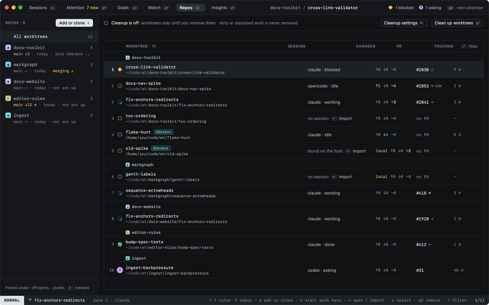
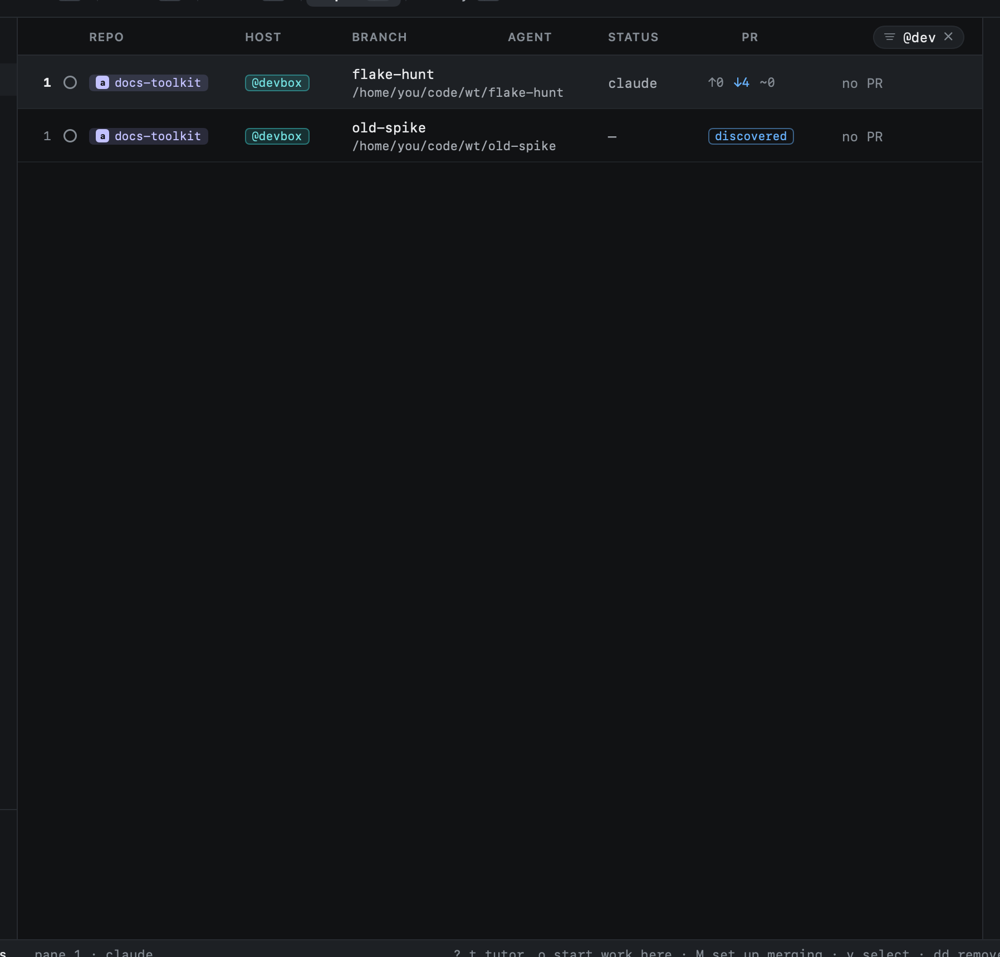
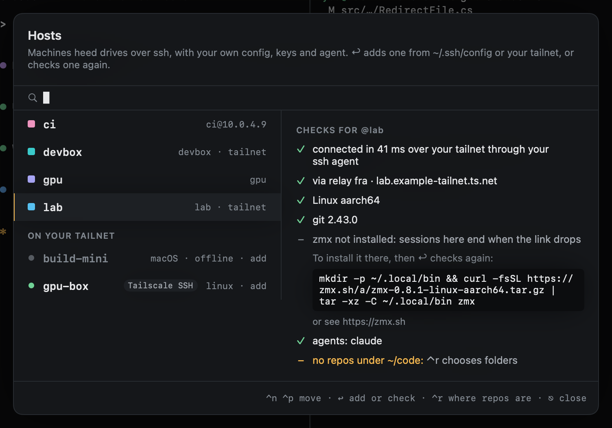
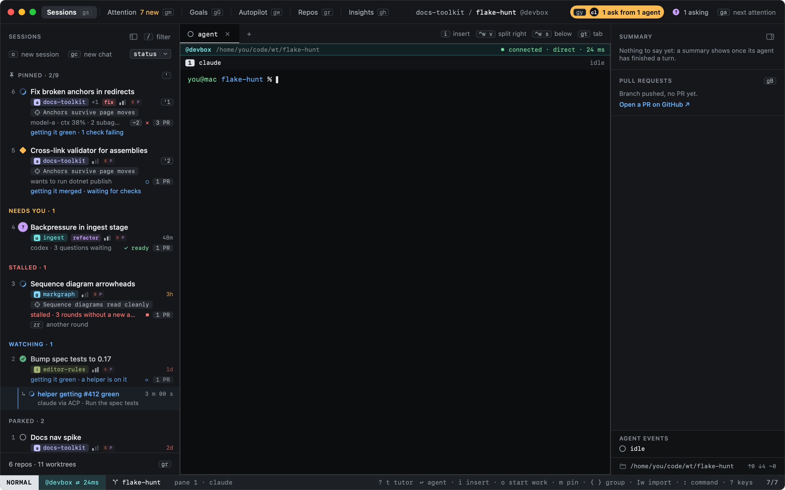
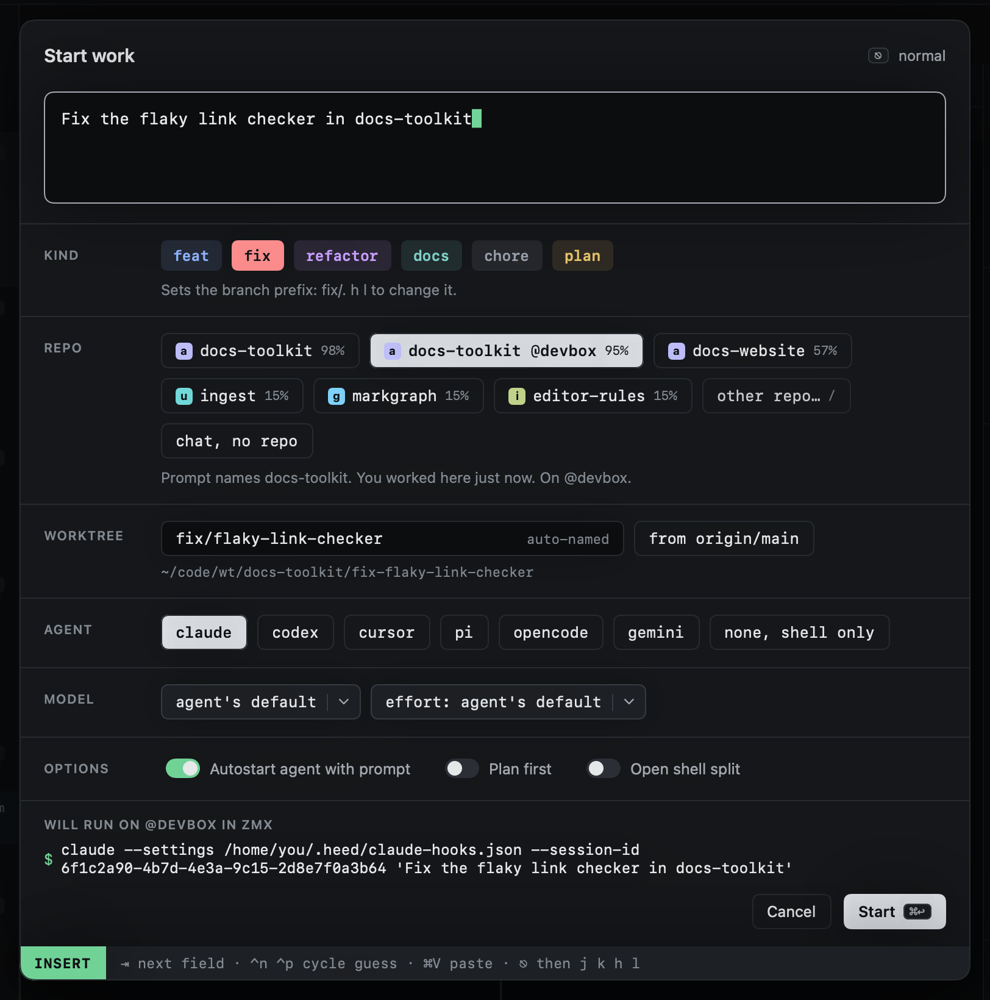

# Repos and sessions on a host

On each refresh Heed checks every host. For each host that answers, Heed finds its repos and lists their worktrees with their status. In [Repos](../worktrees/repos.md) they appear with their host:

A worktree on a host is one of:

| State | |
|---|---|
| **registered** | Heed manages it: Heed made the worktree, or you registered it |
| **discovered** | A scan found it and nothing has touched it. `↩` registers it |
| **stale** | Its host does not answer, so Heed shows it as last seen |
| **missing** | Registered, but no longer on its host |

Cleanup never touches a host's worktrees. `dd` [removes](../worktrees/removing.md) a worktree on its host, in the host's clone, and saves its work there first. [Reopening](../insights/reopening.md) a session that ran on a host makes its worktree again on that host.

`@` narrows the current view to one host. It starts the filter with `@`, so `@dev` keeps what is on `@devbox`
(`:host.filter devbox` does the same).

## Sessions on a host

`↩` on a registered worktree on a host makes the worktree a session there. The first time, Heed puts what the hooks need on the host, all inside `~/.heed` and without root:

- `~/.heed/bin/heed-hook`, a few lines of POSIX sh that agents' hooks call;
- `~/.heed/bin/heed`, a few more lines, which pass `heed goal` and `heed swarm` to heed on this Mac
  ([On a host](../goals/cli.md#on-a-host));
- the hook settings and plugins Heed starts the agents with (the same ones Heed uses on this Mac).

For the agent to outlive the link, the host needs [zmx](https://zmx.sh), which you install there yourself. Heed copies
no programs to your hosts. The host's checks (`gH`) say whether the host has zmx, and if not, the line that installs zmx for that host's system and architecture:

Heed looks for zmx on the host's PATH and in `~/.local/bin`, `~/bin`, `~/.nix-profile/bin`, `/usr/local/bin` and
`/opt/homebrew/bin` (a non-interactive ssh often has no `~/.local/bin` on its PATH). Without zmx, a session there is a
plain login shell over ssh, marked **not persistent**: the session ends when the link drops.

The checks also read your login shell there (`$SHELL`). An agent starts as on this Mac: the host's login shell runs the agent's command line, written in that shell's syntax (fish gets fish's, sh, bash and zsh get sh's), as the zmx session's
process, then becomes the session's shell. The prompt goes along in the session's environment as `HEED_PROMPT`, and Heed types nothing into the remote shell.

A remote session shows where the session runs without you reading anything: an `@host` chip and a rail in the host's colour
in the sidebar, a tinted strip over its panes with the link's state and latency, and the host in the title bar and
status bar. Local sessions stay unmarked.

What runs where:

| | |
|---|---|
| The agent, git, its worktree | On the host. Your Mac never clones the repo |
| The terminal you see | Here: ssh to the host, attached to the pane's zmx session there |
| Agent state (working, asking, blocked) | The agent's hooks write it to `~/.heed/events.log` on the host; Heed reads the log over the shared ssh connection, and catches up on anything Heed missed while away |
| PRs | Here, through `gh`, matched by repo and branch as for local sessions |

When the link drops, the pane says so and reconnects every few seconds. zmx keeps the session, so the screen and
scrollback come back as they were. (Without zmx the pane says the session ended with the link, and closes.) `exit` in the pane, closing the pane, or closing the session ends the zmx session on the host. Heed does not set up Cursor's hooks on hosts yet, so Heed reads Cursor's state from the screen there.

## Starting work on a host

[Start work](../start-work/index.md) offers a host's repos next to the ones on this Mac, each chip naming its host.
A repo on two machines appears once for each machine. Recent sessions count only where they ran, so if you usually work in `docs-toolkit` on `@devbox`, that chip comes first.

With a host's repo picked:

- the worktree goes under that host's `worktree_root` (`~/code/wt` unless you set it), as
  `<worktree_root>/<repo>/<name>`;
- Heed puts its hook files on the host if they are not there yet, as `↩` does;
- the agent starts there with the host's hook paths, and the line over the command says **will run on @host in zmx**,
  or **not persistent** when the host has no zmx.

A session runs in one place: a cross-repo session takes repos all on this Mac or all on one host. A [swarm](../goals/swarms/running.md#on-a-host) can run on a host too, with its lead and workers there, each worker in a worktree of its own under the host's `worktree_root`. The host has to answer when you start. If the host does not answer, `gH` shows why.

The [tutor](../getting-started/tutor.md)'s Hosts lesson (`:tutor hosts`) walks through the hosts dialog, the `@`
filter and starting work on a pretend `@devbox`.
