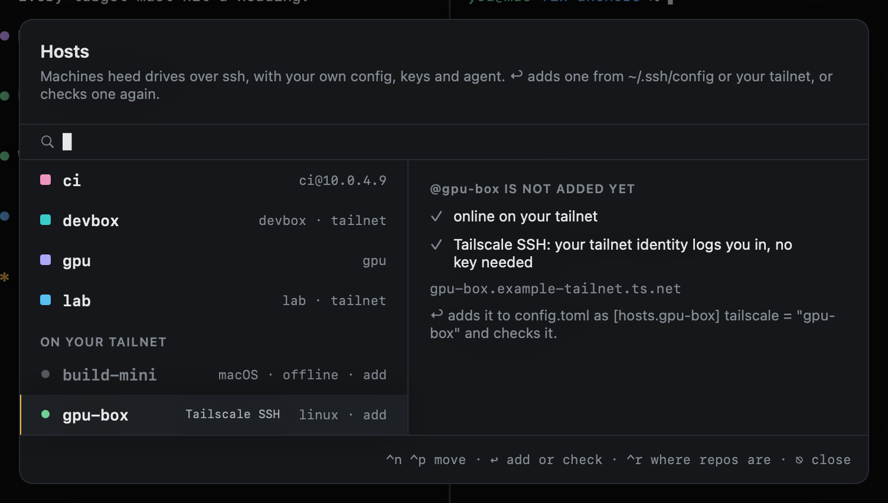
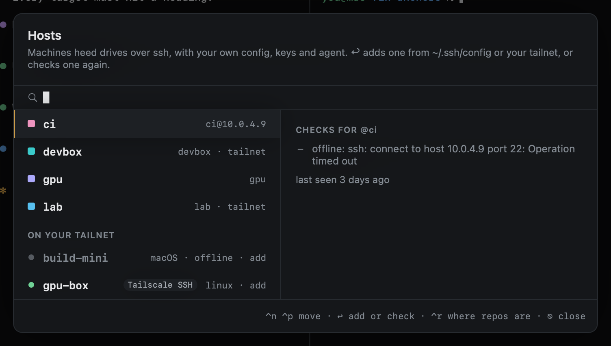

# Hosts over Tailscale


When this Mac is on a [Tailscale](https://tailscale.com) tailnet, `gH` lists the tailnet's machines that are not hosts yet under **On your tailnet**, each with the machine's system, whether the machine is online, and a **Tailscale SSH** badge when the machine runs Tailscale SSH. `↩` on a machine adds it as a host:



```toml
[hosts.gpu-box]
tailscale = "gpu-box"            # the machine on your tailnet
# user = "you"                   # who to log in as, when no ssh alias says so
```

A machine running Tailscale SSH needs no key of yours: your tailnet identity logs you in, and heed checks the
machine's host keys against the ones your tailnet publishes, the way `tailscale ssh` does. Heed reaches a machine without Tailscale SSH over the tailnet too, by its MagicDNS name, with your own keys and `known_hosts`. Heed looks up the machine's key under the name you connected with (your ssh alias, or the machine's name), so a key you already accepted still counts.

Heed prefers the tailnet. A host whose ssh alias or name matches a machine on the tailnet (its machine name or hostname, ignoring case) goes over the tailnet, so an existing `[hosts.devbox]` starts using the tailnet as soon as `devbox` joins it.
Your alias stays what ssh connects to, pointed at the machine's MagicDNS name, so `~/.ssh/config`'s `User` and
`IdentityFile` still apply. Heed skips a `ProxyJump` there, since the tailnet already reaches the machine. To keep a
host off the tailnet:

```toml
[hosts.devbox]
transport = "ssh"                # ssh | tailscale
```

Heed finds the `tailscale` command on your PATH or inside the Tailscale app (Settings > General shows which, and
`[tools] tailscale` sets it). The checks say what stands in the way:

| Check | Means |
|---|---|
| Tailscale is not installed | `brew install --cask tailscale`, or the Mac app from tailscale.com |
| Tailscale is off | Turn it on from the menu bar, then `↩` |
| Sign in to Tailscale | `↩` opens the sign-in page |
| Tailscale SSH wants you to confirm | The machine's check mode wants you to confirm your identity: `↩` opens the page |
| offline on your tailnet | Tailscale says the machine is offline; heed does not try ssh, and shows it stale |

An offline machine shows grey in the list, and the check for an offline host says why:



Over the tailnet the pane strip says how the link goes, with its latency: **direct · 12 ms** when traffic goes
straight to the machine, **via relay fra · 48 ms** through one of Tailscale's relays (its region), or **via peer
relay** through a machine of yours. A relay works, just slower, and the link usually turns direct once the two machines find a path.
