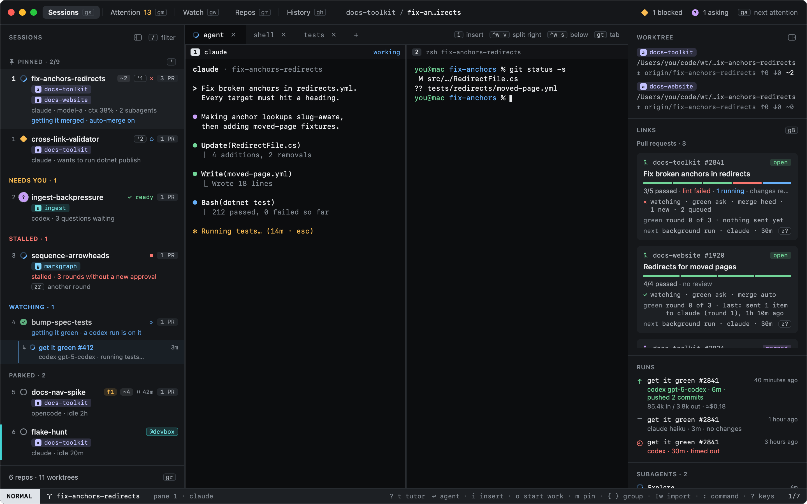

# Heed

Keep an eye on every agent.

Heed is a native macOS app for working with coding agents. It runs agents and shells in real terminals, gives each
task its own git worktree, and keeps the GitHub issues and pull requests around that task in view. It tells you which
agent needs you, and it gets you there in a keystroke. Everything else that wants you, on GitHub or from an agent, is
one feed: Attention. What ended stays in History, with a timeline, a short summary of each piece of work and a
dashboard.

## Where to go next

| | |
|---|---|
| [Getting started](getting-started/index.md) | Install Heed, see what the first run finds, learn the keys with the tutor, and walk through a first session. |
| [Concepts](concepts/index.md) | Sessions, agent states, worktrees and modes: the four ideas the rest builds on. |
| [Sessions](sessions/index.md) | The main view: moving around, typing into agents, panes and tabs, and chats. |
| [Start work](start-work/index.md) | From a sentence to a running agent in its own worktree. |
| [Agents](agents/index.md) | The agents Heed runs, how they report their state, and Heed's own model calls through them. |
| [GitHub](github/index.md) | Attention and its rules, pull requests watched until green and merged, and review feedback fed back to the agent. |
| [Worktrees](worktrees/index.md) | Every worktree of every repo, set up before the agent starts, removed when quiet. |
| [History](history/index.md) | What ended: outcomes, a timeline by day, a ledger of summaries, a dashboard, and reopening. |
| [Keyboard](keyboard/index.md) | Every key, how keys work, and how to change them. |
| [Configuration](configuration/index.md) | `config.toml`, the Settings window, and every key with its default. |
