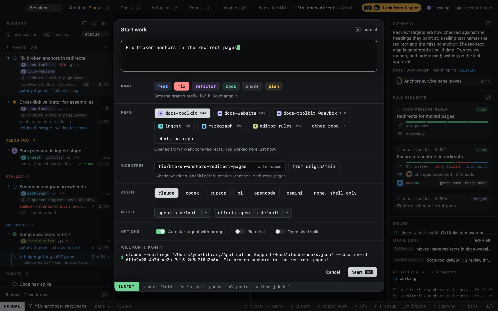
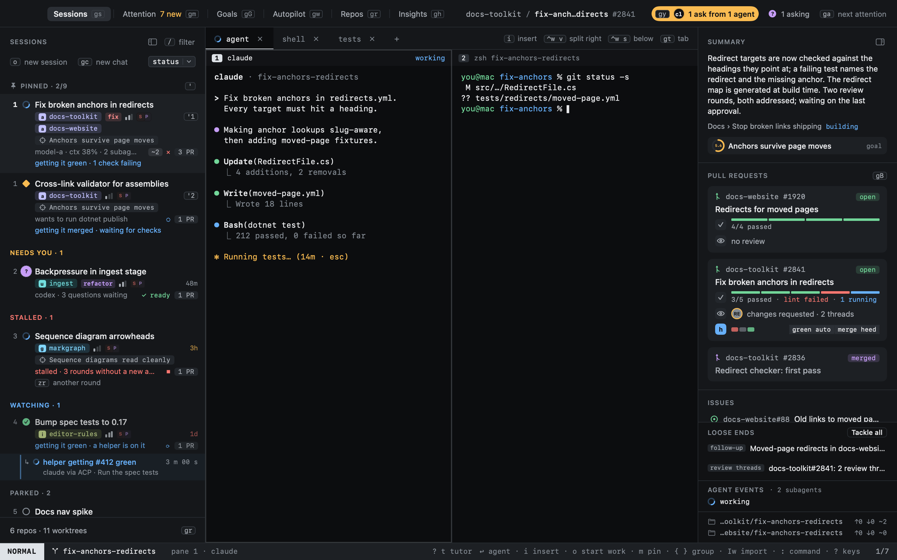
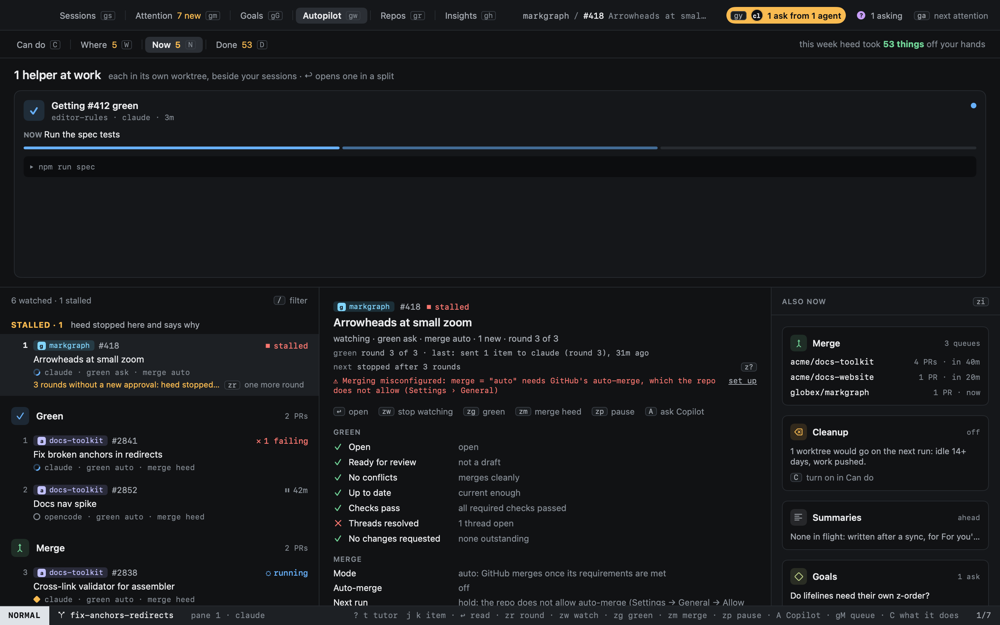
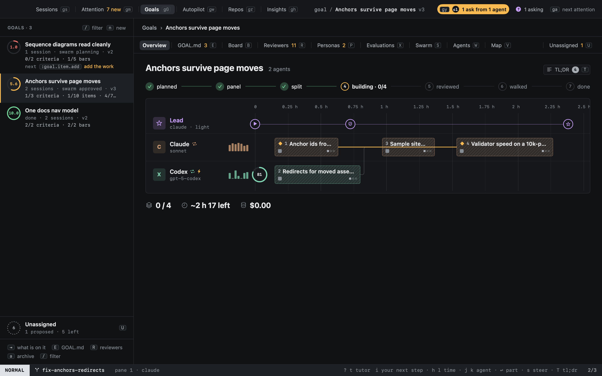
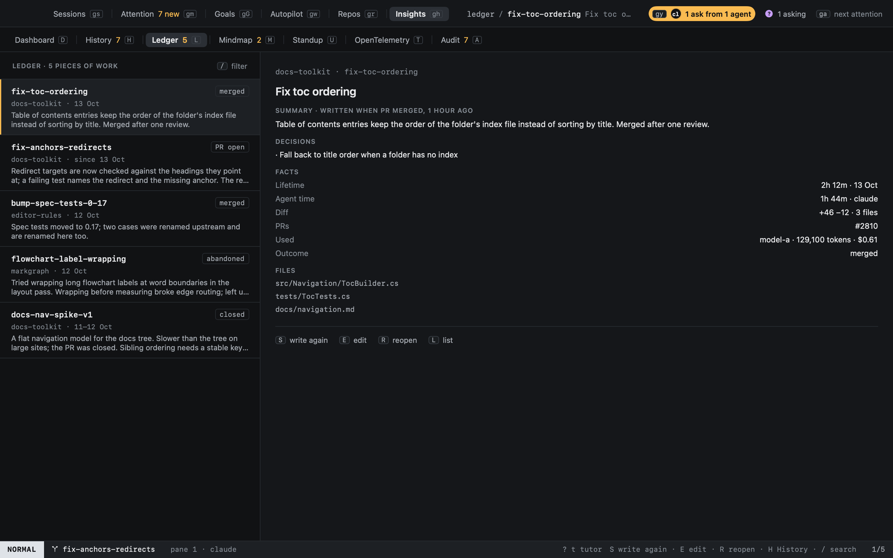

# heed

heed is a native macOS app for coding agents. It watches your agents and everything that happens to their work, and
calls you in when a decision is yours. [Getting started](getting-started/index.md) installs it and walks through a first
session.

The docs follow the five acts of a day with heed. After them come the reference sections, for when you know what you
are looking for.

## 1. Start

Press `⌃⌥Space` in any app, or `o` in heed, and say what you want. heed picks the repo, the worktree, the branch and
the agent, and shows why. [Start work](start-work/index.md) covers the dialog and its guesses.

## 2. Sessions

Every agent runs in its own Ghostty terminal and its own worktree. heed shows what each agent is doing and takes you
to the agent that needs you. [Sessions](sessions/index.md) is the main view. [Repos](worktrees/index.md) lists the
worktrees, [Diff](diff/index.md) shows what an agent changed, and [Hosts](hosts/index.md) brings agents on other
machines into the same window.

## 3. GitHub and Autopilot

[GitHub](github/index.md) gathers everything that wants you into Attention, and feeds review comments back to the agent
that wrote the code. [Autopilot](autopilot/index.md) gets PRs green, merges them by your rules, and answers
permission asks with one key.

## 4. Goals and personas

A [goal](goals/index.md) holds work that outlives a session. heed splits a goal across your agents, and a lead agent
keeps the plan. [Personas](personas/index.md) read the plan and look in on sessions.

## 5. Insights

[Insights](insights/index.md) shows what the work amounted to: a dashboard, History with each piece of work's story,
a ledger of summaries, and a Mindmap of campaigns.

## Reference

| | |
|---|---|
| [Concepts](concepts/index.md) | Sessions, agent states, worktrees and modes: the four ideas the rest builds on. |
| [Agents](agents/index.md) | How heed starts each agent, how each agent reports its state, and how heed talks to it. |
| [Keyboard](keyboard/index.md) | Every key, how keys work, and how to change them. |
| [Outside the window](outside-the-window/index.md) | The menu bar, the Dock, notifications and global shortcuts. |
| [Configuration](configuration/index.md) | `config.toml`, the Settings window, and every key with its default. |
| [Reference](reference/index.md) | The `heed` command line, files, environment variables, the call log and a glossary. |
| [Troubleshooting](troubleshooting.md) | What to check when something does not work. |
