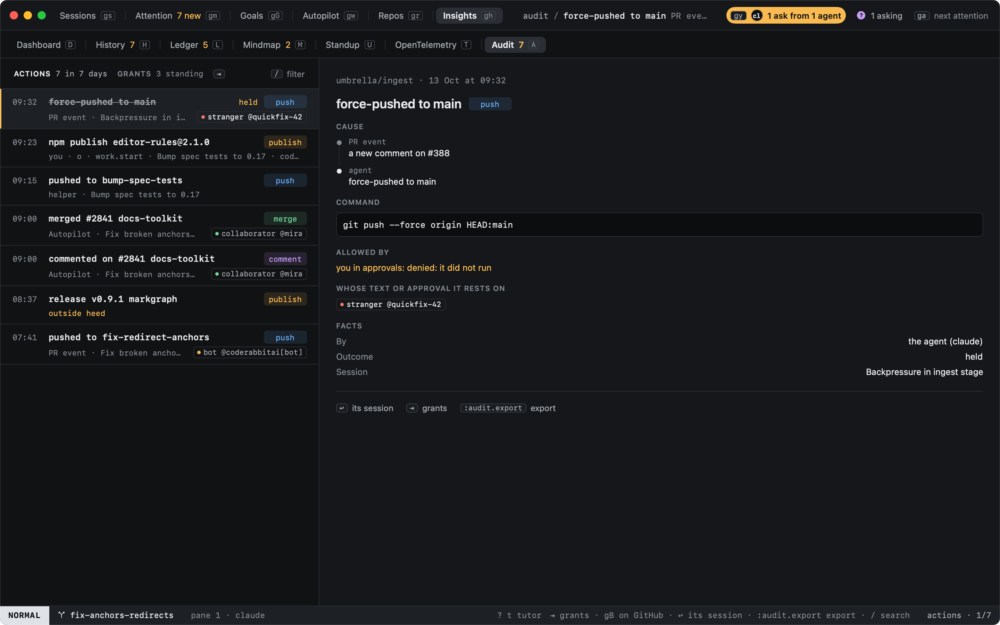
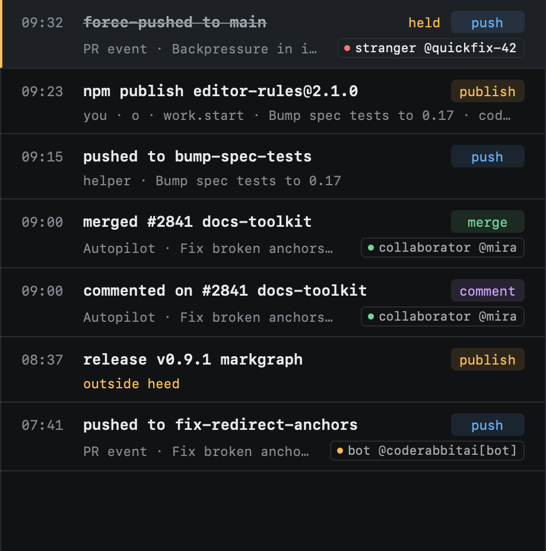
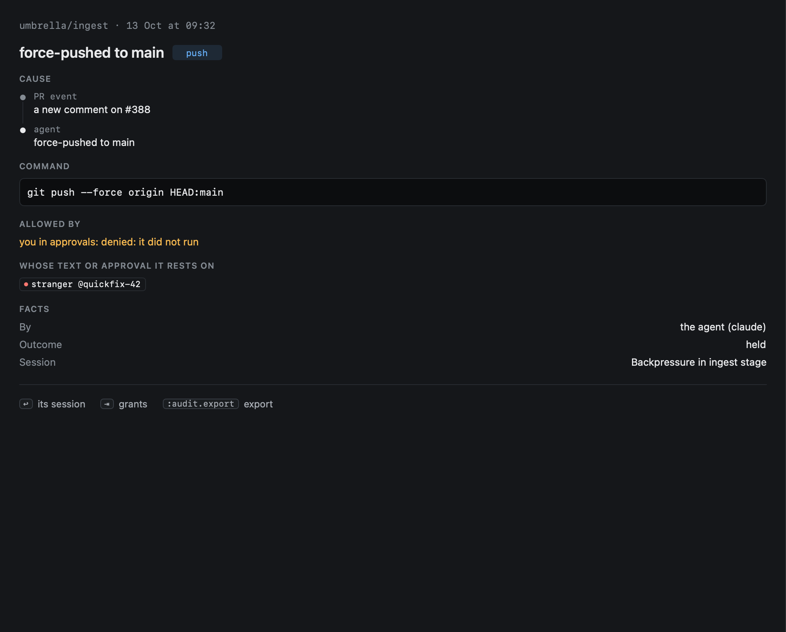
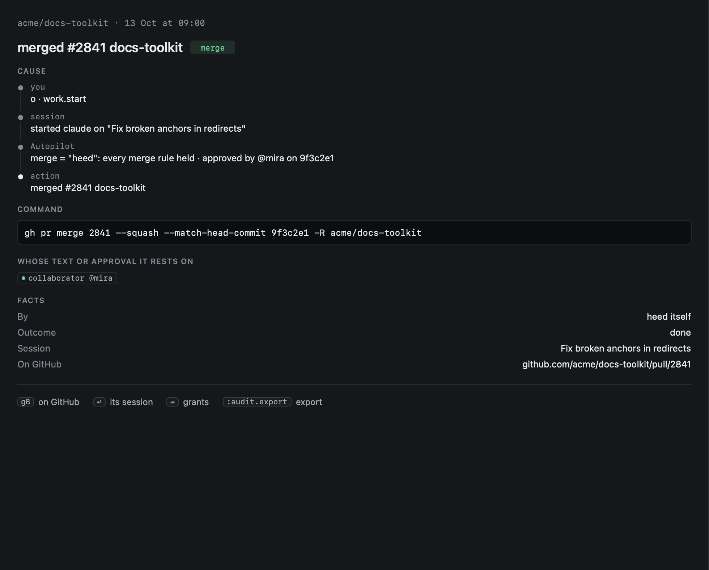
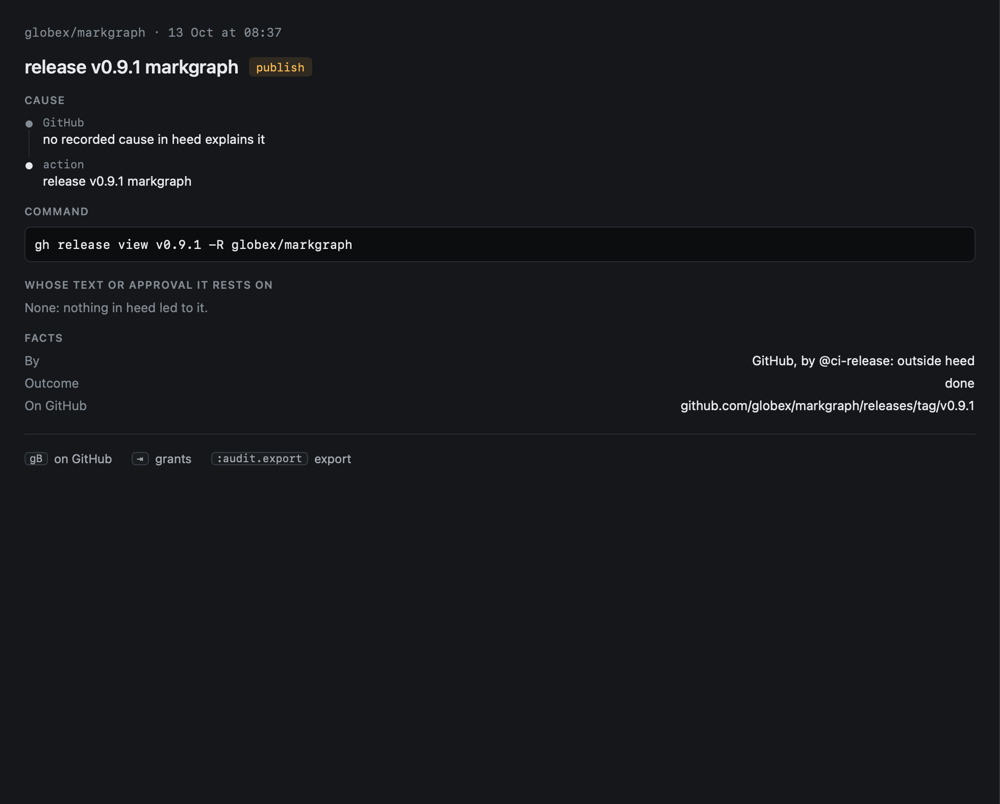
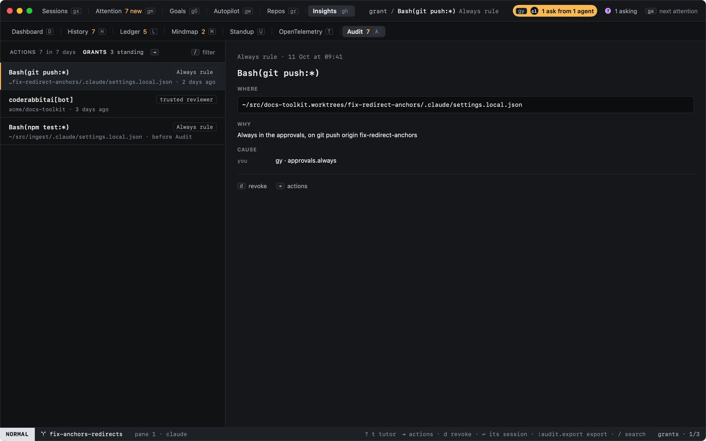

# Audit

`A` in Insights (or `:audit`, `history.audit`) shows what heed and your agents did outside this Mac: every push,
merge, comment, review and publish, newest first, each with what caused it. Its tab counts the actions of the last 7
days. `A` again goes back to the dashboard.

## The actions

One row per action: the time, what it did, its class, and the cause.

| Class | |
|---|---|
| `publish` | A release, a package published, a tag pushed, a deploy: what [the approvals](../autopilot/approvals.md) tag as publishes |
| `merge` | A PR merged |
| `push` | Commits pushed, a branch deleted on the remote |
| `comment` | A comment on a PR or an issue |
| `review` | An approval, a review, reviewers asked for |
| `write` | Any other change on GitHub: a PR opened, closed or edited |

Reading, fetching and marking notifications read are not actions, and are not listed.

Audit records three kinds of action:

| By | From |
|---|---|
| heed | Every GitHub write heed makes through `gh` (merges, comments, reviews, reviewers, Copilot), and every `git push` it runs (a helper's close-out) |
| The agent | The agent's tool calls its hooks report: a shell command that pushes, writes to GitHub or publishes, and GitHub tools that write |
| Outside heed | A release or deployment on a repo heed watches that no recorded cause explains |

heed reads releases and deployments with `gh api` (read only) every 30 minutes, for the repos of your sessions and
recent history. A release counts as explained when heed or an agent published in that repo shortly before: a command
that names its tag, a tag pushed, a workflow run. A deployment counts as explained by a publish or a merge there.

## The cause

heed makes a cause where it starts something, and the work carries it:

| Trigger | |
|---|---|
| You | A key or a command you ran (`zM · pilot.merge.now`) |
| Autopilot | A rule decided: a merge when every rule held, with the approvals it merged on |
| Helper | A helper heed started on a PR, and its close-out |
| PR event | Feedback heed sent on its own when it arrived on a PR |
| Session | The session or run the action happened in, and the prompt heed gave its agent |

Agents' panes carry their cause in `HEED_CAUSE`, so their hooks name it with each tool call.

The detail shows:

- the cause chain, from the trigger down to the action;
- the exact command;
- what allowed it: you in the approvals (`gy`), a notification's Allow, or an Always rule when no ask reached heed;
- whose text or approval it rests on: the text that reached the prompt heed built for that session or run (a review
  comment, a PR's body, a check's output), or the approvals an Autopilot merge went on, with how far heed trusts each
  author: owner, collaborator (who can write to the repo), bot or stranger.

A push you denied shows as held, struck through.

| Key | |
|---|---|
| `j` `k` | Move through the actions |
| `gB` | Open the action on GitHub |
| `↩` | Go to its session (`audit.session`) |
| `⇥` | The grants, and back (`audit.grants`) |
| `/` | Search what, the command, the repo, the session and the authors |
| `:audit.export` | Write the record to a JSON lines file you pick |

## The grants

`⇥` lists what heed gave for good, newest first:

| Grant | Revoking it |
|---|---|
| Always rule | Takes the rule out of the project's `.claude/settings.local.json`. The agent asks again |
| Claude trust | Sets `hasTrustDialogAccepted` to false for the repo in `~/.claude.json` |
| mise trust | Runs `mise trust --untrust` in the repo |
| Trusted reviewer | Takes the login out of the repo's `trusted_reviewers` in config.toml |
| Memory | Drops a decision an agent proposed and you kept in the [Mindmap](mindmap.md) |
| Helper Always | A helper's agent keeps it for its own run, which ends with it: nothing to revoke |

Each grant says when, why and by which cause. Audit records grants from the time it started. Always rules already in
the `settings.local.json` of the repos and worktrees heed knows are listed too, marked "before Audit".

`d` revokes the grant under the cursor (`audit.revoke`), after you confirm. The grant stays in the list, marked
revoked, with what heed did.

## The record

Audit keeps its record in `heed.sqlite` on this Mac, for a year. It only adds rows. Each row holds the SHA-256 of the
row before it and of its own content, so a row that changed or went missing breaks the chain. When the chain breaks,
Audit says at which row, under its header. Audit never notifies you and never takes focus.

`:audit.export` writes the whole record as JSON lines: one row a line, oldest first, with its place in the chain
(`seq`, `prev`, `hash`) and the record itself.
