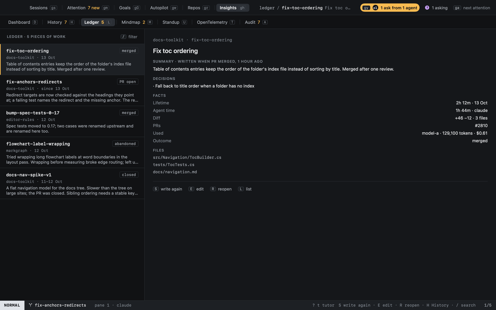
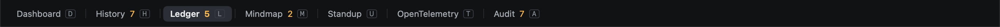

# Insights

Insights shows what your work amounted to, and the story of each piece of work that ended.

`gh` opens Insights on its [dashboard](dashboard.md): what shipped this week, agent time set against the week before,
your bests and the goals that moved. A strip of tabs under the title bar names every Insights view with its key and how much the view holds: Dashboard `D`, History `H`, Ledger `L`, Mindmap `M`, Standup `U` and OpenTelemetry `T`. The same keys work in every view. A view's own key again returns to the dashboard, and a click on a tab opens that view.

| View | |
|---|---|
| [Dashboard](dashboard.md) | Where `gh` opens: the range in numbers, what shipped, bests, agent time, goals |
| [History](history.md) | The work that ended, by day, each with its story, and how to filter it |
| [Ledger](ledger.md) | A short summary of each piece of work, kept after its worktree is gone |
| [Mindmap](mindmap.md) | The work grouped into campaigns, one Mindmap per org |
| [Standup](standup.md) | Your own questions answered from each Mindmap, on the days you choose |
| [OpenTelemetry](opentelemetry.md) | The agents' own spans: latency by tool, waits for your OK, cost by model, and each session's trace |

[Reopening](reopening.md) picks a closed session up again, or starts a new one from its prompt.

**Next:** the reference sections. [Concepts](../concepts/index.md) explains the ideas behind everything above, and the
[glossary](../reference/glossary.md) defines the terms.
