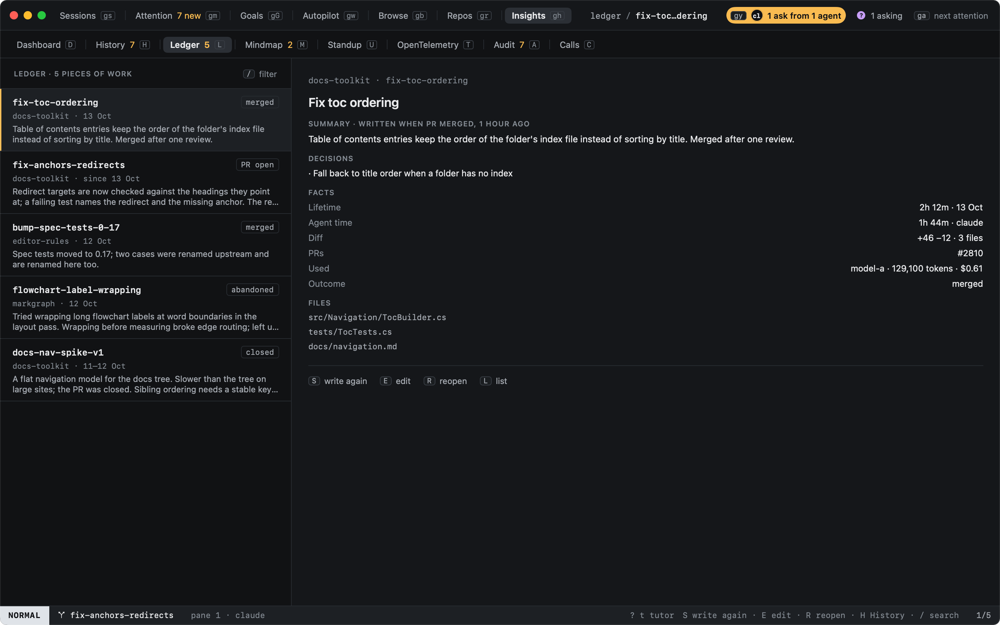
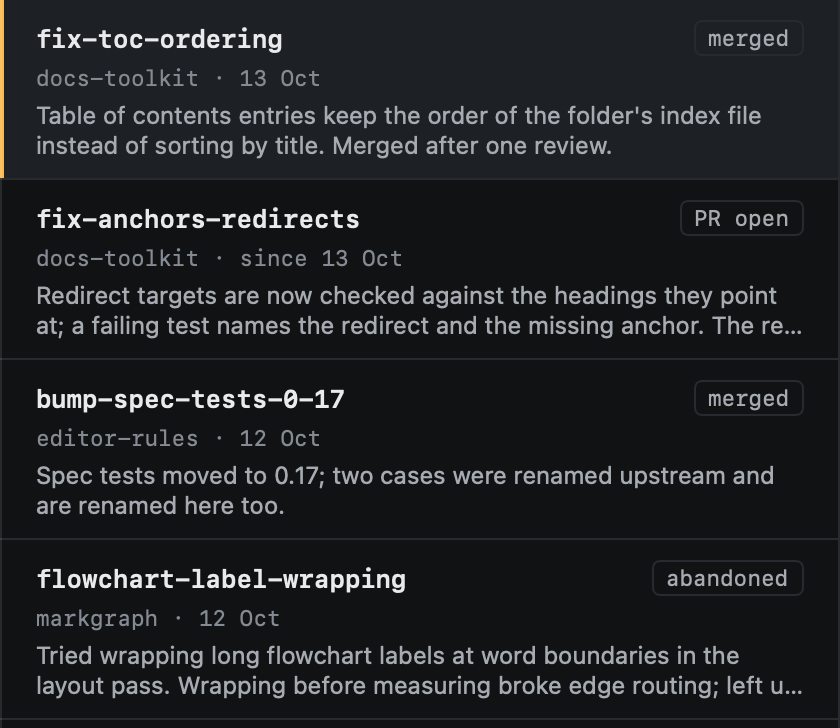
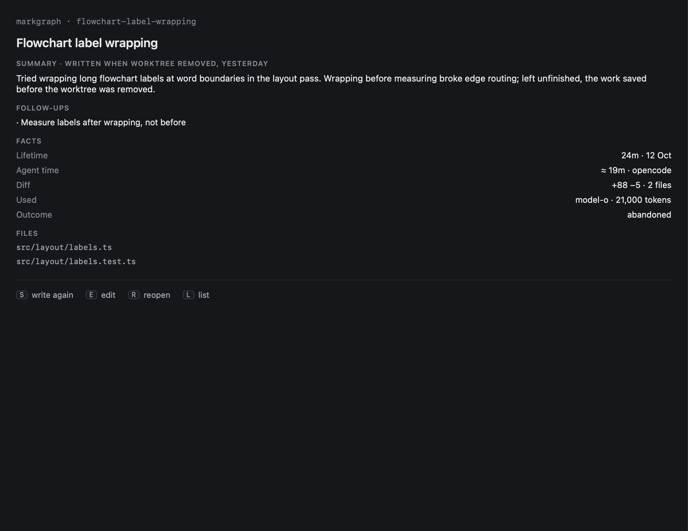

# Ledger

`L` in Insights (or `:ledger`, `history.ledger`) shows the ledger: one entry per session or chat, newest first. Each entry has a short summary of what the work did and where it stands, and the entry stays after the worktree is removed. `L` again goes back to
History.





## What an entry holds

| Part | From |
|---|---|
| Summary, decisions, follow-ups | A cheap model, through heed's [model calls](../agents/model-calls.md) |
| Diff and files | git, in the worktree, or its branch, or the work [saved when it was removed](../worktrees/removing.md#saved-first) |
| Lifetime, PRs, outcome | The session |
| Agent time | The states the agent's hooks reported (`≈` when some were read from the screen) |
| Model, tokens, cost | What the agent reported for the session |

The model reads the work's commits and diff against its base branch, its PR (description, reviews, review
threads), heed's timeline of the session, and the agent's last message.
heed adds your `summary_instructions` (Settings › Autopilot › Instructions, or per org and repo) to its prompt. Summaries and the ledger stay in `heed.sqlite` on this Mac.



## When it is written

```toml
[summary]
when = ["pr_opened", "pr_merged", "worktree_removed", "idle"]
idle_hours = 24
include = ["summary", "decisions", "follow_ups", "files"]
```

| `when` | |
|---|---|
| `pr_opened` | The session starts tracking a PR |
| `pr_merged` | One of its PRs merges |
| `worktree_removed` | Before heed removes its worktree: the removal waits for the summary, 30 seconds at most |
| `idle` | The session had no activity for `idle_hours`, and heed wrote no summary since |
| `chat_closed` | A chat closes (off by default) |

Settings › Insights › Ledger has the same switches. With model calls off (`[llm] enabled = false`) nothing is
written; the daily caps of `[llm]` apply.

| Key | |
|---|---|
| `S` | Write the summary again now (`ledger.summarize`) |
| `E` | Edit it: the command line opens with the summary typed (`ledger.edit`) |
| `R` | Reopen the session, when it is in History |
| `/` | Search titles, summaries, decisions and follow-ups |

An edited summary says so, and stays until you write it again.

## The agent's own summary

This is off by default. With `summary_sign_off` on, heed asks the agent at launch to end its final message with one line that starts with `heed-summary:`. When the session's last message has that line, it becomes the summary, marked "the agent's own sign-off". The model then writes only what else the entry includes (decisions, follow-ups). With nothing else to write, heed calls no model at all. The sign-off works with model calls off too.

```toml
[pilot]
summary_sign_off = true        # or under [orgs.<name>] and [repos."org/name"]
```

claude gets the request as `--append-system-prompt`, codex as `developer_instructions` (`-c`). heed does not ask other agents.
Settings › Autopilot › Instructions has the switch, and Orgs & repos › Instructions the per-org and per-repo ones.

