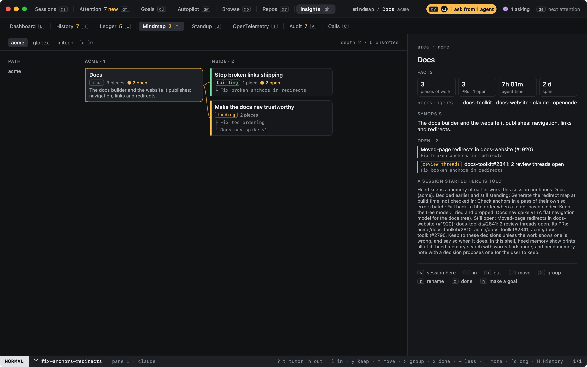
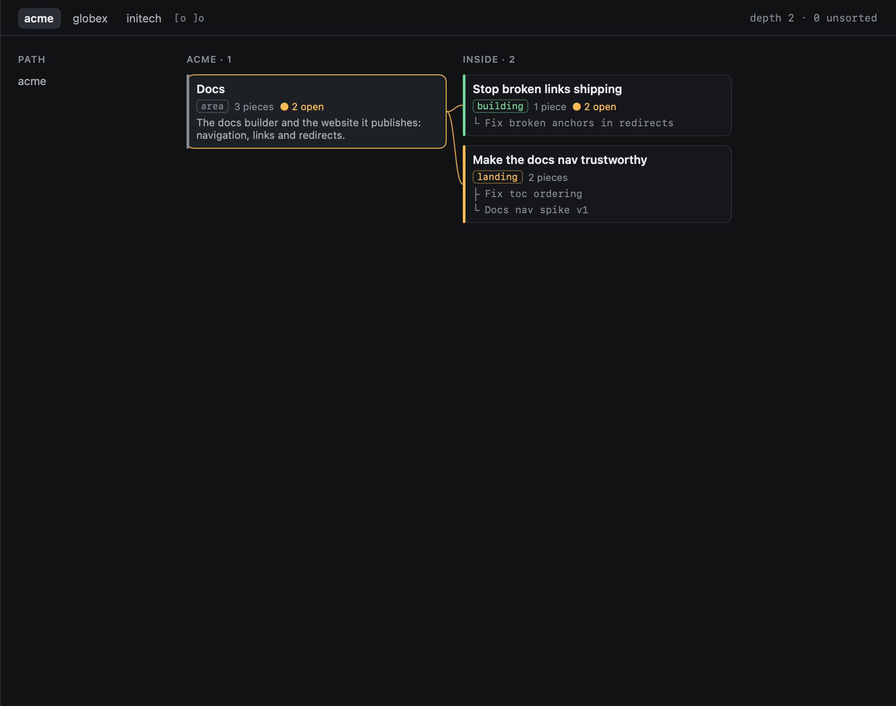
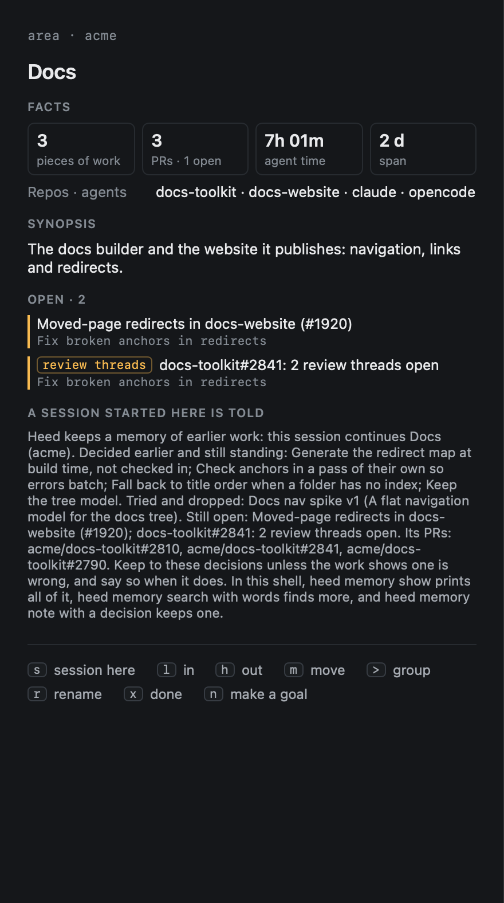
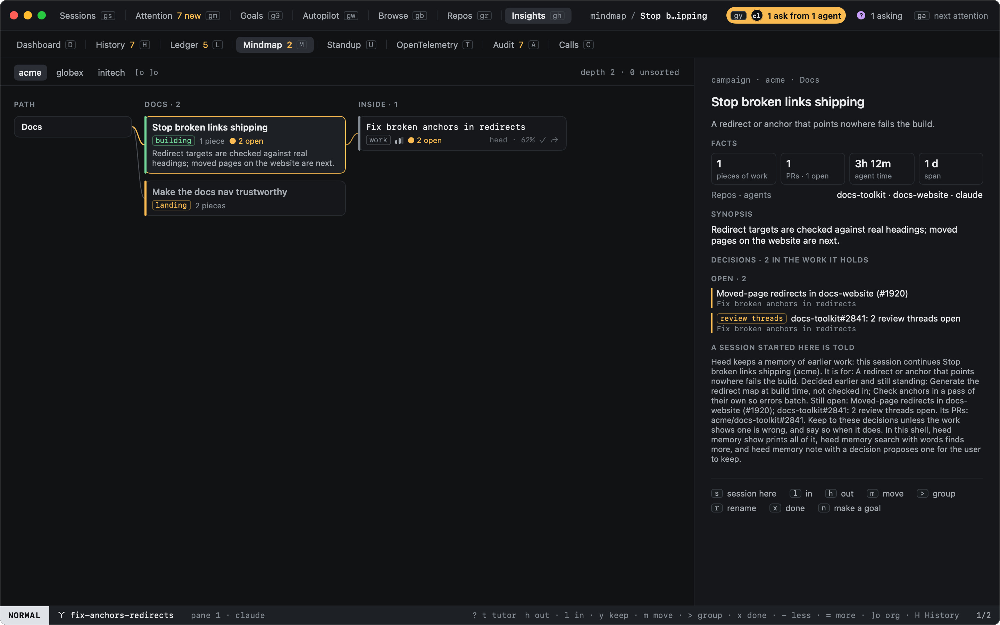
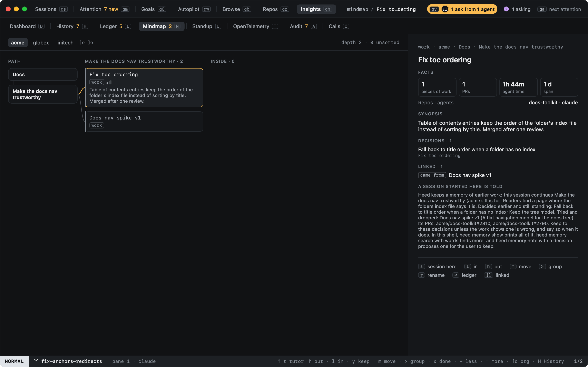

# Mindmap

`M` in Insights (or `:mindmap`, `history.mindmap`) shows the Mindmap: the work heed's [ledger](ledger.md) wrote up,
grouped the way you would tell it at a standup. Areas hold campaigns (what a run of work was for), campaigns hold
the pieces of work, and you can group further yourself. `M` again goes back to the dashboard.





## One Mindmap per org

Every GitHub org has its own Mindmap. So does your personal work: repos under your own login, repos with no GitHub remote, and chats with no repo. Nothing crosses from one Mindmap to another: not the grouping, not the synopses, not search. A fork goes with the org it was forked from (its `upstream` remote). A chat in a folder that is a git repo goes with that repo's org. `[o` and `]o` switch between Mindmaps. Each Mindmap lives in its own file under
`~/Library/Application Support/Heed/mindmap/`.

## Every node reads the same

| Part | From |
|---|---|
| Facts | Counted from the ledger each time: pieces of work, PRs, agent time, the span, repos and agents, the file touched most |
| Synopsis | A piece of work's ledger summary; above it, written from the synopses of what it holds |
| Decisions | The ledger's decisions, with the work they came from. A decision rises to the node above when two of its children take it, or when you pin it (`p`). A decision that later work went against is struck through |
| Open | Follow-ups nobody has done yet. Later work that does a follow-up closes it; `x` marks it done |



## Loose ends

Next to the follow-ups a summary wrote down, Open lists what a piece of work left unfinished that nobody wrote down,
from what heed already knows:

| Loose end | When |
|---|---|
| saved work | heed removed its worktree and saved the work, and the work never landed |
| no PR | It ended with commits and no PR |
| quiet PR | Its PR is open with no activity for a week |
| review threads | Its open PR has review threads nobody resolved |
| red CI | Its open PR's checks fail |
| unanswered | The agent's last message asked a question, and the session ended there (Hunch reads the message) |
| abandoned | It ended abandoned, with nothing written about what was left |

heed works out each loose end again when the ledger writes and when you open the Mindmap. A loose end goes away by itself when its cause does: the PR merges, someone resolves the thread, CI goes green. `x` dismisses a loose end for good. A session's brief and `heed memory show` list the loose ends with what else is still open.



## How work gets placed

When the ledger writes an entry, heed places the work. Clear cases are settled by the words and files alone. The
rest is one question, sized so [Hunch](../configuration/local-learning.md) answers it on this Mac: which of the four
closest campaigns this work continues, or something new. Work that fits none waits in Unsorted until a cheap model
names a campaign for it ([model calls](../agents/model-calls.md), six times a day per Mindmap at most).

heed places the work and moves on; nothing waits for you. On a card heed placed after asking, a faint `heed · 72%` with ✓ and ↦ shows how sure heed was. ✓ (or `y`) says the placement is right, and ↦ (or `m`) moves the card. Hunch learns from either, and Settings › Decisions & Hunch shows how often heed had it right. Leaving a card alone is fine too. With
`shadow = true`, every placement waits for `y` or `m` instead of standing.

```toml
[mindmap]
enabled = true
shadow = false
```

## What sessions are told

`s` on a node starts a session in the repo of its newest work. You type the prompt, and heed tells the agent at launch what was decided there and still stands, what was tried and dropped, what is still open, and its PRs. The detail pane shows this text under "A session started here is told". A session on a [goal](../goals/index.md) is told the
same about the campaign most of the goal's work sits in. The text comes from that org's Mindmap only.



claude gets the text with `--append-system-prompt`, codex as `developer_instructions`. heed does not tell other agents.

```toml
[memory]
brief = "node_and_goal"   # or "off"
```

## heed memory

From a heed session's shell, an agent (or you) reads and adds to that session's Mindmap, its org's or personal, never
another's. The brief a session is told mentions `heed memory`; claude sessions on a goal also get the `heed-memory` skill.

```sh
heed memory show                    # the campaign this work continues: what it is for, decisions, what is open
heed memory search toc order        # decisions, follow-ups and campaigns that mention every word
heed memory note "Cache the toc"    # a decision proposed on the campaign, for you to keep
```

A note is a proposal. The campaign shows the note under **Proposed by agents**, and heed tells no session about it (not in its brief, not by `heed memory show` or `search`) until you keep it with `y` on the campaign (`N` drops it). Then the note is one of the campaign's decisions like any other. heed keeps the decisions it reads from your work's summaries as before.

## Keys

| Key | |
|---|---|
| `j` `k` | The next or previous node beside the current node |
| `h` `l` | Out to what holds it, in to what it holds |
| `-` `=` | Draw one level less or more to the right |
| `[o` `]o` | The previous or next org's Mindmap |
| `y` | Keep a suggested placement, or the decisions an agent proposed on the node |
| `N` | Drop the decisions an agent proposed on the node |
| `m` | Move the node into a campaign or group, by title (`:mindmap.move top` to the top) |
| `>` `<` | Group the node with the next node; lift it out |
| `r` | Rename |
| `J` | Join the node into another, by title |
| `x` | Mark the node's first open follow-up done |
| `p` | Pin the node's first decision |
| `]l` `[l` | To a node the current node links to: work that led to it, or a campaign touching the same files |
| `n` | Make a goal of the campaign: its GOAL.md drafted from the work, the work put on it |
| `S` | Name campaigns for Unsorted work now |
| `s` | Start a session here, told what was decided and what is open |
| `↩` | A piece of work's ledger entry |

What you moved, grouped or renamed stays when heed places work again.
