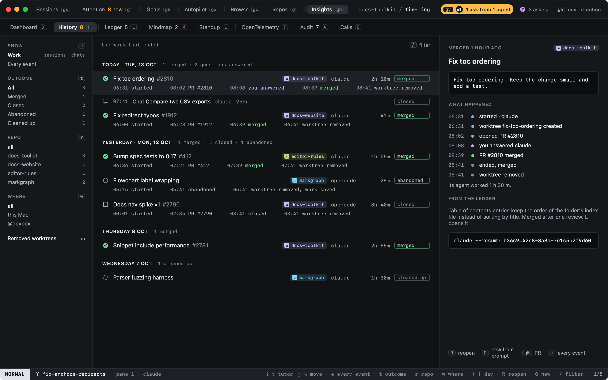
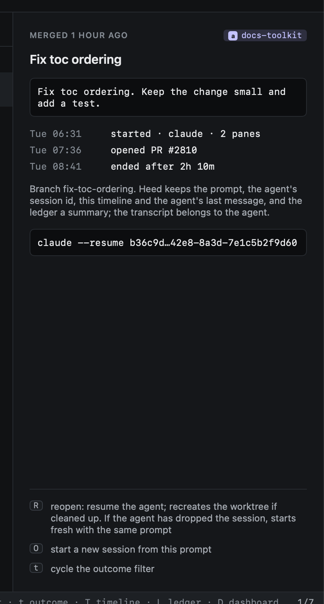

# Reopening

[History](history.md) lists every closed or deleted session. Two keys bring one back.

| Key | |
|---|---|
| `R`, `↩` | Reopen: resume the agent's session, and recreate the worktree from its branch if heed removed it |
| `O` | Start a new session from this prompt ([Starting again](../start-work/index.md#again)) |

`R` also works on a ledger entry or a dashboard PR whose session is still in History. When the session is not in
History, heed says so and does nothing.

## What reopening does

Reopening moves the session out of History and back into Sessions, with the same title, branch and prompt. The agent pane
starts in the worktree:

- **The agent still has the session.** heed resumes it with the agent's own resume command. The timeline says `reopened`.
- **The agent no longer has the session.** heed starts the agent fresh with the same prompt. The timeline says `reopened · started fresh`.
- **The agent is not configured any more.** heed opens a shell. The timeline says `reopened · shell only`.

The session comes back idle and unparked. The shell split from your [options](../start-work/agent-and-options.md)
opens beside the agent.

The detail pane shows the session's prompt, its timeline and the command that resumes the agent.

## A removed worktree comes back

When the worktree was removed, reopening makes it again where new worktrees go. A session on a host gets its worktree on
that host, under its `worktree_root`. heed picks the first source that exists:

1. The local branch, when it is still there.
2. What heed [saved when it removed the worktree](../worktrees/removing.md#saved-first). heed makes the branch again at `heed/archive/<branch>`, and puts back the uncommitted changes saved with it, still uncommitted.
3. The branch on `origin`.

The session's timeline says which source heed used: `worktree recreated from heed/archive/old-spike`, and
`uncommitted changes put back from the archive`. A worktree made again runs the repo's [setup](../worktrees/setup.md)
before the agent starts, as a new session's worktree does.

## Chats

A [chat](../sessions/chats.md) reopens in its folder. heed makes a scratch folder it removed again, empty. A folder you
picked that is gone stays gone, and reopening says so, because heed never makes or removes those.
