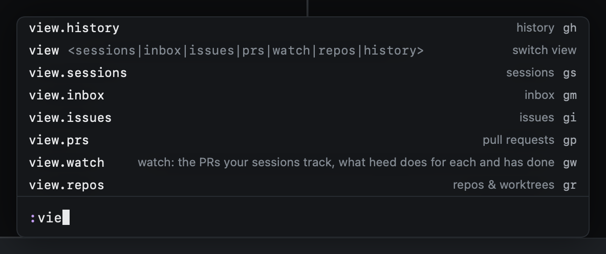

# The command line

`:` opens the command line. Every command has a name, and `:` runs any of them, with completion.

| Key | |
|---|---|
| `⇥` | Complete: one match is taken, several are narrowed to what they share, then taken in turn |
| `⇧⇥` | The previous match |
| `↓` `↑` | The next or previous match |
| `↩` | Run |
| `⎋` | Close |

The list above the line shows every match, scrolling past ten: commands with their keys, and short forms (marked
*alias*) with the command they run. After a space it completes the argument: view names for `:view`, session titles
for `:session.open`, pins for `:pin.jump`, tabs for `:tab.go`, hosts for `:host.filter`, Settings sections, pause
durations, merge queues for `:merge.run` and `:merge.queue`, repos for `:issues.repo`, the session's PRs and issues for
`:pr.untrack` and `:issue.remove`, lessons for `:tutor`, `all` for `:tutor.hide` and agents for `:agent`. Paths, URLs
and prompts are typed as they are.

The mode switches run from `:` too (`:mode.visual`). COMMAND's own `⇥` and `↩` (`command.complete`,
`command.submit`) are not offered: on the line they would act on themselves.

Short forms work too:

| Typed | Runs |
|---|---|
| `:start <prompt>` | Start work with that prompt |
| `:agent codex` | Start work with that agent |
| `:pr 2841` | Read pull request 2841 |
| `:track <url>` | Track a pull request in this session (`gU` takes the URL on the clipboard) |
| `:wt sweep` | Run the cleanup sweep |
| `:inbox`, `:prs`, … | Switch view |
| `:import <path>` | Import the worktree at a path |
| `:tutor [lesson]` | The [tutor](../getting-started/tutor.md)'s picker, or a lesson by name |
| `:back`, `:skip` | In the tutor: the step again, or skip it |
| `:help` | Every key |
| `:q` | Quit (in the tutor: leave the tutor) |

## Commands without a key

Everything you can do with the mouse, the menu bar or a global shortcut is a command too, so `:` reaches it and
`config.toml` can bind it:

| Command | |
|---|---|
| `:session.open <words>` | Go to the first session matching the words |
| `:tab.go <n>` | Go to tab n |
| `:filter.clear` | Clear the view's filter |
| `:issues.repo [name]` | Show one repo's issues; no name shows every repo |
| `:resume` | The "pick up where you left off" dialog, as on launch |
| `:work.start.panel` | Start work in the floating panel |
| `:settings.open [section]` | Settings, on `general`, `agents`, `colors`, `cleanup`, `pilot` or `keys` |
| `:app.activate` | Bring the window to the front |
| `:repo.add <path>` | Add a repo outside the scanned folders |
| `:cleanup.rules` | Show the cleanup rules |
| `:view <name>` | Switch view by name |
| `:pr.untrack [url]`, `:issue.remove [url]` | Stop tracking a PR, take an issue off the session |
| `:overlay.pr` | The session's PR overlay |
| `:welcome`, `:tools.detect`, `:update.check` | The getting-started checks, find git and gh again, look for an update |
| `:agents.stop`, `:config.edit`, `:app.quit` | Stop every agent, edit config.toml, quit |
| `:tutor.back`, `:tutor.skip`, `:tutor.hide [all]` | The tutor's step again, skip it, hide its reminder |

`?` lists these too, by their `:name`, next to the commands that have keys.

The [key reference](reference.md) lists every command name.
