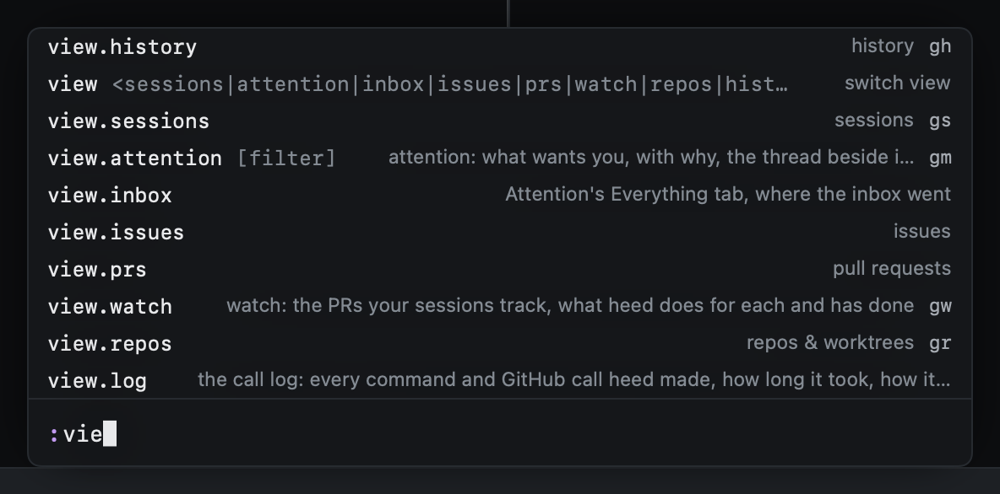

# The command line

`:` opens the command line. Every command has a name, and `:` runs any of them, with completion.

| Key | |
|---|---|
| `⇥` | Complete: one match is taken, several are narrowed to what they share, then taken in turn |
| `⇧⇥` | The previous match |
| `↓` `↑` | The next or previous match |
| `↩` | Run |
| `⎋` | Close |

The list above the line shows every match, scrolling past ten: commands with their keys, and short forms (marked
*alias*) with the command they run. After a space it completes the argument: view names for `:view`, session titles
for `:session.open`, pins for `:pin.jump`, tabs for `:tab.go`, hosts for `:host.filter`, Settings sections, pause
and snooze durations, Attention's tabs for `:view.attention` and `:attention.filter`, the call log's kinds for
`:log.kind`, the timeline's kinds, repos and places, the dashboard's ranges, merge queues for `:merge.run` and
`:merge.queue`, the session's PRs and issues for `:pr.untrack` and `:issue.remove`, lessons
for `:tutor`, `all` for `:tutor.hide` and agents for `:agent`. Paths, URLs and prompts are typed as they are.

The mode switches run from `:` too (`:mode.visual`). COMMAND's own `⇥` and `↩` (`command.complete`,
`command.submit`) are not offered: on the line they would act on themselves.

Short forms work too:

| Typed | Runs |
|---|---|
| `:start <prompt>` | Start work with that prompt |
| `:agent codex` | Start work with that agent |
| `:chat [prompt]` | Start a [chat](../sessions/chats.md) |
| `:promote` | Turn the chat into work |
| `:pr 2841` | Read pull request 2841 |
| `:track <url>` | Track a pull request in this session (`gU` takes the URL on the clipboard) |
| `:wt clean` | Clean up worktrees now (`:wt sweep` and `:cleanup.sweep` still work) |
| `:attention`, `:log`, … | Switch view; `:inbox` and `:issues` open [Attention](../github/attention.md#tabs) on Everything and on its issues |
| `:import <path>` | Import the worktree at a path |
| `:tutor [lesson]` | The [tutor](../getting-started/tutor.md)'s picker, or a lesson by name |
| `:back`, `:skip` | In the tutor: the step again, or skip it |
| `:help` | Every key |
| `:q` | Quit (in the tutor: leave the tutor) |

## Commands without a key

Everything you can do with the mouse, the menu bar or a global shortcut is a command too, so `:` reaches it and
`config.toml` can bind it:

| Command | |
|---|---|
| `:session.open <words>` | Go to the first session matching the words |
| `:tab.go <n>` | Go to tab n |
| `:filter.clear` | Clear the view's filter |
| `:view.attention [tab]` | Attention on a tab: `foryou`, `reviews`, `mentions`, `mine`, `agents`, `all`, `muted`, or `issues`, `ci` (the old `needs`, `tagged`, `inbox` still work) |
| `:attention.coverage` | [Coverage](../github/attention.md#is-anything-missing): what Attention has of each source against what GitHub says, and where it went |
| `:attention.done.new` | Done with everything in For you's [New since](../github/attention.md#for-you) (`X`) |
| `:attention.fold` | List For you's Mentioned before, or fold it again (`za`) |
| `:attention.summarize` | Write the thread's [catch-up summary](../github/attention.md#catch-up-summaries) again now (`U`, ↻ on the card) |
| `:resume` | The "pick up where you left off" dialog, as on launch |
| `:work.start.panel` | Start work in the floating panel |
| `:settings.open [page] [tab]` | Settings, on a page: `general`, `notifications`, `updates`, `agents`, `model-calls`, `decisions`, `worktrees`, `goals`, `history`, `github`, `pilot`, `orgs`, `attention`, `hosts`, `tools` or `keys` (the old `colors`, `cleanup`, `inference` still work); `orgs` and `pilot` take a tab, `agents` an agent and a tab |
| `:settings.find <words>` | [Search Settings](../configuration/settings.md#search): every setting whose name, description, page or config key (`grace_seconds`) has each word |
| `:settings.advanced`, `:settings.modified` | Flip Settings' [Show advanced and Only modified](../configuration/settings.md#show-advanced-and-only-modified) switches |
| `:settings.configure` | [Configure…](../configuration/configure.md): a profile, the settings still worth deciding, then the changes to apply |
| `:whatsnew.show` | [What's new](../configuration/whats-new.md): the features and new settings since the version you last opened |
| `:nudges.hide [always]` | Hide the title bar's [settings worth a look](../configuration/whats-new.md#the-title-bar-pill) pill until the next launch; `always` turns the settings nudge off |
| `:app.activate` | Bring the window to the front |
| `:repo.add [path]` | Add or clone a repo: the dialog, or the repo at a path |
| `:cleanup.rules` | The cleanup settings (Settings › Worktrees › Cleanup) |
| `:view <name>` | Switch view by name |
| `:pr.untrack [url]`, `:issue.remove [url]` | Stop tracking a PR, take an issue off the session |
| `:overlay.pr` | The session's PR overlay |
| `:welcome`, `:tools.detect`, `:update.check` | The getting-started checks, find git and gh again, look for an update |
| `:agents.stop`, `:config.edit`, `:app.quit` | Stop every agent, edit config.toml, quit |
| `:tutor.back`, `:tutor.skip`, `:tutor.hide [all]` | The tutor's step again, skip it, hide its reminder |

`?` lists these too, by their `:name`, next to the commands that have keys.

The [key reference](reference.md) lists every command name.
