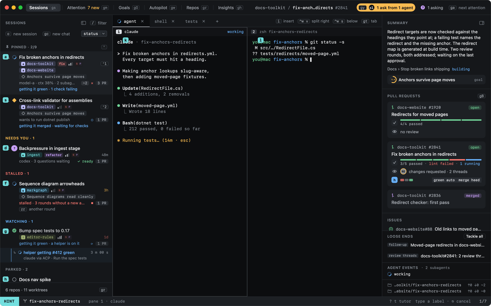
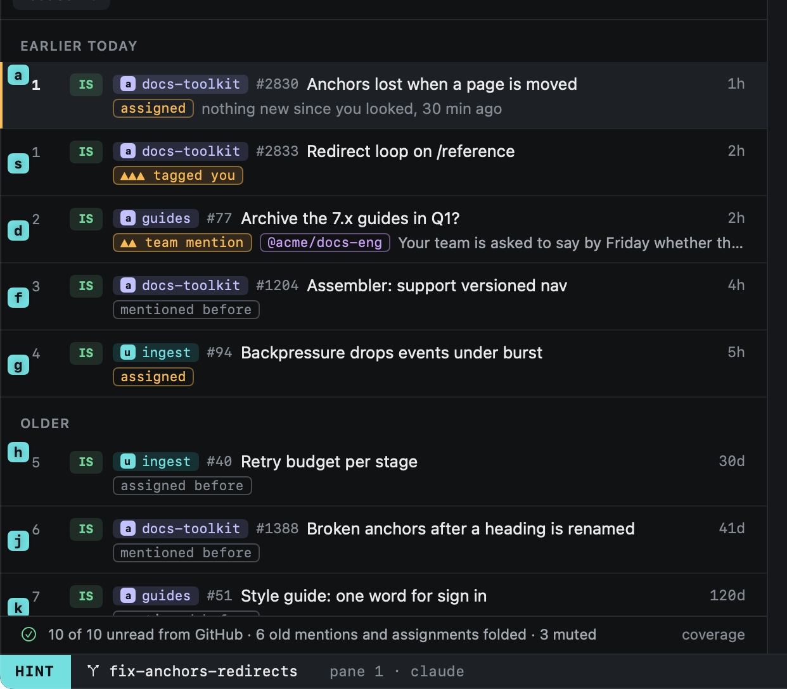

# Hints

`f` labels everything you can jump to in the current view. You type a label, and the cursor goes there. Hints save the
`j` and `k` presses between you and a row far down the list.

| Key | |
|---|---|
| `f` | Jump: the cursor moves to the labelled item |
| `F` | Jump and act: a pane enters INSERT, and some list rows open |
| `⎋` | Cancel |

## The labels

heed labels items in the order they appear on screen. With 26 items or fewer, each label is one letter, from the home
row outwards: `a`, `s`, `d`, `f` and so on. With more, every label is two letters, and you type both.

Typing a letter that starts no label cancels hints. Nothing moves.

## What gets labelled

- **Sessions.** The labels go on every session in the sidebar and every pane of the open tab.
- **Other views.** The labels go on the list's rows: Attention, PRs, Autopilot, Repos, History, the ledger, the Mindmap, the call log, Goals and the rest.

## What `F` does

`F` jumps like `f`, then acts on what it landed on:

| On | `F` does |
|---|---|
| A pane | Enters INSERT, with the keyboard in that pane |
| A row in Attention, PRs or Autopilot's Now | Opens the row in the reader |
| A repo in Repos | Opens the worktree's session, or imports it |
| A goal | Opens the goal |
| A session in the sidebar, or a row in History | Moves the cursor, as `f` does |
