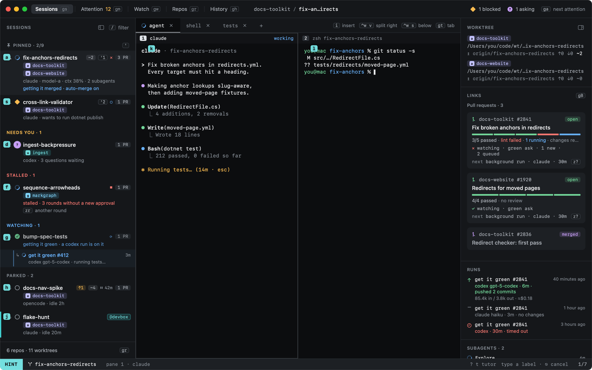
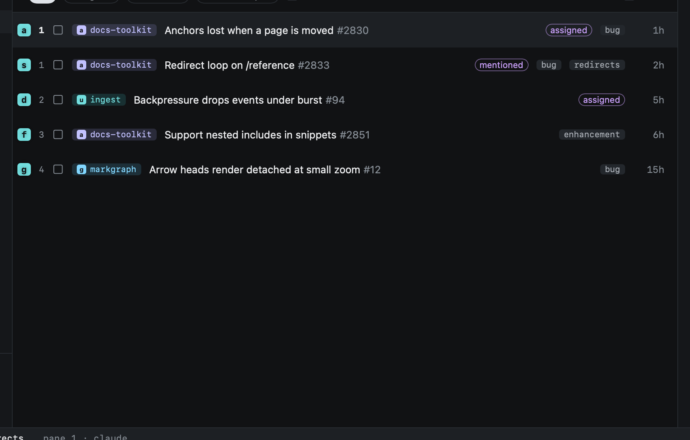

# Hints

`f` labels everything you can jump to in the current view; type a label to go there.

| Key | |
|---|---|
| `f` | Jump: the cursor moves there |
| `F` | Jump and act: a pane enters INSERT, a list row opens |
| `⎋` | Cancel |

In Sessions the labels go on sessions and panes; in the other views (Attention, Watch, Repos, History, the call log
and the rest) they go on the list's rows.

