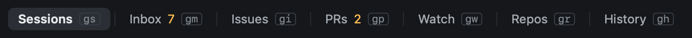

# Views

Heed has five views, named along the top with their keys. Every view key starts with `g`.

| Key | View |
|---|---|
| `gs` | [Sessions](../sessions/index.md) |
| `gm` | [Attention](../github/attention.md) |
| `gi` | [Attention](../github/attention.md), on Issues |
| `gp` | [Attention](../github/attention.md), on My PRs |
| `gw` | [Watch](../github/watch.md) |
| `gr` | [Repos](../worktrees/index.md) |
| `gh` | [History](../history/index.md) |

Clicking a view's name works too, and `:attention`, `:watch` and the rest switch by name. The middle of the title bar
shows what you are looking at: the session's branch and PR, or the item under the cursor. On narrow windows the view
keys are hidden first, never the names.

In History, `T`, `L` and `D` show its [timeline](../history/timeline.md), [ledger](../history/ledger.md) and
[dashboard](../history/dashboard.md); the History tab stays lit.

Some views have no key and no name along the top, and are reached by name:

- `:inbox`, `:issues` and `:prs`: the [Inbox](../github/inbox.md), [Issues](../github/issues.md) and
  [Pull requests](../github/pull-requests.md) views, which Attention gathers into one feed.
- `:log`: the [call log](../reference/call-log.md) of every command and GitHub call Heed made.

`⎋` closes an overlay or a reader, but never changes the view: views are places of their own.
