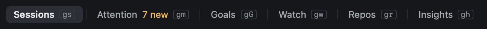

# Views

Heed has six views, named along the top with their keys. Every view key starts with `g`.

| Key | View |
|---|---|
| `gs` | [Sessions](../sessions/index.md) |
| `gm` | [Attention](../github/attention.md) |
| `gG` | [Goals](../goals/index.md) |
| `gi` | [Attention](../github/attention.md), on Issues |
| `gp` | [Attention](../github/attention.md), on My PRs |
| `gw` | [Autopilot](../github/autopilot.md): Can do `C`, Where `W`, Now `N`, Done `D` |
| `gr` | [Repos](../worktrees/index.md) |
| `gh` | [Insights](../history/index.md), on its [dashboard](../history/dashboard.md) |

Clicking a view's name works too, and `:attention`, `:watch` and the rest switch by name. The middle of the title bar
shows what you are looking at: the session's branch and PR, or the item under the cursor. On narrow windows the view
keys are hidden first, never the names.

In Insights, `D`, `L`, `M`, `U` and `T` show its [dashboard](../history/dashboard.md), [ledger](../history/ledger.md),
[Mindmap](../history/mindmap.md), [standups](../history/standup.md) and the agents'
[OpenTelemetry](../history/opentelemetry.md) from any of them, and the same key again
[History](../history/index.md#history); the Insights tab stays lit, and the tab strip under it says which one shows.
`view.history`, the name `gh` had before, still opens Insights.

Some views have no key and no name along the top, and are reached by name:

- `:prs`: the [Pull requests](../github/pull-requests.md) view, which Attention gathers into its My PRs tab.
  `:inbox` and `:issues` open [Attention](../github/attention.md#tabs) on Everything and on its issues, where the Inbox
  and Issues views were.
- `:log`: the [call log](../reference/call-log.md) of every command and GitHub call Heed made.
- `:trace`: a session's [trace](../history/opentelemetry.md#a-sessions-trace) from its agent's own OpenTelemetry,
  also `t` on a session in Sessions; `t` or `⎋` goes back.

`⎋` closes an overlay or a reader, but never changes the view: views are places of their own.
