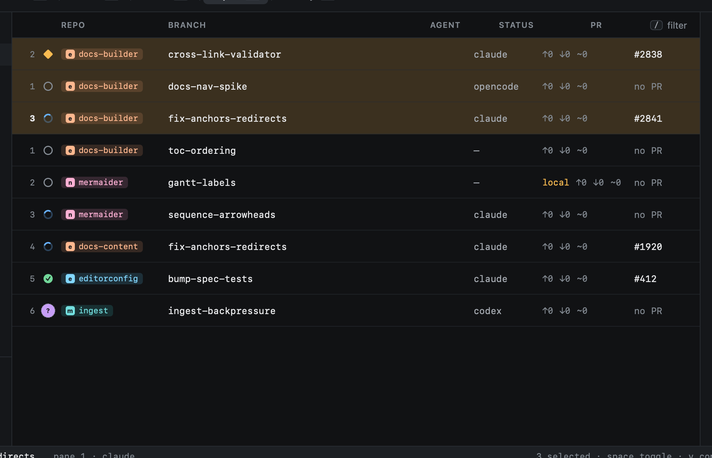

# Selecting

`v` starts VISUAL: move to extend the selection from where you started, `space` to add or drop single rows, then act
on all of them at once.

| Key | |
|---|---|
| `j` `k` `gg` `G` | Extend the selection |
| `space` | Add or drop the row under the cursor |
| `d` | Remove the selected (asks first) |
| `p` | Pin the selected |
| `y` | Copy their paths |
| `o` | Open them (in Repos: their sessions, importing those without one) |
| `⎋` | Back to NORMAL |

In the Inbox and Issues, `space` picks items without VISUAL, for [starting a session](../start-work/from-github.md)
from several at once.
