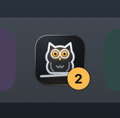

# The Dock

When sessions need you, heed's Dock icon gets a badge with how many. The badge sits at the icon's bottom right, and its
colour is the state's.



## What the badge counts

The badge counts the sessions that are blocked or asking. The count is the same number the
[menu bar](menu-bar.md) shows.

| Colour | When |
|---|---|
| Amber | At least one session is blocked, waiting on a permission |
| Violet | Sessions are asking, and none is blocked |

Blocked outranks asking, so one blocked session turns the whole badge amber. See [Agent states](../concepts/agent-states.md).

The badge disappears when no session needs you. It updates while heed runs in the background, with its window closed.

## Turning it off

The badge is on by default. Switch **Dock state** off in Settings (`⌘,`), or set it in `config.toml`:

```toml
[ui]
dock_state = true
```

You can turn off the badge and the [menu bar item](menu-bar.md) independently.
