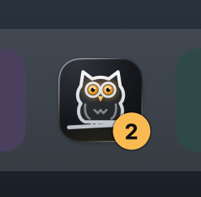
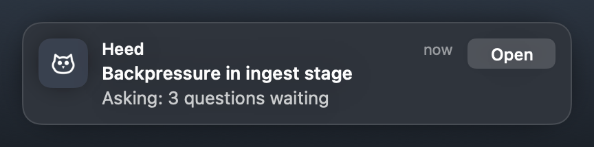

# Outside the window

Agents keep working while you are in another app. heed tells you when an agent needs you, and gets you back with one key.

The menu bar owl counts the sessions that need you, and its menu lists them.

- [The menu bar](menu-bar.md): an owl that counts what needs you.
- [The Dock](dock.md): the same count, as a badge.
- [Notifications](notifications.md): a notification when a session starts needing you, or when an Attention rule asks for one. None arrive in quiet hours.
- [Global shortcuts](global-shortcuts.md): Start work from any app, and heed to the front.

The Dock icon shows the same count as a badge in the state's colour.

A notification names the session and what it needs.

With the menu bar item on, closing the window keeps heed and its agents running. Without it, closing the window quits.
