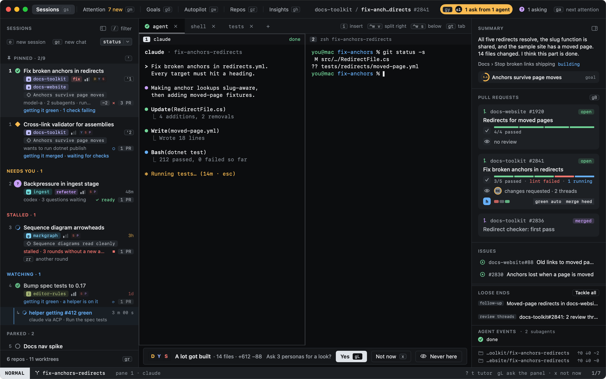

# Personas in sessions

A [persona](../agents/index.md) can look at a session's work. Personas look at it only when something happened that is worth a look, and never type into the session.
While the agent works, the only sign of them is a faint stack of tiles on the session's sidebar row: up to three
personas whose scope covers its repos and that join sessions (**before a PR** or **every session's plan**), the most
relevant first (a repo's before an org's before everywhere, then learned and from your repos before yours and heed's).
Out of the box the Skeptic and the Purist join sessions (before a PR and every session's plan), so a fresh library has
someone to offer; heed's other built-ins join goal panels only. It is a default, not a file: their **Joins** switches
show it, and turning one off writes the built-in's file saying so. An offer only asks: nothing is called until you
say yes.




At a **milestone**, a line at the foot of the session's panes offers a look: the tiles, what happened, and "Ask 3
personas for a look?".


| Milestone | When | Default |
|---|---|---|
| A lot got built | Files or lines changed since the last look pass `built_files` (10) or `built_lines` (300), from the sizes heed measures for open sessions | On |
| The agent says it's done | Its turn ends on "done", "ready for review", "I think this part is done" (and does not ask you something) | On |
| Before a PR opens | The agent's `gh pr create` (or GitHub's MCP tool), seen through its [permission hook](../autopilot/approvals.md) | On |
| A second repo | The session starts changing a repo it had not | Off |
| Long without a look | `long_hours` (4) of work since the panel last looked | Off |

Each milestone is offered once. **Yes** (`gL`) asks them; **Not now** (`x` while the line shows) lets the offer go,
and milestones count again from there, so the next one offers again; **Never here** (`N`) ends offers in this session
(you can still ask). The line stacks with the [helpers' line](../sessions/sidebar.md) and the growing-into-a-goal line,
most urgent first: a held PR or a verdict with a concern goes above a working helper; an offer waits under it.

**The look** is one cheap model call for every persona at once, as a goal panel's is: they read the session's task,
the agent's last message and its diff against its base (bounded: every file keeps its header and a share of the
room), and each gives a verdict (happy ✓, a concern ?, against ⇄), one line, and a fix when not happy. The line
becomes the verdict: the counts and the top concern in a few words. `gL` opens it:


| Key | Does |
|---|---|
| `j` `k` | The persona below or above |
| `↩` | **Send to the agent**: the concerns and their fixes, through the agent's [inbox](../agents/messages.md) (typed only when it has none, under the usual rules) |
| `i` | **Talk to one**: a small chat with the persona under the cursor (`i` types, `⎋` closes) |
| `x` | Dismiss the verdict |
| `⎋` | Close |

**Before a PR opens**, heed holds the agent's `gh pr create` in its permission hook for up to `hold_seconds` (120)
while the panel looks. Everyone happy, it goes on at once to the [approvals](../autopilot/approvals.md), as it would have. A
concern, and the line turns amber with how long it is held; `gL` shows what they said:


| Key | Does |
|---|---|
| `↩` | **Let it open**: the hook allows this one `gh pr create` |
| `s` | **Send the concern first**: the hook says no, with the concerns as the reason, and the agent addresses them before it tries again |
| `h` | **Hold the PR**: the hook says no, and the agent is told to wait for you |

Nobody choosing within the hold, it goes on to the approvals as it would have: heed never opens or blocks a PR on
its own. The hold only applies when the agent asks permission for the command: a `gh pr create` your agent is
allowed to run without asking never reaches the hook.

**Asking by hand**: `gL` on a session with nothing offered asks now. Right-click a session (or the Session menu) for
**Ask the panel…**: the relevant personas, or only one of those in scope. With nobody joining sessions in its scope (the
Skeptic and the Purist switched off), asking still gets the Skeptic (and your team's style when heed has one).

**Settings › Personas › In sessions** (`s` on the library) has the milestones' switches and thresholds, who looks,
and when it offers: **ask me** (the line), **look without asking**, or **never**. `j` `k` move over the milestones,
`␣` turns one on or off.


```toml
[personas]
built = true
built_files = 10
built_lines = 300
says_done = true
before_pr = true
hold_seconds = 120     # at most 180
second_repo = false
long = false
long_hours = 4
offers = "ask"         # "ask", "look" or "never"
```
