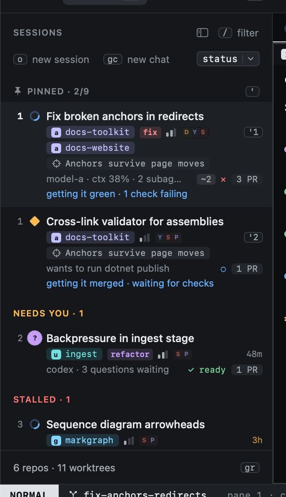
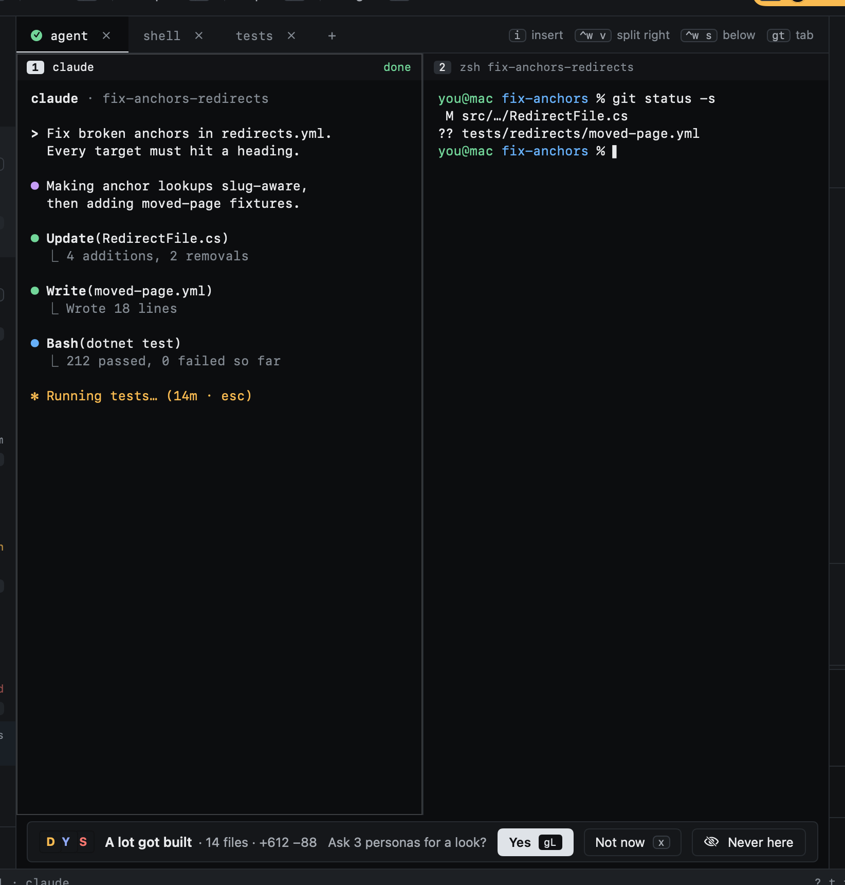
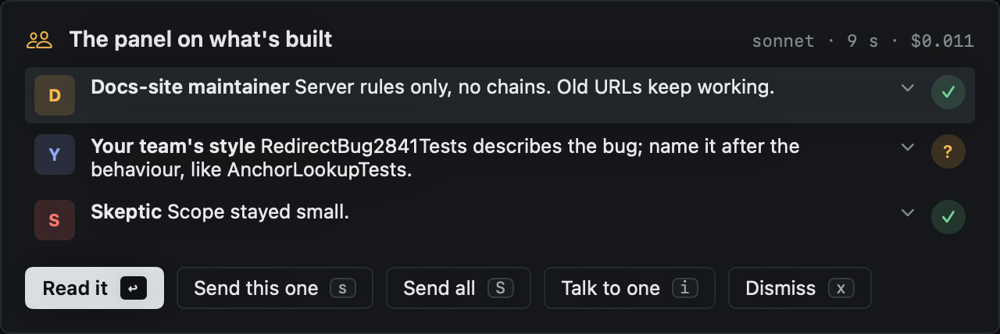
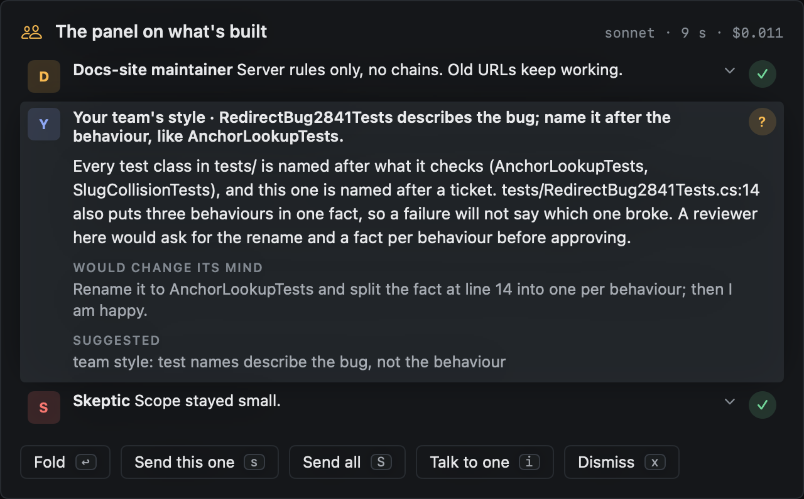
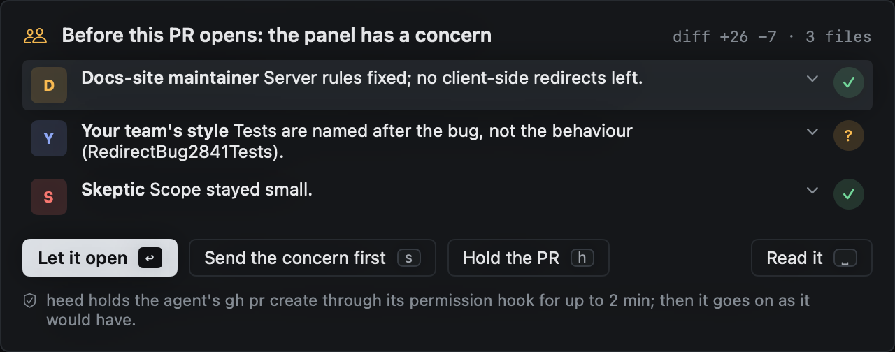
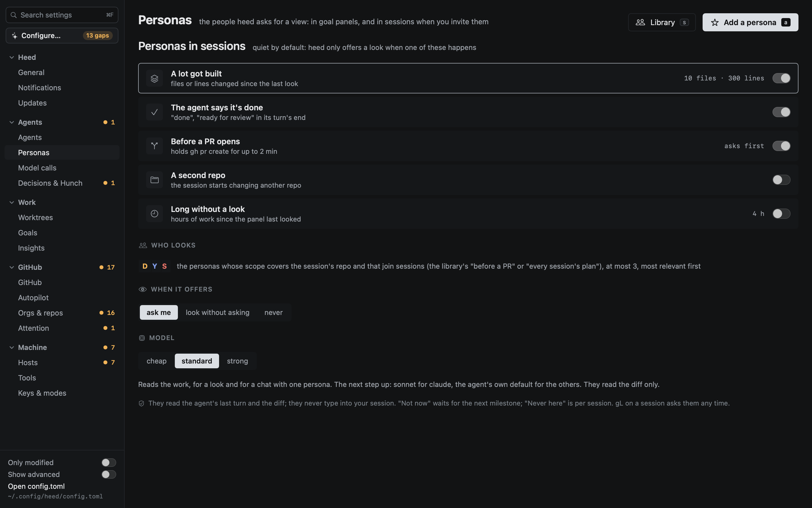

# Personas in sessions

A [persona](../agents/index.md) can look at a session's work. Personas look at the work only when something happened that is worth a look, and they never type into the session.
While the agent works, the only sign of the personas is a faint stack of tiles on the session's sidebar row: up to three
personas whose scope covers the session's repos and that join sessions (**before a PR** or **every session's plan**), the most
relevant first (a repo's before an org's before everywhere, then learned and from your repos before yours and heed's).
Out of the box the Skeptic and the Purist join sessions (before a PR and every session's plan), so a fresh library has
someone to offer. heed's other built-ins join goal panels only. This is a default, not a file: the personas' **Joins**
switches show it, and turning one off writes the built-in's file saying so. An offer only asks. heed calls no persona
until you say yes.




At a **milestone**, a line at the foot of the session's panes offers a look: the tiles, what happened, and "Ask 3
personas for a look?".



| Milestone | When | Default |
|---|---|---|
| A lot got built | Files or lines changed since the last look pass `built_files` (10) or `built_lines` (300), from the sizes heed measures for open sessions | On |
| The agent says it's done | Its turn ends on "done", "ready for review", "I think this part is done" (and does not ask you something) | On |
| Before a PR opens | The agent's `gh pr create` (or GitHub's MCP tool), seen through its [permission hook](../autopilot/approvals.md) | On |
| A second repo | The session starts changing a repo it had not | Off |
| Long without a look | `long_hours` (4) of work since the panel last looked | Off |

heed offers each milestone once. **Yes** (`gL`) asks the personas; **Not now** (`x` while the line shows) lets the offer go,
and milestones count again from there, so the next milestone offers again. **Never here** (`N`) ends offers in this
session, and you can still ask by hand. The line stacks with the [helpers' line](../sessions/sidebar.md) and the growing-into-a-goal line,
most urgent first: a held PR or a verdict with a concern goes above a working helper; an offer waits under it.

**The look** is one model call for every persona at once, as a goal panel's look is. The personas read the
session's task, the agent's last message and its diff against its base (bounded: every file keeps its header and a share
of the room). Each persona gives a **verdict** (happy ✓, a concern ?, against ⇄), a one-line **headline**, its
**reasoning** (two to five sentences in its own voice, naming the files and lines of the diff that made it decide),
**what would change its mind**, and a fix when not happy. The offer line and the verdict line stay one line: the line
becomes the counts and the top concern in a few words. `gL` opens the verdict, one headline per persona:



**Reading it.** `↩` (or `␣`, or a click) on a persona reads its full reasoning in place: the reasoning, what would change
its mind and its fix, under its headline. `j` `k` move to the next persona and the reading follows; `↩` again (or a click
on it) folds it. The popover scrolls when the reasoning needs more room than the window has. A look made before heed asked
for reasoning shows its one line and says so.



| Key | Does |
|---|---|
| `j` `k` | The persona below or above (a persona being read stays open as you move) |
| `↩` `␣` | **Read it**: the persona under the cursor's full reasoning, in place; again: fold it |
| `s` | **Send this one**: that persona's full reasoning, with what would change its mind and its fix, to the agent through its [inbox](../agents/messages.md) (typed only when it has none, under the usual rules) |
| `S` | **Send all**: every persona's full reasoning, the happy ones too |
| `i` | **Talk to one**: a small chat with the persona under the cursor, which opens with its reasoning (`i` types, `⎋` closes) |
| `x` | Dismiss the verdict |
| `⎋` | Fold the reasoning, then close |

`s` sends in the PR overlay and in a held PR's popover too, and `␣` is the toggle that works in both, because `↩` is
**Let it open** on a held PR.

**The model.** The look runs on `look_model` (**Settings › Personas › In sessions › Model**), `standard` by default, and so
does a chat with one persona. The tiers are the ones every model call has (see [Heed's own model calls](../agents/model-calls.md#model-tiers)):

| `look_model` | Model | What it does |
|---|---|---|
| `cheap` | What heed's short model calls use: haiku for claude | One call with tools off; reads the diff only |
| `standard` | The next step up: sonnet for claude, the agent's own default for the others | One call with tools off; reads the diff only |
| `strong` | claude's opus (the agent's own default for the others) | A headless, read-only run of your default agent (claude or codex) in the session's own worktree, the run the [goal wizard](../goals/first-goal.md)'s plan uses: the personas can read the code around the diff |

A `strong` look costs more and takes longer; when it cannot run (a session on another machine, no worktree, a default
agent that is not claude or codex), heed makes the look at `standard` and says so. The popover's header shows what read it,
as `sonnet · 9 s · $0.011`, and `opus · read the code · 41 s · $0.09` for a strong one.

**Before a PR opens**, heed holds the agent's `gh pr create` in its permission hook for up to `hold_seconds` (120)
while the panel looks. When every persona is happy, the command goes on at once to the [approvals](../autopilot/approvals.md), as it would have. When a
persona raises a concern, the line turns amber with how long the command is held; `gL` shows what the personas said:



| Key | Does |
|---|---|
| `↩` | **Let it open**: the hook allows this one `gh pr create` |
| `␣` | **Read it**: the persona under the cursor's full reasoning, in place |
| `s` | **Send the concern first**: the hook says no, with the concerns as the reason, and the agent addresses them before it tries again |
| `h` | **Hold the PR**: the hook says no, and the agent is told to wait for you |

When you choose nothing within the hold, the command goes on to the approvals as it would have: heed never opens or
blocks a PR on its own. The hold applies only when the agent asks permission for the command. A `gh pr create` your
agent is allowed to run without asking never reaches the hook.

**Asking by hand**: `gL` on a session with nothing offered asks now. Right-click a session (or the Session menu) for
**Ask the panel…**: the relevant personas, or only one of the personas in scope. When no persona joins sessions in the
scope (the Skeptic and the Purist switched off), asking still gets the Skeptic, and your team's style when heed has one.

**Settings › Personas › In sessions** (`s` on the library) has the milestones' switches and thresholds, who looks,
when heed offers a look (**ask me**, the line, **look without asking**, or **never**) and the **model** that reads the work. `j` `k` move over the milestones,
`␣` turns one on or off.



```toml
[personas]
built = true
built_files = 10
built_lines = 300
says_done = true
before_pr = true
hold_seconds = 120     # at most 180
second_repo = false
long = false
long_hours = 4
offers = "ask"         # "ask", "look" or "never"
look_model = "standard"  # "cheap", "standard" or "strong" (reads the code, in the session's worktree)
```
