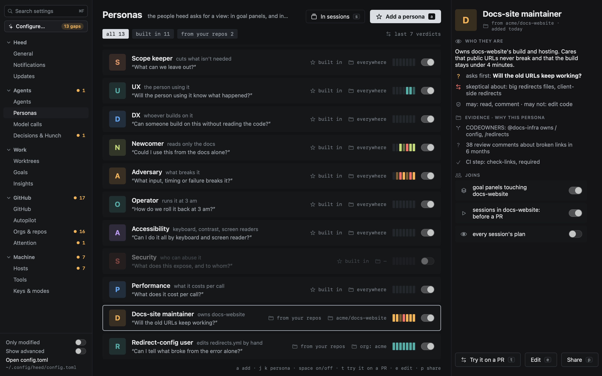
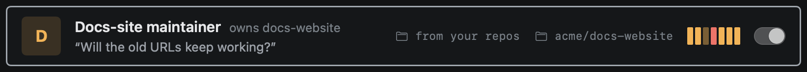
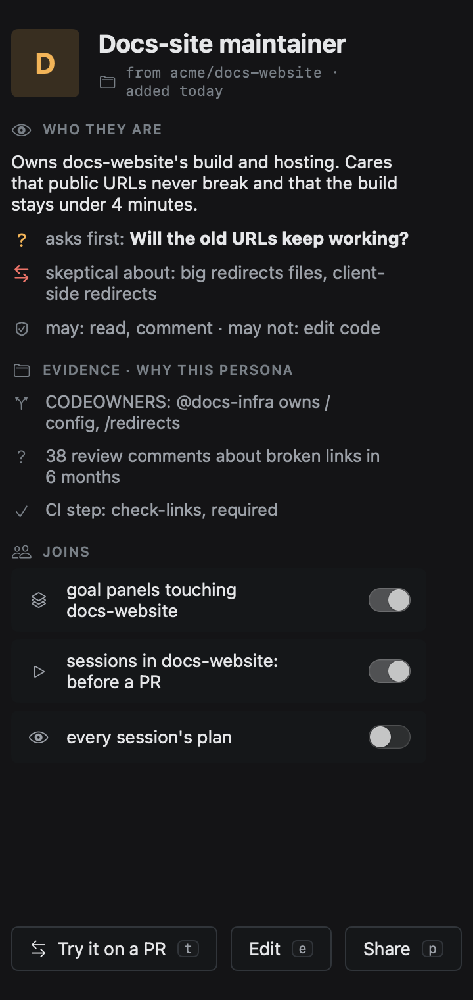
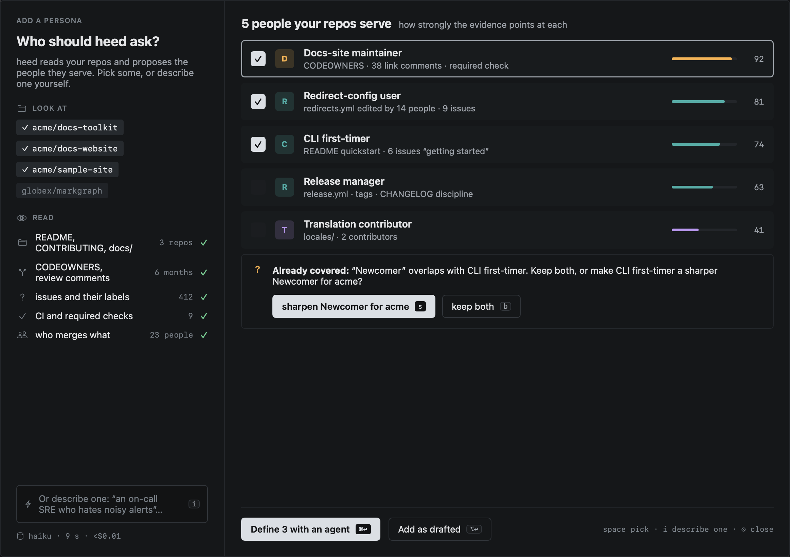
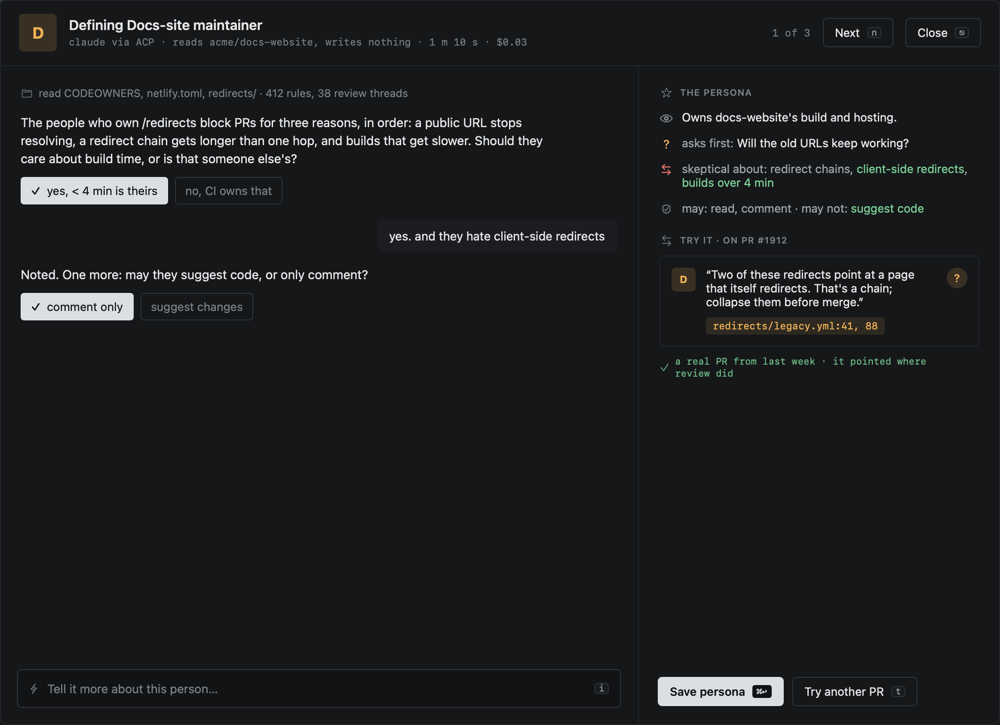

# Personas

Personas read a plan and look in on a session, each from the view of one kind of person.



## In this section

- [The library](#the-list) (this page): the personas, how to add one from your repos, and how to define one with an agent.
- [Personas in sessions](in-sessions.md): the offers at a session's milestones, and the look before a PR opens.
- [Personas on a goal](goal-panels.md): the experts a goal needs, from its board.

A **persona** is a kind of person heed asks for a view: the Skeptic who argues not to do it, the newcomer who only
reads the docs, the maintainer who owns your docs site. **Settings › Personas** is the one library of them. Goal
panels ([the new-goal wizard](../goals/index.md)'s step 2) seat their personas from it, Goals'
[persona pane](goal-panels.md) copies from it, and the personas that join sessions look at a session's work at its
milestones ([Personas in sessions](in-sessions.md)). `:personas.open` (or
`:settings.open personas`) opens it.

## The list

Every row is one persona:



| Part | What it says |
|---|---|
| Tile | Its letter, in its tint: the same tint wherever heed draws it |
| Name and who | The persona, and who it is in a few words |
| The quote | The question it asks first |
| Source | A star for built in, a folder for from your repos, a bolt for learned, a person for yours |
| Scope | Where it applies: everywhere, `org: acme`, or one repo (`acme/docs-website`) |
| Bars | Its last seven verdicts on goal panels, newest right: its tint for happy, dimmed for a concern, red for not; empty slots until a panel has read a plan with it |
| Switch | On or off. Off, it stays in the library and nothing asks it |

The built-ins are heed's panel personas: Skeptic, Purist, Scope keeper, UX, DX, Newcomer, Adversary, Operator,
Accessibility, Security and Performance. They are always in the library. Turn one off, or edit it, and heed writes
its file in the library saying so; your version is the one panels seat. The chips over the list filter by source.

**Your team's style** shows only when the library has one: a persona whose source is `learned`, or one named "team
style". heed does not learn one on its own yet, so it is there only when you add it.

## The persona under the cursor

The right side says who they are, what they ask first, what they are skeptical about and what they may and may not do;
the **evidence**, why this persona (for one from your repos: the CODEOWNERS line, the review comments, the required
check that pointed at it); and what it **joins** on its own:



| Join | What it does |
|---|---|
| goal panels touching its scope | It sits on the panel of every goal whose repos are in its scope, with the built-ins the plan invites |
| sessions in its scope: before a PR | It may look at sessions in its scope ([Personas in sessions](in-sessions.md)), first in line before a PR opens |
| every session's plan | It may look at sessions in its scope, at every milestone |

| Key | Does |
|---|---|
| `j` `k` | The persona below or above |
| `␣` | Turn it on or off |
| `t` | **Try it on a PR**: a cheap model call reads a recent merged PR in its scope (its diff, through `gh pr diff`) as this persona and shows its verdict, its quote and the lines it points at; when review commented on the same files, it says so, else it shows what review actually said. `t` again tries the next PR |
| `e` | Edit its file in place; `e` again, `⎋` or `⌘S` saves |
| `p` | Share: its file on the pasteboard, to send to a teammate for their library |
| `a` | Add a persona |
| `s` | In sessions: when personas look at sessions (`s` or `⎋` back to the library) |

The keys work while Personas shows in the Settings window; they are bound in `[keys.personas]`.

## In sessions

The personas that join sessions look at a session's work at its milestones: an offer at the foot of the panes, a PR held while they look, or a look you ask for by hand. [Personas in sessions](in-sessions.md) has the milestones, the keys and the `[personas]` settings.

## Where a persona applies

A persona's scope walls it in. One from `acme`'s repos is never offered to work in another org: a goal panel seats it
only when the goal's repos are in its scope, Goals' `:persona.use` only offers library personas on and in scope for
the goal, and a goal's derivation copies a library file only when it is. A persona with no scope applies everywhere.
heed proposes a persona only within the repos it read, so one drawn from an org's repos is scoped to that org or one
of its repos, never everywhere.

## Add a persona

`a` opens **Add a persona**. heed picks up to three repos of the org you work in most (the session under the cursor's
org, if any) and starts reading; click a repo to read it too or leave it out (one org at a time).



For each repo heed reads, with `gh` and the checkout: README, CONTRIBUTING and `docs/`; CODEOWNERS and the last
hundred review comments; issues and their labels; the required checks and CI workflows; and who merged the last forty
PRs, in which folders. The left side counts each. All of it goes into a compact digest (at most 12,000 characters,
each section cut to a few lines) that one cheap model call reads, through heed's [model calls](../agents/model-calls.md). It
proposes the people the repos serve, each with its evidence and a strength from 0 to 100: how strongly the evidence
points at them. A proposal without evidence is dropped; at most six show, strongest first, and the ones at 70 or more
start picked.

When a proposal says the same as a persona you have (the model names it, or most of the words in who it is and what it
asks first are the same), heed asks: **sharpen** that one (`s`: the proposal becomes, say, "Newcomer for acme", which
takes the Newcomer's seat on acme's panels) or **keep both** (`b`).

| Key | Does |
|---|---|
| `␣` | Pick or unpick the proposal under the cursor |
| `i` | Describe one in your words ("an on-call SRE who hates noisy alerts"); heed drafts it and picks it |
| `r` | Read again |
| `⌘↩` | Define the picked with an agent |
| `⌥↩` | Add the picked as drafted |
| `⎋` | Close |

## Define with an agent

`⌘↩` opens one session per picked persona, over [ACP](../autopilot/helpers.md) with your helpers' agent, in the persona's repo. It
reads and writes nothing: reading and searching go ahead, anything else is refused, as when defining a goal's part.
It asks what it cannot tell from the repo, one question at a time with two or three answers (`1` `2` `3`, or `i` to
type one), and builds the persona on the right as you go: what it added or changed since the proposal is marked.



`t` tries the persona as it stands on a recent merged PR, as on the list. `n` goes to the next picked persona, `⌘↩`
saves this one into the library and goes on, `⎋` closes without saving.

## The file

A library persona is a plain file, `~/Library/Application Support/Heed/personas/<name>.md`, in the same format as a
goal's [persona files](goal-panels.md#the-personas-file), with a few more lines, each written only when it is not
the default (so an older file reads and saves as it was):

```text
name: Docs-site maintainer
skeptical about: big redirects files, client-side redirects
asks first: Will the old URLs keep working?
may: read, comment
may not: edit code
who: owns docs-website
about: Owns docs-website's build and hosting. Cares that public URLs never break.
scope: repo acme/docs-website
joins: goal panels, before a PR
source: repos
added: 2026-11-11
evidence:
- CODEOWNERS: @docs-infra owns /config, /redirects
- CI step: check-links, required
```

`on: no` turns it off; `sharpens: newcomer` makes it a built-in's sharper version within its scope.

**Next:** [Insights](../insights/index.md).
