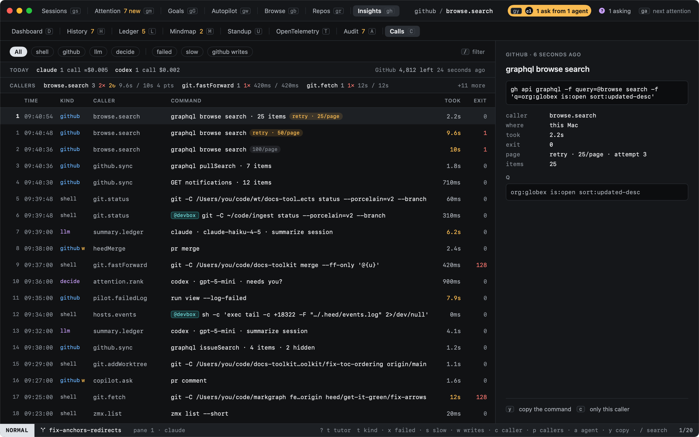
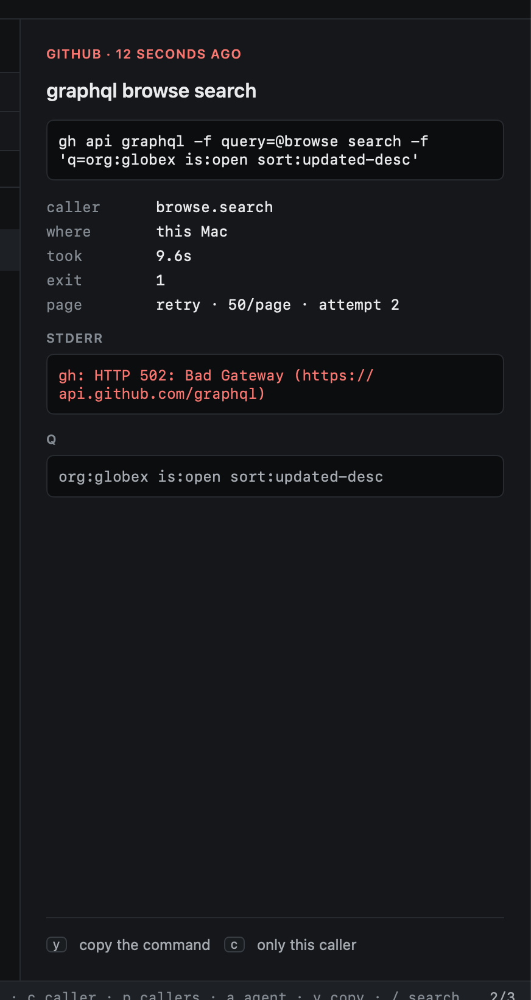
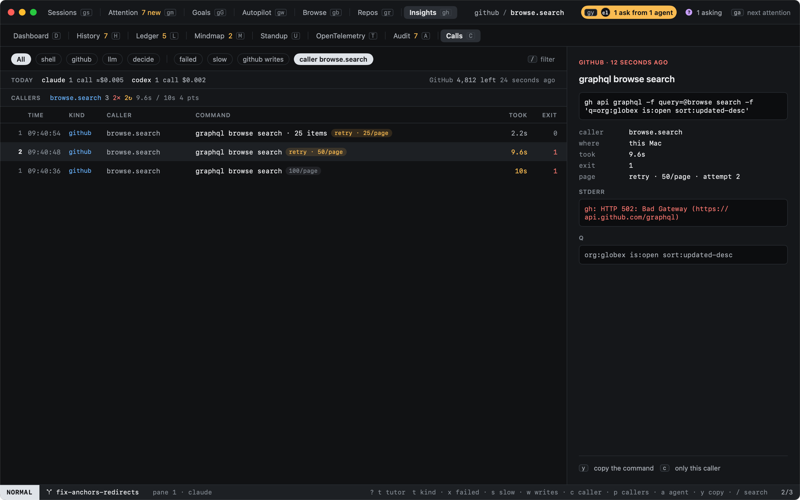
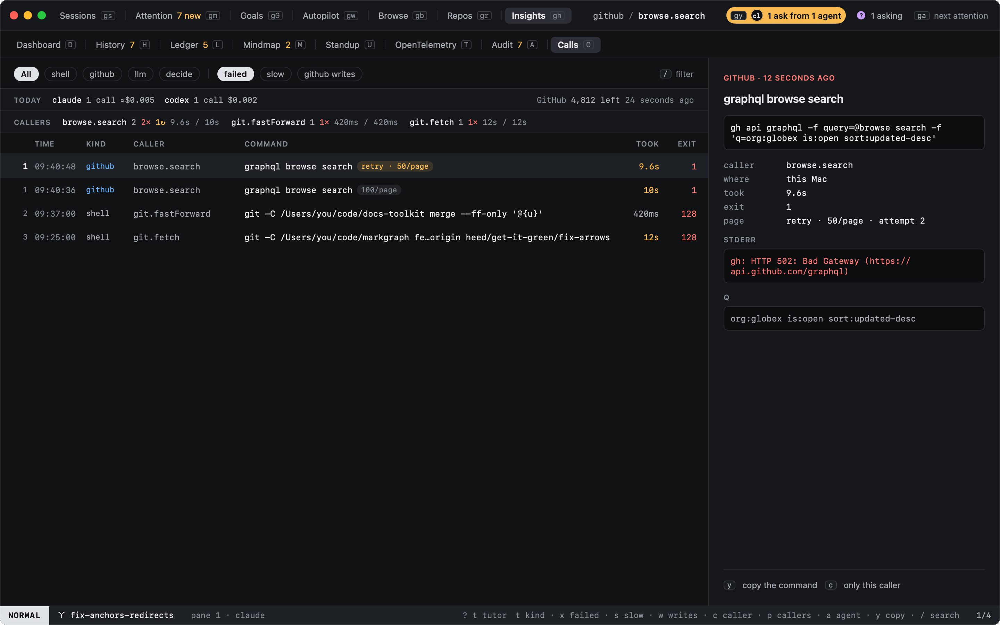
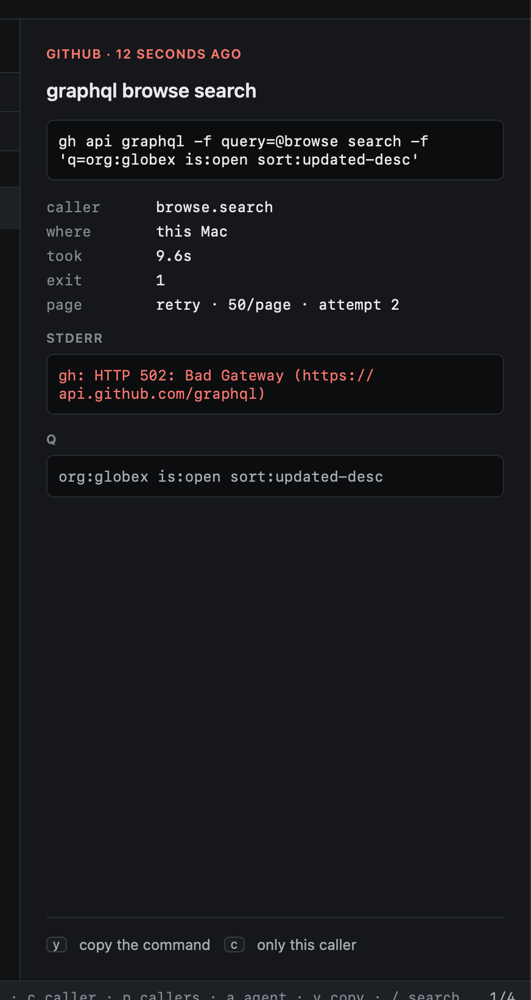
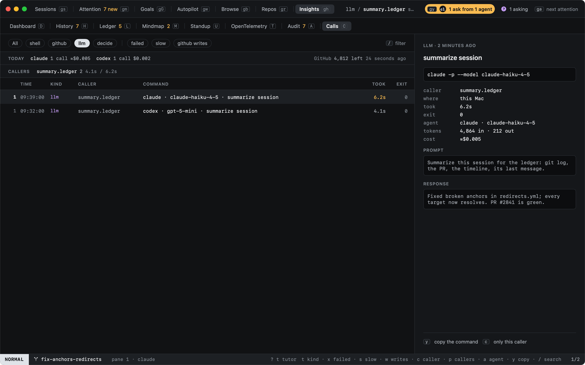
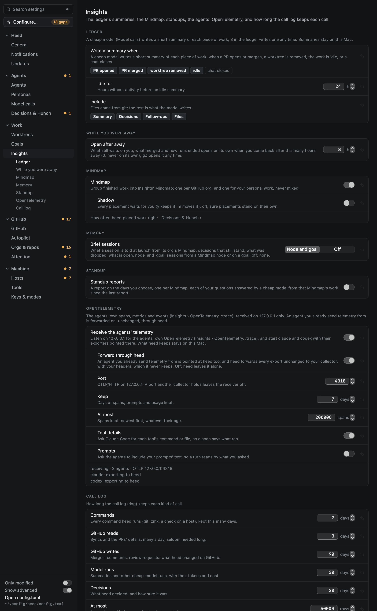

# Call log

The call log is Calls, a view of [Insights](../insights/index.md): every command Heed ran (git, zmx, a check on a
host) and every GitHub call it made, newest first, as they happen. `C` in any Insights view opens it (`C` again returns
to the dashboard), a click on the Calls tab does too, and `:log` (or `:view log`) opens it from anywhere. The Insights
tab stays lit, and the other Insights views' capitals work here as they do everywhere in Insights.

Each row says when, what kind, which part of Heed made the call (its caller: `git.status`, `github.sync`,
`heedMerge`), what ran, how long it took and its exit code. A call to a host shows the host, and the command as it ran
there, not the ssh line around it. GitHub calls show their operation (`graphql pullSearch`, `GET notifications`,
`pr merge`), how many items came back and how many SAML withheld; a write to GitHub is marked `w`.

| Key | |
|---|---|
| `t` | All calls, or one kind: `shell`, `github`, `llm`, `decide` (`:log.kind github` picks one) |
| `x` | Only calls that failed |
| `s` | Only slow calls (5 seconds or more) |
| `w` | Only GitHub writes |
| `c` | Only the caller of the call under the cursor; again for every caller |
| `p` | Every caller in turn, then back to all (`:log.callers browse.search` picks one by name; `:` completes the callers the log has) |
| `a` | Only the agent of the call under the cursor; again for every agent |
| `y` | Copy the command |
| `/` | Search commands, callers, operations, hosts and error output |

Right-click a call to copy it or narrow the log to its caller.

## Callers

Under today's usage, a second strip sums the calls shown per caller: how often it ran, how many failed (`✗`), how
many were asked again (`↻`), the median and the 95th percentile of how long they took, and the rate-limit points the
GitHub ones spent. The callers with the most failures come first; a click on one narrows the log to it. The numbers
cover the rows the filters show, so `x` turns them into a count of what failed.

## Retries

Browse asks GitHub for a page of results and, when GitHub answers 502 or times out, asks again at a smaller page (100,
50, 25, 10, then 10 without the parts that cost most). Each of those GitHub calls is its own row, marked with the page
size it asked for: `100/page` for the first ask, `retry · 50/page` for each ask after a failure. The detail has the same
under `page`.

## From a failure to its call

When Browse could not refresh, its banner says so and offers **See the call**. A click (or `:log.see`) opens Calls on
Browse's searches only, with the cursor on the newest one that failed. `:log.see git.fetch` does the same for any
caller.

The detail on the right has the whole command, where it ran, its error output, and its output when it failed. A
command that worked keeps only its error output; Heed never keeps environment variables, nor the output of anything
that prints a credential.

## Today's usage

The strip above the list sums today's model calls (`llm`) per agent, with their cost: what the agent reported, else
an estimate (marked ≈) from `[usage.prices]`. None are built in, so without prices only reported costs show. On the
right, what GitHub's rate limit had left when Heed last asked.

## How long calls are kept

`log.sqlite` in `~/Library/Application Support/Heed` keeps each kind for its own number of days, set under `[log]`
in config.toml or under Call log in Settings › Insights (advanced: turn on Show advanced, or search for `log.`), and at most `max_rows` of each kind; Heed prunes it every
hour.

| Key | Default | |
|---|---|---|
| `shell_days` | 7 | Commands |
| `github_read_days` | 3 | GitHub calls that read |
| `github_write_days` | 90 | GitHub calls that changed something |
| `llm_days` | 30 | Model runs |
| `decide_days` | 30 | Decisions |
| `max_rows` | 50000 | Rows per kind, newest kept |
