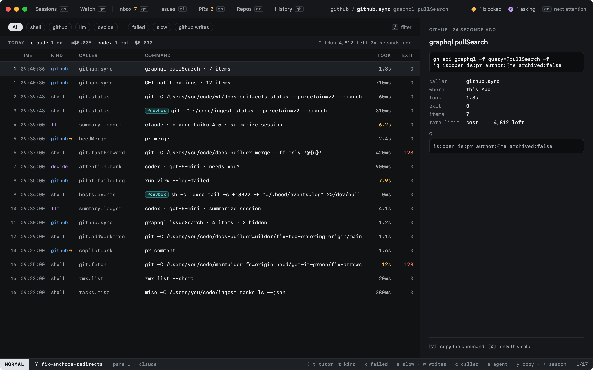
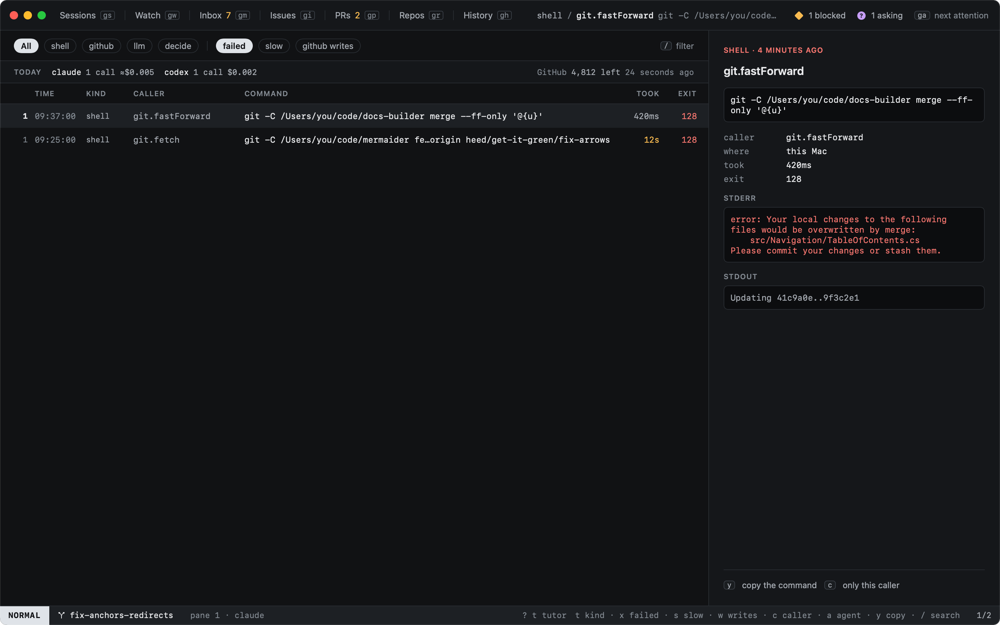
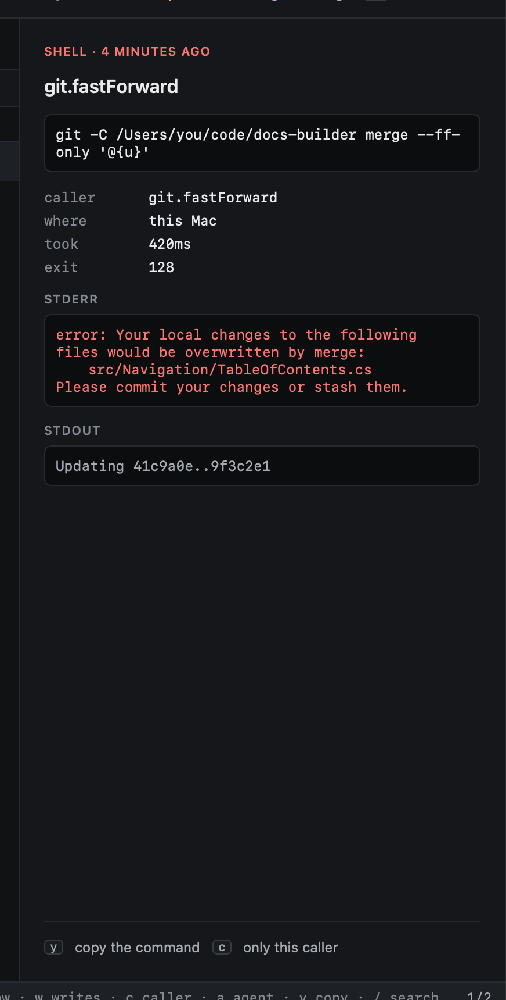
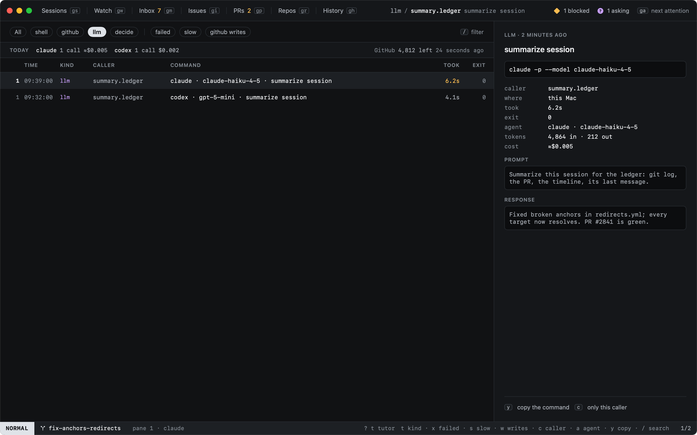

# Call log

`:log` opens the call log: every command Heed ran (git, zmx, a check on a host) and every GitHub call it made,
newest first, as they happen. It has no key of its own; `:log` (or `:view log`) opens it, and `gs` or any other view
key leaves it.

Each row says when, what kind, which part of Heed made the call (its caller: `git.status`, `github.sync`,
`heedMerge`), what ran, how long it took and its exit code. A call to a host shows the host, and the command as it ran
there, not the ssh line around it. GitHub calls show their operation (`graphql pullSearch`, `GET notifications`,
`pr merge`), how many items came back and how many SAML withheld; a write to GitHub is marked `w`.

| Key | |
|---|---|
| `t` | All calls, or one kind: `shell`, `github`, `llm`, `decide` (`:log.kind github` picks one) |
| `x` | Only calls that failed |
| `s` | Only slow calls (5 seconds or more) |
| `w` | Only GitHub writes |
| `c` | Only the caller of the call under the cursor; again for every caller |
| `a` | Only the agent of the call under the cursor; again for every agent |
| `y` | Copy the command |
| `/` | Search commands, callers, operations, hosts and error output |

Right-click a call to copy it or narrow the log to its caller.

The detail on the right has the whole command, where it ran, its error output, and its output when it failed. A
command that worked keeps only its error output; Heed never keeps environment variables, nor the output of anything
that prints a credential.

## Today's usage

The strip above the list sums today's model calls (`llm`) per agent, with their cost: what the agent reported, else
an estimate (marked ≈) from `[usage.prices]`. None are built in, so without prices only reported costs show. On the
right, what GitHub's rate limit had left when Heed last asked.

## How long calls are kept

`log.sqlite` in `~/Library/Application Support/Heed` keeps each kind for its own number of days, set under `[log]`
in config.toml, and at most `max_rows` of each kind; Heed prunes it every hour.

| Key | Default | |
|---|---|---|
| `shell_days` | 7 | Commands |
| `github_read_days` | 3 | GitHub calls that read |
| `github_write_days` | 90 | GitHub calls that changed something |
| `llm_days` | 30 | Model runs |
| `decide_days` | 30 | Decisions |
| `max_rows` | 50000 | Rows per kind, newest kept |
